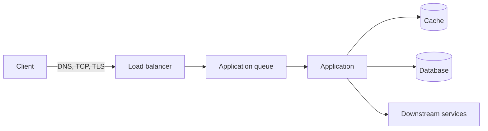
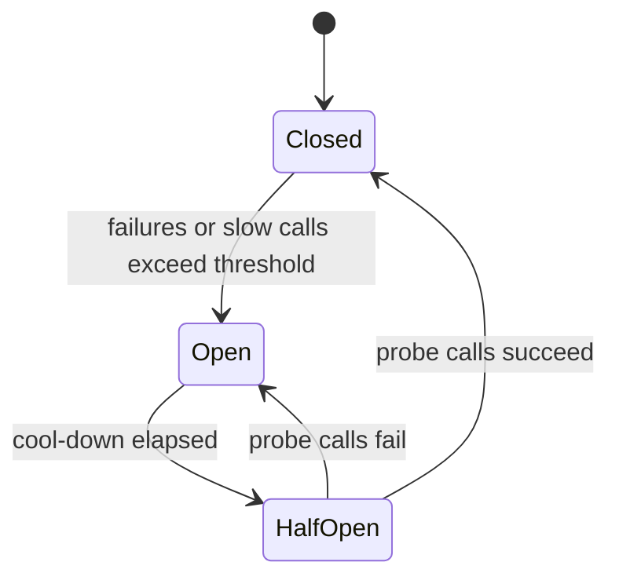

# Latency in System Design: An In-Depth Guide

> **Topic:** System Design Fundamentals
> **Level:** Beginner to Advanced
> **Focus:** Distributed Systems, SRE, Performance Engineering, and System Design Interviews
> **Prerequisites:** Basic familiarity with HTTP, databases, and networking
> **Last updated:** October 2026

## Table of Contents

1. [What Is Latency?](#1-what-is-latency)
2. [Latency vs Response Time vs Throughput](#2-latency-vs-response-time-vs-throughput)
3. [Understanding Latency Through an Example](#3-understanding-latency-through-an-example)
4. [Types of Latency](#4-types-of-latency)
5. [Latency Numbers Worth Knowing](#5-latency-numbers-worth-knowing)
6. [Latency Percentiles: P50, P90, P95, P99, and P99.9](#6-latency-percentiles-p50-p90-p95-p99-and-p999)
7. [Why Average Latency Is Misleading](#7-why-average-latency-is-misleading)
8. [Measuring Latency Correctly](#8-measuring-latency-correctly)
9. [Tail Latency in Distributed Systems](#9-tail-latency-in-distributed-systems)
10. [The Request Lifecycle and Latency Breakdown](#10-the-request-lifecycle-and-latency-breakdown)
11. [Common Causes of High Latency](#11-common-causes-of-high-latency)
12. [Queueing Theory and Little's Law](#12-queueing-theory-and-littles-law)
13. [The Relationship Between Latency and Throughput](#13-the-relationship-between-latency-and-throughput)
14. [Techniques to Reduce Latency](#14-techniques-to-reduce-latency)
15. [Caching and Latency](#15-caching-and-latency)
16. [Database Latency Optimization](#16-database-latency-optimization)
17. [Network Latency Optimization](#17-network-latency-optimization)
18. [Latency in Microservices](#18-latency-in-microservices)
19. [Timeouts, Retries, Circuit Breakers, and Load Shedding](#19-timeouts-retries-circuit-breakers-and-load-shedding)
20. [Latency Budgets](#20-latency-budgets)
21. [Latency, SLI, SLO, and SLA](#21-latency-sli-slo-and-sla)
22. [Monitoring and Observability](#22-monitoring-and-observability)
23. [A Practical High-Latency Troubleshooting Workflow](#23-a-practical-high-latency-troubleshooting-workflow)
24. [Load Testing and Capacity Validation](#24-load-testing-and-capacity-validation)
25. [Real-World System Design Examples](#25-real-world-system-design-examples)
26. [Latency Optimization Trade-Offs](#26-latency-optimization-trade-offs)
27. [Common Mistakes](#27-common-mistakes)
28. [System Design Interview Questions](#28-system-design-interview-questions)
29. [Interview Cheat Sheet](#29-interview-cheat-sheet)
30. [Key Takeaways](#30-key-takeaways)
31. [References](#31-references)

---

## 1. What Is Latency?

Latency is the time delay between initiating an operation and the relevant result becoming available.

In system design, latency describes how quickly a system responds to a request.

Consider an e-commerce application:

1. A customer searches for a product.
2. The application sends a request to the backend.
3. The backend queries a database or cache.
4. The application processes the result.
5. The response is returned to the customer.

If the customer waits 250 ms for the search result, the observed response time is approximately 250 ms.

**Lower latency generally means a more responsive system**, provided the system still returns correct and complete results.

### Why latency matters

Latency directly affects:

- User experience and customer satisfaction.
- Conversion rates in online businesses.
- API responsiveness and real-time application behavior.
- Distributed system performance, because delays compound across dependencies.
- Service-level objectives.
- How many requests a system can handle efficiently, because slow requests hold resources longer.

| Application | Why latency matters |
|---|---|
| Search engine | Users expect results almost instantly. |
| Online banking | Customers expect balances and transaction statuses promptly. |
| Video conferencing | Delays disrupt conversation. |
| Online gaming | Delays affect responsiveness and fairness. |
| Payment processing | Delays can cause timeouts and uncertain transaction outcomes. |
| Real-time bidding (ad tech) | Responses arriving after the auction deadline are discarded. |
| Analytics platform | Some reports can tolerate seconds or minutes of delay. |

The acceptable latency depends on the business requirement. A real-time gaming service and a nightly analytics pipeline should not share a latency target.

## 2. Latency vs Response Time vs Throughput

These terms are related, but they describe different aspects of performance.

### 2.1 Latency

The delay associated with an operation or a particular stage of processing.

Example: A database query takes 20 ms to execute.

### 2.2 Response time

The total time a caller waits between sending a request and receiving the relevant response.

Example: An API request takes 180 ms from the client's perspective.

Depending on the measurement boundary, response time can include network delays, queueing, application processing, and data access.

> **Terminology note:** Usage varies. Some authors (for example, *Designing Data-Intensive Applications*) define *response time* as what the client sees (service time + network delays + queueing) and reserve *latency* for time a request spends waiting to be handled. This guide uses *latency* for the delay of any operation or stage, and *response time* or *end-to-end latency* for the full client-observed duration. Always state your measurement boundary.

### 2.3 Throughput

The amount of work a system completes per unit of time.

Examples:

- 2,000 requests per second.
- 50,000 database operations per second.
- 10 GB of data processed per minute.

### Comparison

| Metric | Measures | Example |
|---|---|---|
| Latency | Delay of an operation or stage | Database query takes 20 ms |
| Response time | End-to-end request duration | API responds in 180 ms |
| Throughput | Completed work per unit time | API handles 2,000 requests/s |
| Concurrency | Work in progress at the same time | 500 requests are in flight |
| Availability | Whether the service is usable when needed | 99.95% availability |

A system can have high throughput but poor latency if it processes many requests concurrently while making each one wait in a queue.

Similarly, a service can have low latency under light traffic but become slow as traffic increases.

**Remember:** Throughput tells you how much work gets done; latency tells you how long a particular operation takes.

## 3. Understanding Latency Through an Example

Imagine an API that retrieves a customer's account information. A request passes through these stages:

| Stage | Time |
|---|---:|
| Network request to the service | 20 ms |
| Waiting in the application queue | 15 ms |
| Application processing | 25 ms |
| Database query | 40 ms |
| Network response to the client | 20 ms |
| **Total** | **120 ms** |

`20 + 15 + 25 + 40 + 20 = 120 ms`

The database consumes 40 ms, but it is not the only source of delay.

If we optimize the database query from 40 ms to 10 ms:

`20 + 15 + 25 + 10 + 20 = 90 ms`

Response time falls by 30 ms, or 25%.

### Amdahl's Law applied to latency

Even a perfect optimization has a ceiling. If the database stage dropped to **0 ms**, response time would fall to 80 ms, an improvement of at most `40 / 120 ≈ 33%`.

In general, if a stage accounts for fraction `p` of total time and you make it `s` times faster:

`overall speedup = 1 / ((1 − p) + p / s)`

This is why you should rank stages by their share of the critical path before optimizing anything.

**Measure the complete request path before optimizing individual components.**

Also, do not add component durations blindly when operations run in parallel. In a parallel request, the critical path, not the sum of every task, determines completion time.

## 4. Types of Latency

### 4.1 Network latency

The time required for data to travel across a network and, depending on the metric, for a request and response to complete.

Common contributors:

- Physical distance.
- Network congestion.
- Routing inefficiencies.
- Packet loss and retransmissions.
- DNS resolution.
- Connection establishment (TCP handshake).
- TLS negotiation.

### 4.2 Processing latency

The time spent executing application logic: validating requests, running business rules, serializing JSON, performing calculations, and executing synchronous code.

### 4.3 Database latency

The delay involved in obtaining data from a database.

Possible causes:

- Slow SQL queries and poor query plans.
- Missing indexes.
- Lock contention.
- Disk I/O.
- Connection pool exhaustion.
- Large result sets.

### 4.4 Queueing latency

The time a request waits before processing begins.

For example, an API server may be able to process 500 concurrent operations, but additional requests must wait for available capacity.

Queueing latency often increases sharply as utilization approaches capacity (see [Section 12](#12-queueing-theory-and-littles-law)).

### 4.5 Storage latency

The time required to read or write data to a storage system, such as disk operations, object storage requests, and persistent volume access.

### 4.6 End-to-end latency

The complete elapsed time from the defined starting point to the defined completion point.

For user-facing applications, client-observed end-to-end latency matters most because it reflects the experience the user actually receives.

## 5. Latency Numbers Worth Knowing

Rough orders of magnitude help you sanity-check designs. Exact values depend on hardware, cloud provider, and configuration, so treat these as approximations and measure your own environment.

| Operation | Approximate magnitude |
|---|---|
| CPU cache reference | ~1 to 10 ns |
| Main memory reference | ~100 ns |
| SSD random read | tens to hundreds of µs |
| Round trip within a data center | ~0.5 ms |
| Spinning-disk seek | ~5 to 10 ms |
| Round trip across a continent | tens of ms |
| Round trip across an ocean | ~70 to 150 ms |

Two takeaways:

1. **Each tier is roughly 10x to 1,000x slower than the one above it.** A design that makes one extra cross-region call per request can cost more than all your in-process work combined.
2. **Distance sets a hard floor.** Light in optical fiber travels at roughly 200,000 km/s, which is about 5 ms one way per 1,000 km, or **10 ms of round-trip time per 1,000 km**. New York to London is roughly 5,600 km in a straight line, so the round trip cannot be below about 56 ms in fiber, and real paths are longer.

No amount of code optimization beats physics. Move data or compute closer instead.

## 6. Latency Percentiles: P50, P90, P95, P99, and P99.9

Request latency is a distribution, not a single fixed value.

If an API receives 10,000 requests, some may finish in 20 ms, others in 50 ms, and a small number may take several seconds. Percentiles describe this distribution.

| Percentile | Meaning |
|---|---|
| **P50** (median) | About 50% of requests finish at or below this value. A "typical" request. |
| **P90** | About 90% finish at or below this value; 10% are slower. |
| **P95** | About 95% finish at or below this value; 5% are slower. |
| **P99** | About 99% finish at or below this value; 1% are slower. |
| **P99.9** | About 99.9% finish at or below this value; 0.1% are slower. |

### Example

| Percentile | Latency | Interpretation |
|---|---:|---|
| P50 | 40 ms | Half of requests complete within 40 ms |
| P90 | 90 ms | 90% complete within 90 ms |
| P95 | 150 ms | 95% complete within 150 ms |
| P99 | 600 ms | 99% complete within 600 ms |
| P99.9 | 2,000 ms | 99.9% complete within 2 seconds |

This system is fast for most requests, but its slowest requests deserve investigation.

The gap between P50 and P99 reveals inconsistent performance, queueing, noisy dependencies, or resource contention. A narrow gap suggests predictable behavior; a wide gap suggests variability worth chasing.

### Which percentile should you monitor?

- **P50:** Typical experience and baseline performance.
- **P90/P95:** Early signs of broader degradation.
- **P99:** User-facing tail latency.
- **P99.9:** Rare but potentially severe problems.

The right choice depends on traffic volume, user impact, measurement quality, and the service's SLO.

### Why tail percentiles matter more than they look

A user who loads a page making 30 backend calls will probably hit at least one P99 event. Heavy users (who make the most requests) therefore see the tail most often, and they are frequently your most valuable users.

## 7. Why Average Latency Is Misleading

Consider two APIs.

**API A:** Most requests complete in about 50 ms.

**API B:** Most requests complete in 20 ms, but a small fraction take several seconds.

Both might have similar average latency, yet users of API B experience occasional severe delays. An average hides the shape of the distribution.

### Example

Suppose six requests take:

`10, 11, 12, 13, 14, 5000 ms`

Average latency:

`(10 + 11 + 12 + 13 + 14 + 5000) / 6 = 5060 / 6 ≈ 843.3 ms`

Five of the six requests complete in 14 ms or less. The ~843 ms average describes none of them. The median (P50) here is 12.5 ms, which is far more representative of the typical request, while the outlier is what a P99-style metric would surface.

The opposite problem also exists: a low average can hide an unacceptable tail.

### Best practice

Monitor complementary metrics:

- Request count.
- Error rate.
- P50, P95, and P99 latency.
- Timeout count.
- Queue depth.
- Dependency latency.
- CPU, memory, and connection pool utilization.

## 8. Measuring Latency Correctly

Percentiles are only as trustworthy as the measurement behind them.

### 8.1 Never average percentiles

**Do not calculate a fleet-wide P99 by averaging the P99 values of individual servers.** Each server has its own request distribution and traffic volume, so percentiles cannot be combined by averaging.

Instead, record latency into **histograms**, then merge the histogram buckets across servers and compute the percentile from the merged data.

### 8.2 Example: Prometheus histograms

Fleet-wide P99 per service, computed from merged buckets:

```promql
histogram_quantile(
  0.99,
  sum by (le, service) (
    rate(http_request_duration_seconds_bucket[5m])
  )
)
```

Notes:

- Aggregate with `sum by (le, ...)` **before** calling `histogram_quantile`. Never apply it to per-instance results and then average.
- Accuracy depends on bucket boundaries. The estimate is interpolated within a bucket, so choose buckets that are dense around your SLO threshold (for example, include a bucket boundary exactly at 300 ms if that is your target).
- Alternatives: native histograms (Prometheus), HdrHistogram, t-digest, and DDSketch are all designed to be mergeable.

### 8.3 Pick and document the measurement boundary

The same request has different latencies depending on where you measure it:

| Measured at | Includes | Misses |
|---|---|---|
| Application handler | Business logic and dependencies | Network, load balancer, and kernel queueing |
| Load balancer | Backend time plus LB overhead | Client network and last mile |
| Client or synthetic probe | Everything the user experiences | Nothing, but noisier |

Server-side duration is not necessarily the client-observed latency. Prefer measuring at or near the client for user-facing SLOs, and server-side for diagnosis.

### 8.4 Coordinated omission

A common benchmarking bug: a load generator sends a request, waits for the response, then sends the next. If the server stalls for 5 seconds, the generator also stalls and records **one** slow sample instead of the hundreds of requests that would have arrived during the stall in the real world. The result is a flattering tail that does not exist in production.

To avoid it:

- Use **open-model** load generation that sends requests on a fixed arrival schedule regardless of response times (for example, wrk2, or k6's constant-arrival-rate executors).
- Measure latency from the **intended** send time, not the actual send time.
- Be suspicious of any benchmark that reports a perfect-looking P99.9.

Gil Tene's talk *How NOT to Measure Latency* is the standard reference.

### 8.5 Sample size and percentile validity

A P99.9 computed from 1,000 requests is determined by a single request. As a rule of thumb, you need at least several thousand samples per window to trust P99 and tens of thousands for P99.9. For low-traffic endpoints, use longer windows or rely on lower percentiles.

## 9. Tail Latency in Distributed Systems

Tail latency refers to delays experienced by the slowest fraction of requests, commonly examined at P95, P99, or P99.9.

It matters especially in distributed systems because one user request may depend on many backend services.

### 9.1 The fan-out problem

Imagine a product page that needs information from 20 services: catalog, pricing, inventory, customer profile, recommendations, reviews, shipping estimates, and so on.

Assume each dependency has a 1% chance of exceeding its own P99 threshold.

If the delays are independent, the probability that every dependency stays below its threshold is:

`0.99^20 ≈ 81.8%`

So the probability that at least one exceeds its threshold is:

`1 − 0.99^20 ≈ 18.2%`

Each service has only a 1% chance of a slow response, yet nearly 18.2% of requests that depend on all 20 encounter at least one slow event.

For 100 independent dependencies:

`1 − 0.99^100 ≈ 63.4%`

This is an illustrative calculation, not a guarantee. Real delays may be correlated, and a slow dependency does not always slow the whole request if the architecture supports fallbacks or asynchronous work.

| Dependencies on the critical path | P(at least one exceeds its P99) |
|---:|---:|
| 1 | 1.0% |
| 5 | 4.9% |
| 20 | 18.2% |
| 50 | 39.5% |
| 100 | 63.4% |

### 9.2 Why tail latency happens

- Uneven load distribution.
- Shared resource contention (noisy neighbors).
- Garbage collection pauses.
- Slow database queries and lock waits.
- Network retransmissions.
- Cold cache misses.
- Queue buildup.
- A single overloaded or degraded node.
- Background jobs (compaction, backups, log rotation).
- Dependencies with inconsistent performance.

### 9.3 How to reduce tail latency

1. Set deadlines for downstream requests and propagate them.
2. Avoid unnecessary synchronous dependencies.
3. Cache frequently requested data.
4. Distribute traffic across healthy instances, and eject outliers.
5. Prevent overload and queue buildup (load shedding, bounded queues).
6. Use bounded retries with backoff and jitter.
7. Consider request hedging or tied requests only for suitable idempotent operations.
8. Use graceful degradation when optional dependencies are slow.
9. Isolate background work from latency-sensitive paths.

A useful architectural principle is to **reduce the number of dependencies on the critical path**.

Reference: [The Tail at Scale (Communications of the ACM)](https://cacm.acm.org/research/the-tail-at-scale/)

## 10. The Request Lifecycle and Latency Breakdown

To troubleshoot latency effectively, divide the request into measurable stages.



A typical HTTP request may involve:

1. DNS resolution.
2. TCP connection establishment.
3. TLS negotiation.
4. Request transmission.
5. Load balancer processing.
6. Application queueing.
7. Application execution.
8. Database or cache access.
9. Response serialization.
10. Response transmission.
11. Client-side processing.

Not every request performs every step. DNS results and established connections may be reused.

### Example: API response takes 1 second

| Component | Duration |
|---|---:|
| Client-to-service network | 80 ms |
| Load balancer | 10 ms |
| Application queue | 300 ms |
| Application processing | 100 ms |
| Database | 450 ms |
| Response transmission | 60 ms |
| **Total** | **1,000 ms** |

The application code takes only 100 ms. Restarting the application or optimizing business logic would not address the main problem: queueing and database latency together account for 750 ms.

**Measure each stage and identify the dominant contribution to the critical path.**

## 11. Common Causes of High Latency

### 11.1 CPU saturation

When CPU demand exceeds available capacity, requests wait or run slower.

Investigate CPU utilization, **CPU throttling** (common with container CPU limits), run queue length, garbage collection, expensive algorithms, and excessive serialization or compression.

### 11.2 Memory pressure

Causes garbage collection pauses, paging or swapping, cache eviction, out-of-memory events, and container restarts.

### 11.3 Database bottlenecks

Rising query duration, exhausted connection pools, lock waits, and increasing disk I/O.

### 11.4 Network problems

Packet loss, congestion, distant regions, DNS delays, and repeated connection establishment.

### 11.5 Excessive concurrency

Allowing too many operations to run simultaneously can overwhelm the database, thread pools, or external APIs. More concurrency is not always faster.

### 11.6 Resource contention

Multiple workloads competing for CPU, disk, network bandwidth, or memory.

### 11.7 Cold starts

New application instances, serverless functions, JIT warmup, and cold caches carry additional initialization overhead.

### 11.8 Poor architecture

An unnecessarily deep synchronous call chain adds network hops, serialization, dependency waits, and failure opportunities.

### 11.9 Retry storms and thundering herds

When a dependency slows, naive retries multiply load and make it slower still. Synchronized cache expirations or reconnects can cause many clients to hit the backend at the same instant.

## 12. Queueing Theory and Little's Law

Queueing theory explains why latency rises rapidly under heavy load.

### 12.1 Little's Law

Little's Law relates average concurrency, throughput, and time in a stable system:

`L = λ × W`

- `L` = average number of requests in the system.
- `λ` = average throughput (requests per second).
- `W` = average time spent in the system (seconds).

Rearranged: `W = L / λ`

### Example

An API processes 200 requests per second with an average of 100 requests in the system:

`W = 100 / 200 = 0.5 s`

Average time in the system is 500 ms (assuming consistent measurement boundaries and a stable system).

If in-flight requests rise to 400 while throughput stays at 200 requests per second:

`W = 400 / 200 = 2 s`

The extra in-flight work indicates queue buildup or slower processing.

**Little's Law is a relationship between averages, not a formula for P99 latency.**

### 12.2 Why high utilization causes latency spikes

As a service approaches its maximum sustainable capacity, small traffic increases cause disproportionately large increases in queueing delay.

A classic simplified model is the **M/M/1 queue** (random arrivals, exponentially distributed service times, one server). With utilization `ρ = λ / μ` and average service time `S`, the average time in the system is:

`W = S / (1 − ρ)`

For a service whose average service time is 10 ms:

| Utilization (ρ) | Average time in system | Approx. P99 |
|---:|---:|---:|
| 50% | 20 ms | ~92 ms |
| 70% | 33 ms | ~154 ms |
| 80% | 50 ms | ~230 ms |
| 90% | 100 ms | ~461 ms |
| 95% | 200 ms | ~921 ms |
| 99% | 1,000 ms | ~4,605 ms |

(In M/M/1 the time in system is exponentially distributed, so P99 ≈ `W × ln(100)` ≈ `4.6 × W`.)

Real systems have multiple servers, non-random traffic, and different service-time distributions, so the exact numbers will differ. The **shape** is what matters: latency is nearly flat at low utilization, then climbs steeply past roughly 70 to 80%.

Practical consequences:

- Running hot (90%+) leaves no headroom for bursts.
- Autoscale on leading indicators (queue depth, concurrency, utilization), not on latency alone, because by then you are already on the steep part of the curve.
- Capacity planning should include traffic bursts, request complexity, and dependency limits.
- Bounded queues and load shedding keep latency predictable when demand exceeds capacity ([Section 19](#19-timeouts-retries-circuit-breakers-and-load-shedding)).

### 12.3 Sizing pools with Little's Law

Little's Law also sizes connection and thread pools. If a service issues 500 database queries per second and each holds a connection for 20 ms on average:

`L = 500 × 0.020 = 10` connections in use on average.

Provision some headroom above this (for variance and bursts), but an oversized pool just moves the queue into the database, where it is harder to see and can degrade every client.

## 13. The Relationship Between Latency and Throughput

Consider a service handling 1,000 requests per second with an average time in system of 100 ms. Little's Law gives:

`L = 1000 × 0.1 = 100` concurrent requests.

If throughput stays at 1,000 requests per second but average time in the system rises to 500 ms:

`L = 1000 × 0.5 = 500` concurrent requests.

The service now has about 500 requests in progress on average, which increases memory usage, connection consumption, queue lengths, and overload risk. This is how a latency problem becomes an availability problem.

### Latency vs throughput trade-offs

Some techniques raise throughput at the cost of latency, and vice versa:

- **Batching** (database writes, Kafka producers with `linger.ms` and `batch.size`, Nagle's algorithm) improves throughput but adds waiting time per item.
- **Larger queues** absorb bursts but add queueing delay.
- **Higher concurrency** improves utilization until contention dominates.

Decide which metric your use case optimizes: interactive requests usually prioritize latency; bulk pipelines usually prioritize throughput.

### Important distinction

Adding servers may improve throughput and reduce latency if the workload can be distributed effectively. However, scaling the application tier will not help if all requests depend on one saturated database.

Always identify the constrained resource before scaling.

## 14. Techniques to Reduce Latency

### 14.1 Caching

Store frequently accessed data closer to the caller: browser cache, CDN, application cache, Redis or Memcached, database buffer cache.

Caching reduces repeated computation and retrieval, but introduces freshness, invalidation, and memory-management concerns. See [Section 15](#15-caching-and-latency).

### 14.2 Database optimization

- Add appropriate indexes.
- Inspect query execution plans.
- Avoid unnecessary full-table scans.
- Fetch only required columns.
- Eliminate N+1 query patterns.
- Tune connection pools.
- Use read replicas when consistency requirements allow.
- Partition or shard data when justified.

See [Section 16](#16-database-latency-optimization).

### 14.3 Reduce network round trips

- Keep services geographically close to their dependencies.
- Reuse connections (keep-alive, HTTP/2 multiplexing).
- Batch compatible requests.
- Reduce unnecessary synchronous service calls.
- Use suitable request and response formats.

### 14.4 Parallelize independent work

If two operations do not depend on each other, run them concurrently when resources permit.

Two independent operations taking 100 ms and 150 ms:

- Sequential: `100 + 150 = 250 ms`
- Parallel: `max(100, 150) = 150 ms`

The real result also includes scheduling, coordination, and shared-resource overhead. Parallelism also raises tail exposure, since the request now waits for the *slowest* of its branches.

### 14.5 Reduce payload size

- Use pagination.
- Compress suitable payloads.
- Avoid returning unused fields.
- Use efficient serialization (for example, Protocol Buffers instead of verbose JSON on hot internal paths).
- Transfer only the data the caller needs.

Compression reduces transfer time but consumes CPU, so evaluate it against payload size and network conditions.

### 14.6 Do less work

Often the fastest operation is the one you skip: precompute results, use better algorithms and data structures, remove redundant validation, and avoid repeated serialization.

### 14.7 Scale bottlenecked components

Use horizontal or vertical scaling when measurements show capacity is the problem. Scaling helps only when the bottleneck benefits from additional resources.

### 14.8 Use asynchronous processing

For work that does not need to finish before the user receives a response, use queues or event-driven processing.

For example, an order API can accept an order and enqueue email notifications instead of waiting for the email provider. The API responds sooner while notifications are delivered in the background.

This changes completion semantics: the response may mean "accepted for processing," not "all work completed."

### 14.9 Keep things warm

Pre-warm caches, connection pools, and JIT-compiled code paths; keep a minimum number of instances running for latency-sensitive services to avoid cold starts.

## 15. Caching and Latency

Caching is one of the most common techniques for reducing read latency.

### Example

Suppose a database lookup takes 80 ms and a cache lookup takes 5 ms.

For a cache hit, the saving is `80 − 5 = 75 ms`.

On a **miss**, the request pays for the failed cache lookup *and* the database read: `5 + 80 = 85 ms` (for a cache-aside pattern).

With a 90% hit rate:

`(0.90 × 5) + (0.10 × 85) = 4.5 + 8.5 = 13 ms`

Average lookup time falls from 80 ms to about 13 ms. (Ignoring the lookup cost on misses would give 12.5 ms and slightly overstate the benefit.)

Note what this does to the tail: the **P90 is still bounded by the hit path, but P95 and P99 are dominated by the miss path (~85 ms)**. A caching layer improves the average much more than it improves the tail unless the hit rate is very high. At a 99.9% hit rate, even P99 stays on the fast path.

### Cache strategies

**Cache-aside:** The application checks the cache first; on a miss, it reads the database and populates the cache.

**Read-through:** The caching layer loads missing data from the backing store.

**Write-through:** Writes update the cache and backing store according to the chosen consistency semantics.

**Write-behind:** Writes are accepted by the cache and persisted later. This improves write latency but introduces durability and data-loss risks if not carefully designed.

### Cache trade-offs

- Stale data.
- Cache invalidation complexity.
- Memory cost.
- **Cache stampedes:** many requests miss simultaneously on a popular key and hit the database together. Mitigate with request coalescing (single-flight), TTL jitter, and early refresh.
- Hot keys and uneven popularity.
- Cold-start performance after deploys or failovers.

Select caching strategies according to access patterns, freshness requirements, and consistency needs.

## 16. Database Latency Optimization

Database performance frequently determines application response time.

### 16.1 Indexing

An appropriate index reduces the data the database must examine. Indexes consume storage and add write overhead.

### 16.2 Query optimization

Avoid:

- Retrieving unnecessary columns.
- Unbounded result sets.
- Repeated queries inside loops.
- Expensive joins without suitable access paths.
- Sorting large datasets unnecessarily.

Use `EXPLAIN` (or the engine's equivalent) to verify the query plan rather than guessing.

### 16.3 Connection pooling

Opening a new database connection per request adds overhead and creates connection pressure.

Pools reuse connections, but an oversized pool can overload the database while an undersized one creates application-side queueing. Size pools using Little's Law ([Section 12.3](#123-sizing-pools-with-littles-law)) and confirm with measurements.

### 16.4 Read replicas

Replicas distribute eligible read traffic. Consider replication lag, read-after-write consistency, failover behavior, and whether the application tolerates stale reads.

### 16.5 Avoiding N+1 queries

If an application loads 100 orders and then runs one extra query per order to fetch customer data, that is 101 queries instead of one well-designed join or a small number of batched queries.

At 2 ms per round trip, 101 sequential queries add about 200 ms; a single batched query adds about 2 ms plus slightly more execution time.

### 16.6 Lock contention and long transactions

Long-running transactions hold locks and can block unrelated requests, producing tail latency spikes that look random. Keep transactions short, avoid doing network calls inside them, and monitor lock wait time.

## 17. Network Latency Optimization

Network delay becomes especially important when services communicate across regions or continents.

### Key techniques

1. Place services near their primary users or data sources.
2. Avoid unnecessary cross-region calls.
3. Reuse TCP and TLS connections where appropriate.
4. Use CDNs for cacheable content.
5. Reduce payload sizes.
6. Investigate packet loss and retransmissions.
7. Measure DNS and connection-establishment time.
8. Use appropriate load balancing and routing.
9. Prefer private, efficient network paths when supported and beneficial.

### Connection setup cost

Suppose the client-to-server round-trip time (RTT) is 80 ms. For a **new** HTTPS connection (roughly, with TLS 1.3 and a cached DNS result):

| Step | Cost |
|---|---:|
| TCP handshake | 1 RTT = 80 ms |
| TLS 1.3 handshake | 1 RTT = 80 ms |
| HTTP request and response | 1 RTT = 80 ms |
| **Total before first byte arrives** | **~240 ms** |

On a **reused** connection, only the request/response RTT remains: about 80 ms.

This is why keep-alive, connection pooling, HTTP/2, session resumption, and HTTP/3 (which combines transport and TLS handshakes over QUIC) matter. Connection reuse can cut latency by multiples for chatty clients, independent of any server-side optimization.

### Geographic distance

Distance imposes a lower bound on communication time ([Section 5](#5-latency-numbers-worth-knowing)).

Applications requiring extremely low latency may need regional deployments, local caches, or replicated read paths. However, multi-region architectures add complexity in data consistency, replication, routing, and failover.

## 18. Latency in Microservices

Microservices improve independent deployment and scaling, but synchronous communication increases end-to-end latency.

Consider this path:

`API Gateway → Order Service → Inventory Service → Pricing Service → Database`

Each hop adds network delay, serialization, queueing, and a chance of a slow response.

### Common problems

- Too many synchronous calls.
- Deep dependency chains.
- Repeated serialization and deserialization.
- Cross-region network calls.
- Shared database contention.
- Cascading overload.
- Slow optional dependencies.

### Design improvements

- Reduce synchronous dependencies.
- Combine operations when appropriate.
- Parallelize independent requests.
- Cache frequently requested data.
- Use asynchronous messaging for non-critical work.
- Define deadlines for each dependency and propagate them.
- Use bulkheads to isolate resource pools.
- Provide fallback responses when business rules allow.

### Critical path

The critical path is the chain of dependent operations that determines when the response can complete.

If three dependencies run in parallel and take 20 ms, 50 ms, and 100 ms, their contribution is about 100 ms, not 170 ms.

If another operation must wait for all three, that wait is on the critical path.

Reducing work *off* the critical path may improve throughput or resource usage without improving response latency.

## 19. Timeouts, Retries, Circuit Breakers, and Load Shedding

These mechanisms improve resilience, but they must be designed together and carefully.

### 19.1 Timeouts and deadlines

A timeout limits how long a caller waits for an operation.

Without limits, requests occupy threads, connections, and memory while waiting on an unhealthy dependency.

Set timeouts from the end-to-end latency budget. A client timeout does not necessarily cancel work already executing on the server.

**Prefer deadline propagation over independent per-hop timeouts.** Pass the *remaining* time budget downstream (gRPC does this natively via deadlines; for HTTP, use a header). Each service then knows how much time is left and can skip work that cannot finish in time.

Why per-hop timeouts fail: if A calls B with a 1 s timeout and B calls C with its own 1 s timeout (plus retries), A can time out while B and C continue working on a request no one is waiting for.

### 19.2 Retries

Retries can recover from transient failures, but they increase load and can worsen latency when a service is already overloaded.

Use:

- A bounded retry count.
- Exponential backoff.
- Random jitter.
- A shared deadline.
- Idempotency controls where needed.
- A **retry budget** (for example, retries limited to a small percentage of total requests) to cap amplification.

Do not retry every error indiscriminately.

**Retry amplification:** with 3 layers each retrying 3 times, one failing request at the bottom can generate up to `3 × 3 × 3 = 27` attempts. Retry at one layer, not all of them.

### 19.3 Circuit breakers

A circuit breaker temporarily stops calls to a failing or slow dependency according to configured conditions. It prevents repeated expensive calls and cascading failures.



- **Closed:** Calls are allowed.
- **Open:** Calls are rejected or routed to a fallback.
- **Half-open:** A limited number of calls test recovery.

A circuit breaker does not make the dependency faster. It protects the rest of the system from its failure or prolonged slowness.

### 19.4 Load shedding and backpressure

When demand exceeds capacity, queues grow without bound and **every** request becomes slow. It is usually better to fail some requests quickly than to make all of them wait.

- Use **bounded queues** and reject new work when the queue is full.
- Return a clear overload signal (for example, `429` or `503` with `Retry-After`) so clients can back off.
- Prioritize critical traffic over best-effort traffic.
- Drop requests whose deadline has already expired; processing them wastes capacity.
- Propagate **backpressure** upstream so producers slow down instead of piling work up.

### 19.5 Request hedging

For selected latency-sensitive, safe-to-repeat operations, a client may issue a duplicate request after a delay (commonly around the P95 latency) and use the first acceptable result.

This can reduce tail latency, but it duplicates work and can worsen overload. Use it only with load controls, cancellation of the losing request, and appropriate operation semantics (idempotent reads, typically).

## 20. Latency Budgets

A latency budget allocates the allowed end-to-end response time across the components involved in a request.

Suppose a product search API has an end-to-end target of 300 ms. An illustrative budget:

| Component | Budget |
|---|---:|
| Client and network overhead | 40 ms |
| API gateway | 20 ms |
| Application processing | 50 ms |
| Cache or database access | 80 ms |
| Other required dependencies | 60 ms |
| Response processing and transfer | 30 ms |
| Coordination margin | 20 ms |
| **Total** | **300 ms** |

This is an engineering allocation, not a prediction that each component will always use its entire budget.

If a dependency consumes most of its allocation, the team can investigate before it threatens the end-to-end target.

### Important considerations

- Account for queueing and network variability.
- Leave margin for bursts and slow dependencies.
- Use deadlines rather than unrelated per-hop timeouts.
- Avoid double-counting overlapping parallel work.
- Remember that percentiles do not add: the sum of each component's P99 is **not** the end-to-end P99. Budget with percentiles as a planning tool, then validate against measured end-to-end percentiles.
- Revisit allocations when traffic or architecture changes.

A latency budget makes performance requirements explicit and measurable.

## 21. Latency, SLI, SLO, and SLA

Latency connects directly to Site Reliability Engineering.

### SLI: Service Level Indicator

A measurement of service behavior.

Example: "The percentage of valid API requests completed within 300 ms."

### SLO: Service Level Objective

A target for an SLI.

Example: "At least 99% of valid API requests must complete within 300 ms over a rolling 28-day window."

### SLA: Service Level Agreement

An agreement with users or customers that may include remedies or other consequences when commitments are missed.

An internal performance objective does not automatically constitute an SLA.

### Defining a good latency SLI

The team must define:

- Which requests are eligible.
- Where latency is measured ([Section 8.3](#83-pick-and-document-the-measurement-boundary)).
- When measurement starts and ends.
- Whether timeouts and errors count as bad events.
- How the measurement window is calculated.
- How missing telemetry is handled.

A latency SLI is commonly expressed as a good-event ratio:

`Good-event ratio = Requests completed within threshold / Eligible requests`

If 990,000 out of 1,000,000 eligible requests finish within 300 ms:

`990,000 / 1,000,000 = 99%`

That meets a 99% target for that sample.

> **Tip:** Phrase latency SLOs as "X% of requests faster than Y ms" rather than "average latency below Y." It is directly computable from histogram buckets and cannot be satisfied by a good average hiding a bad tail. Consider two thresholds, for example 90% under 100 ms **and** 99% under 400 ms, to constrain both the typical case and the tail.

### Error budgets and burn rate

With a 99% SLO, the **error budget** is 1% of eligible requests.

**Burn rate** = observed bad-event ratio / allowed bad-event ratio.

If 5% of requests are currently slower than the threshold against a 1% budget, the burn rate is 5. At that rate a 28-day budget is exhausted in `28 / 5 = 5.6` days.

Alerting on burn rate (using multiple windows) detects real user impact quickly while avoiding noisy pages for brief blips. The Google SRE Workbook describes this approach in detail.

References:

- [Google SRE Book: Service Level Objectives](https://sre.google/sre-book/service-level-objectives/)
- [Google SRE Workbook: Alerting on SLOs](https://sre.google/workbook/alerting-on-slos/)

## 22. Monitoring and Observability

A production service should expose latency metrics that explain both normal behavior and degradation.

### 22.1 Metrics frameworks

Three checklists cover most services:

| Framework | Applies to | Signals |
|---|---|---|
| **RED** | Request-driven services | **R**ate, **E**rrors, **D**uration |
| **USE** | Resources (CPU, disk, network, pools) | **U**tilization, **S**aturation, **E**rrors |
| **Four Golden Signals** (Google SRE) | User-facing systems | Latency, traffic, errors, saturation |

When tracking latency, **measure successful and failed requests separately.** A fast error can make latency look better during an outage, and a slow timeout can distort percentiles.

### 22.2 Useful metrics

- Request rate.
- P50, P95, and P99 latency (from histograms).
- Error rate.
- Timeout rate.
- Queue depth and queue wait time.
- CPU, memory, and throttling.
- Database query latency.
- Connection pool utilization and wait time.
- Dependency latency.
- Cache hit ratio.
- GC pause time.

### 22.3 Distributed tracing

Distributed tracing follows a request through multiple services. A trace contains spans representing operations such as gateway processing, application execution, database queries, HTTP calls, and cache operations.

Tracing identifies which stage contributes the most delay to an individual request. Standards such as OpenTelemetry provide vendor-neutral instrumentation.

Tips:

- Sample intelligently. Keep traces for slow and failed requests (tail-based sampling) rather than only a random fraction.
- Attach **exemplars** (trace IDs) to latency histogram buckets so you can jump from a bad P99 to a concrete slow trace.

### 22.4 Logs

Logs explain *why* a request was slow. Useful fields: trace ID, request ID, endpoint, dependency name, query duration, retry count, timeout reason, and result status.

Avoid logging sensitive information unnecessarily.

### 22.5 Dashboards

A useful latency dashboard includes:

1. Request rate and error rate.
2. P50, P95, and P99 latency.
3. Latency by endpoint.
4. Latency by region and instance.
5. Dependency-level latency.
6. Queue depth and resource utilization.
7. Timeout and retry counts.
8. SLO compliance and error-budget burn over the relevant window.

### 22.6 Alerting

Alert on meaningful user impact, such as a sustained SLO burn.

Use resource metrics and dependency indicators for diagnosis, not as the primary page. A CPU alert alone does not prove users are experiencing high latency, and a healthy CPU graph does not prove the service is fast.

## 23. A Practical High-Latency Troubleshooting Workflow

Imagine a production API that normally responds in 150 ms at P95, but P95 rises to 1,200 ms.

### Step 1: Confirm the symptom

- When did the problem begin?
- Which endpoints are affected?
- Did P50, P95, and P99 all change, or only the tail?
- Did error rates and timeouts increase?
- Is it all regions or only one?

### Step 2: Identify the affected request path

Use distributed traces to find slow spans. Determine whether the delay comes from queueing, application processing, database access, cache access, network calls, or a downstream dependency.

### Step 3: Correlate with infrastructure metrics

Inspect CPU utilization and throttling, memory pressure, garbage collection, connection pools, thread pools, queue depth, and disk and network performance.

### Step 4: Check recent changes

Investigate new deployments, configuration changes, feature flags, database migrations, traffic spikes (or a change in traffic *mix*), cache changes, dependency releases, and infrastructure scaling events.

### Step 5: Mitigate safely

Depending on the evidence:

- Roll back a problematic deployment.
- Scale the constrained tier.
- Reduce non-essential work.
- Apply rate limiting or load shedding.
- Disable an optional expensive feature.
- Fail over to a healthy dependency if supported.
- Reduce retries during overload.

Choose mitigations based on evidence, not by restarting components by default.

### Step 6: Verify recovery

Confirm that latency percentiles return to normal, error and timeout rates decline, queues drain, dependency latency recovers, and the SLO is no longer being breached.

### Step 7: Prevent recurrence

Perform root-cause analysis and add fixes, dashboards, alerts, capacity limits, tests, or architectural changes.

## 24. Load Testing and Capacity Validation

You cannot know latency under load without testing it.

### What to test

- **Baseline:** latency at normal traffic.
- **Ramp or step test:** gradually increase load to find the "knee" where latency curves upward ([Section 12.2](#122-why-high-utilization-causes-latency-spikes)).
- **Soak test:** sustained load for hours to expose leaks, GC drift, and slow resource exhaustion.
- **Spike test:** sudden bursts to validate autoscaling, queues, and load shedding.
- **Failure injection:** slow or fail a dependency and confirm timeouts, circuit breakers, and fallbacks behave as designed.

### Good practice

- Use an **open-model** generator to avoid coordinated omission ([Section 8.4](#84-coordinated-omission)).
- Use production-like data volumes, cache state, and request mix.
- Report percentiles (histograms), not just averages.
- Watch the saturating resource (CPU, pool, queue), not only latency.
- Define the **maximum sustainable throughput at the SLO**: the highest load at which P99 still meets the target. That, not the absolute peak, is your real capacity.

## 25. Real-World System Design Examples

### Example A: E-commerce product search

**Problem:** Search requests are slow during peak traffic.

Possible causes: database scans, missing indexes, low cache hit ratio, excessive synchronous dependencies, queueing under peak load.

Potential solutions:

- Cache popular searches where appropriate.
- Optimize query execution.
- Use a search engine designed for the access pattern.
- Set timeouts for recommendation services.
- Scale the actual bottleneck.

### Example B: Payment API

**Problem:** Customers see delayed payment confirmation.

Important considerations:

- Database and payment-provider latency.
- Duplicate requests and idempotency.
- Timeouts with uncertain outcomes.
- Retries and reconciliation.
- Correctness and durability.

A payment system must not sacrifice transaction correctness merely to improve latency.

If a provider times out, the transaction may still have succeeded. The design should support safe status checks and reconciliation rather than blindly submitting another payment.

### Example C: Video streaming

**Problem:** Video playback takes too long to start.

Potential contributors: DNS and connection setup, CDN cache misses, origin latency, manifest retrieval, segment delivery, client buffering.

Possible improvements:

- Place cacheable content near users.
- Improve CDN hit rates.
- Optimize manifest and segment delivery.
- Preconnect when beneficial.
- Monitor startup delay separately from ongoing playback quality.

### Example D: Microservices checkout

**Problem:** Checkout latency rises when several dependencies become slow.

Potential improvements:

- Identify the critical path.
- Parallelize independent validations.
- Remove non-essential synchronous calls.
- Bound downstream timeouts.
- Use safe fallbacks for optional features.
- Protect shared dependencies from overload.

The solution must preserve business correctness and payment integrity.

### Example E: Real-time bidding (ad tech)

**Problem:** A bidder receives bid requests from ad exchanges and must respond before the auction closes.

In the OpenRTB protocol, the bid request carries a `tmax` field, the maximum time in milliseconds the exchange will wait for a bid, and exchanges generally count network latency against it. The value varies by exchange. **A response that arrives after `tmax` is discarded**, so a timeout is a lost auction, not a slow page.

Illustrative budget for a 100 ms `tmax`:

| Stage | Budget |
|---|---:|
| Network (both directions) | 30 ms |
| Parse and validate request | 5 ms |
| User and segment lookup (low-latency key-value store such as Aerospike or Redis) | 10 ms |
| Targeting and candidate selection | 15 ms |
| Model scoring / bid price computation | 20 ms |
| Auction logic and response build | 5 ms |
| Safety margin | 15 ms |
| **Total** | **100 ms** |

Design implications:

- **The SLI is deadline-based:** "percentage of bid requests answered within `tmax`." Average latency is nearly meaningless here; the tail directly maps to revenue.
- **Per-request deadlines:** read `tmax` from each request and propagate the remaining budget to lookups and model calls. Skip optional enrichment when the budget is nearly spent and return a bid (or a no-bid) rather than a late response.
- **Keep the critical path minimal:** do lookups in parallel, keep hot data in a low-latency store, and avoid cross-region calls.
- **Take everything non-essential off the path:** emit bid logs, billing events, and analytics asynchronously (for example, to a message bus like Kafka) rather than synchronously.
- **Shed load deliberately:** at very high QPS, intentionally no-bid on low-value traffic when overloaded rather than letting queues grow and miss deadlines across *all* traffic.
- **Fail fast on dependencies:** short, budget-aware timeouts, with a fallback bid strategy when an enrichment source is slow.
- **Watch GC and cold paths:** tail spikes from garbage collection or cache misses show up directly as timeouts at this scale.

Reference: [IAB Tech Lab: OpenRTB](https://iabtechlab.com/standards/openrtb/)

## 26. Latency Optimization Trade-Offs

Performance improvements often introduce costs or additional complexity.

| Technique | Benefit | Trade-off |
|---|---|---|
| Caching | Faster repeated reads | Staleness, invalidation, stampedes |
| Read replicas | Distributes read load | Replication lag and consistency concerns |
| More application instances | More processing capacity | Higher cost; may not fix shared bottlenecks |
| Asynchronous processing | Faster acknowledgement | Eventual completion and operational complexity |
| Request hedging | Can reduce tail latency | Duplicate work and additional load |
| Retries | Recovers from transient failures | Can amplify overload |
| Compression | Less data transferred | Additional CPU consumption |
| Batching | Higher throughput, fewer round trips | Adds waiting time per item |
| Larger queues | Absorb bursts | Add queueing delay; hide overload |
| Multi-region deployment | Reduces geographic latency | Replication, routing, and failover complexity |
| Larger connection pools | May reduce application-side waits | Can overload downstream services |
| Database sharding | Distributes data and load | Cross-shard queries and operational complexity |
| Load shedding | Keeps latency predictable under overload | Some requests are rejected deliberately |

The goal is not to minimize latency at any cost. The goal is to meet business performance requirements while preserving correctness, availability, security, and acceptable operating cost.

## 27. Common Mistakes

1. **Monitoring only average latency.** This hides slow requests.
2. **Assuming high CPU is always the cause.** Network, database, and queueing delays can dominate.
3. **Scaling the wrong component.** More application servers do not fix every database bottleneck.
4. **Using unlimited retries.** Retries can amplify an outage.
5. **Treating cache hits as free.** Cache operations still have network, memory, and consistency costs, and misses pay for both lookups.
6. **Ignoring queueing.** A request can spend more time waiting than executing.
7. **Ignoring fan-out.** Multiple dependencies amplify the chance of hitting a slow operation.
8. **Averaging percentiles across servers.** This produces an invalid fleet-wide percentile.
9. **Setting unrelated timeouts at each service.** Nested operations can exceed the caller's deadline; propagate deadlines instead.
10. **Optimizing before measuring.** The most obvious component may not be the bottleneck.
11. **Ignoring measurement boundaries.** Server-side duration is not necessarily client-observed latency.
12. **Optimizing latency without preserving correctness.** Fast but wrong or unsafe results are not useful.
13. **Benchmarking with a closed-loop generator.** Coordinated omission hides the tail.
14. **Running at high utilization with no headroom.** Latency climbs steeply near saturation.
15. **Mixing failed and successful requests in one latency metric.** Fast failures can mask real slowness.
16. **Adding the P99 of each stage to get an end-to-end P99.** Percentiles do not add.
17. **Unbounded queues.** They convert overload into universal slowness instead of fast, clear failure.

## 28. System Design Interview Questions

### Beginner

**Q1. What is latency?**

The time delay associated with an operation. In system design, end-to-end latency is how long a request takes from the defined starting point to completion.

**Q2. What is the difference between latency and throughput?**

Latency measures time per operation; throughput measures completed operations per unit time.

**Q3. What is P99 latency?**

The 99th percentile of a latency distribution: about 99% of measured requests finish at or below that value, and 1% take longer.

**Q4. Why is average latency insufficient?**

It can hide severe delays affecting a minority of requests. Percentiles describe the distribution.

### Intermediate

**Q5. How would you reduce API latency?**

Measure end-to-end behavior, identify the critical path, inspect traces, optimize the actual bottleneck, and validate the improvement against latency percentiles and error rates.

**Q6. How does caching reduce latency?**

It serves eligible repeated requests from a faster data source, reducing database access and repeated computation. It improves the average more than the tail unless the hit rate is very high, because misses still pay the slow path.

**Q7. Why does latency rise near capacity?**

Requests wait for limited resources. As utilization approaches capacity, queueing delay rises sharply (in a simple M/M/1 model, average time grows as `1 / (1 − utilization)`).

**Q8. What is tail latency amplification?**

In a fan-out architecture, the probability that at least one dependency is slow increases with the number of dependencies, potentially affecting the end-to-end request.

**Q9. What is the difference between a timeout and a deadline?**

A timeout bounds one call. A deadline is an absolute point in time by which the whole request must finish, propagated downstream so each hop knows how much budget remains.

### Advanced

**Q10. How does Little's Law help with system design?**

It relates average concurrency, throughput, and time in the system: `L = λ × W`. It helps estimate in-flight work, size connection and thread pools, and understand queueing, but it does not directly calculate tail latency.

**Q11. How do you reduce P99 latency without significantly affecting P50?**

Investigate the causes of the slow tail: noisy instances, queueing, cold misses, lock contention, GC, and slow dependencies. Apply targeted mitigations (hedging for idempotent reads, outlier ejection, load shedding, isolating background work) and verify with distribution-aware metrics.

**Q12. When should you use asynchronous processing?**

When the caller does not need to wait for the entire operation to finish, provided correctness, delivery, and completion requirements support asynchronous execution.

**Q13. Why can retries worsen an incident?**

They increase demand on a dependency that may already be overloaded, creating more queueing and additional failures. Layered retries multiply (3 layers × 3 attempts = up to 27 calls).

**Q14. Why is the average of server P99 values not the fleet P99?**

Each server has its own distribution and traffic volume. Percentiles cannot generally be combined by averaging; merge the underlying histograms and compute the percentile from the merged data.

**Q15. What is coordinated omission?**

A load-testing flaw where the generator waits for a response before sending the next request, so a stall suppresses the very requests that would have experienced it, producing an artificially good tail. Fix it with open-model load generation and by measuring from intended send time.

**Q16. How would you design a low-latency global application?**

Define user-facing targets, locate compute and data near users where appropriate, use CDNs and caching, reduce cross-region synchronous calls, measure regional latency, and explicitly manage consistency and failover trade-offs.

**Q17. How would you alert on a latency SLO?**

Alert on error-budget burn rate over multiple windows (a fast window for severe incidents, a slow window for gradual degradation) rather than on a raw percentile crossing a line, so alerts reflect real user impact and avoid noise.

**Q18. A service meets its P99 target in load tests but misses it in production. What could explain it?**

Coordinated omission in the test, unrepresentative data or request mix, cold caches, noisy neighbors, a different measurement boundary, correlated dependency slowness, or traffic bursts that push utilization onto the steep part of the queueing curve.

## 29. Interview Cheat Sheet

| Concept | Remember |
|---|---|
| Latency | Delay associated with an operation |
| Response time | End-to-end time for a defined request |
| Throughput | Completed work per unit time |
| P50 / P95 / P99 | Median / 95% / 99% of requests finish at or below this value |
| Tail latency | Slow end of the distribution; amplified by fan-out |
| Fan-out math | `1 − 0.99^N` chance of hitting at least one slow dependency |
| Little's Law | `L = λ × W` (averages only) |
| Queueing (M/M/1) | `W = S / (1 − ρ)`; steep growth past ~70 to 80% utilization |
| Percentile aggregation | Merge histograms; never average percentiles |
| Coordinated omission | Closed-loop load tests hide the tail |
| Amdahl's Law | Optimizing a stage helps at most its share of the critical path |
| Caching | Improves average more than tail unless hit rate is very high |
| Connection reuse | A new TLS connection costs about 2 extra RTTs |
| Timeout vs deadline | Per-call limit vs propagated end-to-end budget |
| Retry | Bounded, with backoff, jitter, and a budget |
| Circuit breaker | Stops calling a failing dependency |
| Load shedding | Fail some requests fast so the rest stay fast |
| Hedging | Duplicate slow idempotent requests to cut the tail |
| Latency budget | Allocates end-to-end time across required work |
| SLI / SLO / SLA | What is measured / target / agreement with consequences |
| Burn rate | Observed bad ratio / allowed bad ratio |
| RED / USE | Rate-Errors-Duration for services; Utilization-Saturation-Errors for resources |
| Distributed tracing | Identifies slow spans along a request path |

## 30. Key Takeaways

1. Latency is a core measure of responsiveness.
2. End-to-end latency depends on the critical path and its queueing, processing, and communication delays.
3. Monitor percentiles from mergeable histograms, not averages and not averaged percentiles.
4. Tail latency is especially important in distributed systems because fan-out amplifies it.
5. Queueing can dominate execution time as utilization approaches capacity; keep headroom.
6. Little's Law connects average concurrency, throughput, and time in the system, and sizes pools.
7. Caching, query optimization, connection reuse, and reduced fan-out help when they target the actual bottleneck.
8. Timeouts, deadlines, retries, circuit breakers, load shedding, and asynchronous processing must be designed together with correctness and overload behavior in mind.
9. Use metrics, logs, and distributed traces to find the cause before optimizing.
10. Validate with open-model load tests that avoid coordinated omission.
11. Define measurable latency SLIs and SLOs that reflect real user experience, and alert on error-budget burn.

**The central principle:** Design for predictable end-to-end performance, not merely a low average response time.

## 31. References

1. Google SRE Book: [Service Level Objectives](https://sre.google/sre-book/service-level-objectives/)
2. Google SRE Book: [Monitoring Distributed Systems](https://sre.google/sre-book/monitoring-distributed-systems/)
3. Google SRE Workbook: [Alerting on SLOs](https://sre.google/workbook/alerting-on-slos/)
4. Jeff Dean and Luiz André Barroso: [The Tail at Scale](https://cacm.acm.org/research/the-tail-at-scale/)
5. Google Cloud: [How We Build Good SLOs at Google](https://cloud.google.com/blog/products/gcp/building-good-slos-cre-life-lessons)
6. AWS: [Availability and Beyond: Understanding and Improving Resilience](https://docs.aws.amazon.com/whitepapers/latest/availability-and-beyond-improving-resilience/availability-and-beyond-improving-resilience.html)
7. Prometheus: [Histograms and Summaries](https://prometheus.io/docs/practices/histograms/)
8. IAB Tech Lab: [OpenRTB](https://iabtechlab.com/standards/openrtb/)
9. Martin Kleppmann: *Designing Data-Intensive Applications* (chapter on describing performance)
10. Gil Tene: *How NOT to Measure Latency* (conference talk)

---
