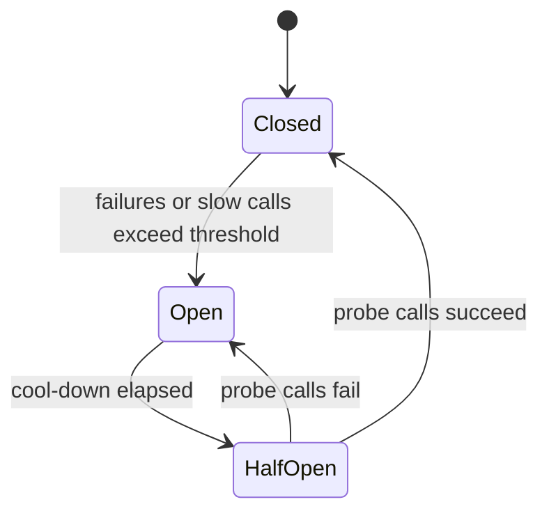
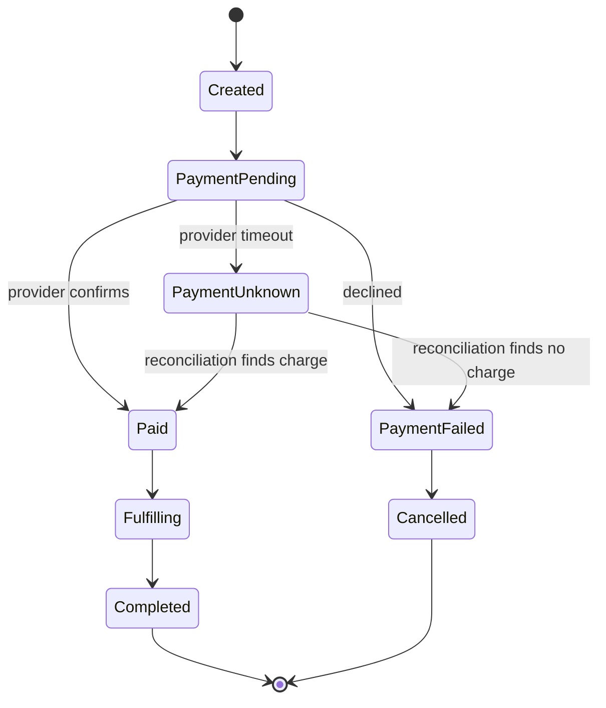

# Reliability in System Design: An In-Depth Guide

> **Topic:** System Design Fundamentals
> **Level:** Beginner to Advanced
> **Focus:** Distributed Systems, Site Reliability Engineering (SRE), Fault Tolerance, Resilience, and System Design Interviews
> **Prerequisites:** Basic familiarity with distributed systems, databases, and networking
> **Companion guide:** [Latency in System Design](latency.md)
> **Last updated:** October 2026

## Table of Contents

1. [What Is Reliability?](#1-what-is-reliability)
2. [Why Reliability Matters](#2-why-reliability-matters)
3. [Reliability vs Availability vs Resilience](#3-reliability-vs-availability-vs-resilience)
4. [Reliability vs Durability](#4-reliability-vs-durability)
5. [Reliability in Distributed Systems](#5-reliability-in-distributed-systems)
6. [Common Causes of System Failures](#6-common-causes-of-system-failures)
7. [Failure Modes and Fault Models](#7-failure-modes-and-fault-models)
8. [Failure Domains and Blast Radius](#8-failure-domains-and-blast-radius)
9. [Fault Tolerance](#9-fault-tolerance)
10. [Redundancy and Replication](#10-redundancy-and-replication)
11. [Consensus, Quorums, and Leader Election](#11-consensus-quorums-and-leader-election)
12. [Failover and Recovery](#12-failover-and-recovery)
13. [Single Points of Failure](#13-single-points-of-failure)
14. [Reliability Mathematics](#14-reliability-mathematics)
15. [Series, Parallel, and Quorum System Reliability](#15-series-parallel-and-quorum-system-reliability)
16. [Failure Detection and Health Checks](#16-failure-detection-and-health-checks)
17. [Timeouts, Retries, Circuit Breakers, and Backpressure](#17-timeouts-retries-circuit-breakers-and-backpressure)
18. [Overload and Cascading Failures](#18-overload-and-cascading-failures)
19. [Bulkheads and Graceful Degradation](#19-bulkheads-and-graceful-degradation)
20. [Data Reliability and Consistency](#20-data-reliability-and-consistency)
21. [Backups, Disaster Recovery, RPO, and RTO](#21-backups-disaster-recovery-rpo-and-rto)
22. [Reliability in Microservices](#22-reliability-in-microservices)
23. [Reliability in Kubernetes](#23-reliability-in-kubernetes)
24. [Reliability in Cloud Architecture](#24-reliability-in-cloud-architecture)
25. [Safe Change Management and Deployments](#25-safe-change-management-and-deployments)
26. [SLI, SLO, SLA, and Error Budgets](#26-sli-slo-sla-and-error-budgets)
27. [Observability and Reliability Monitoring](#27-observability-and-reliability-monitoring)
28. [Incident Management and Root Cause Analysis](#28-incident-management-and-root-cause-analysis)
29. [Reliability Testing](#29-reliability-testing)
30. [Designing a Reliable E-Commerce System](#30-designing-a-reliable-e-commerce-system)
31. [Reliability Trade-Offs](#31-reliability-trade-offs)
32. [Practical SRE Reliability Workflow](#32-practical-sre-reliability-workflow)
33. [Production Readiness Checklist](#33-production-readiness-checklist)
34. [Common Reliability Mistakes](#34-common-reliability-mistakes)
35. [System Design Interview Questions](#35-system-design-interview-questions)
36. [Reliability Cheat Sheet](#36-reliability-cheat-sheet)
37. [Key Takeaways](#37-key-takeaways)
38. [References](#38-references)

---

## 1. What Is Reliability?

Reliability is the ability of a system to perform its intended function correctly and consistently over a specified period under defined conditions.

A reliable system continues to provide correct service despite normal operating conditions, expected workloads, and foreseeable component failures.

Consider an online banking application. Customers expect to:

- Log in and view account balances.
- Transfer money without losing transactions.
- Avoid duplicate payments.
- Retrieve accurate transaction histories.
- Complete operations despite individual infrastructure failures.

A system that responds quickly but occasionally loses transactions is not reliable. A system that stays online but returns incorrect balances does not provide reliable service either.

**Reliability is about delivering the correct service consistently, not merely keeping servers running.**

### 1.1 Key characteristics of a reliable system

- **Correctness:** Produces the intended results.
- **Consistency:** Behaves predictably under defined conditions.
- **Fault tolerance:** Continues operating when certain components fail.
- **Recoverability:** Can restore service after failures.
- **Data integrity:** Protects data against corruption or unintended modification.
- **Predictability:** Has understood failure modes and measurable operating objectives.

Requirements vary by application. A recommendation engine may tolerate temporarily stale data, while a financial ledger requires strict protection against incorrect or lost transactions.

## 2. Why Reliability Matters

### 2.1 Business impact

Unreliable systems cause lost revenue, failed transactions, customer dissatisfaction, regulatory or contractual consequences, data corruption, operational disruption, and increased support costs.

### 2.2 Engineering impact

Poor reliability leads to frequent incidents, emergency deployments, repeated manual recovery, alert fatigue, growing operational toil, and reduced capacity for planned improvements.

### 2.3 Example

An e-commerce platform processes 100,000 orders daily. If a failure causes 2% of orders to fail:

`100,000 × 0.02 = 2,000 affected orders per day`

Even if the application servers are technically up, the business outcome may be unacceptable. Monitor meaningful user and business operations, not only infrastructure health.

## 3. Reliability vs Availability vs Resilience

These concepts are related, but they answer different questions.

### 3.1 Reliability

**Question:** Does the system perform its intended function correctly over time?

Example: A payment service processes transactions without losing or duplicating accepted payments.

### 3.2 Availability

**Question:** Is the system usable when a user needs it?

Example: An API is up and successfully serves eligible requests.

### 3.3 Resilience

**Question:** Can the system withstand disruption, limit the impact, and recover?

Example: When a database replica fails, the application keeps serving requests or restores service within an acceptable time.

### Comparison

| Concept | Primary focus | Example |
|---|---|---|
| Reliability | Correct operation over time | Transactions are processed correctly |
| Availability | Service accessibility and usability | Customers can access the API |
| Resilience | Handling and recovering from disruption | Service recovers after a node failure |
| Durability | Data remains intact over time | A committed transaction survives a server failure |
| Fault tolerance | Continued operation despite specified faults | One failed instance does not interrupt service |

A system can be available but unreliable (for example, returning HTTP 200 with incorrect data). It can also be reliable in its computation but temporarily unavailable during maintenance.

The design goal is to meet the required level of **all** these properties.

## 4. Reliability vs Durability

Durability matters most for databases, storage systems, and financial applications.

Reliability concerns correct service over time. Durability concerns whether committed data survives failures according to the storage system's guarantees.

### Example

A user transfers ₹5,000 between accounts. The system acknowledges the transfer, but a subsequent server failure makes the transaction record disappear.

The application was available when the request was submitted, but its durability guarantees were insufficient.

### Durability techniques

- Replication across independent failure domains.
- Durable transaction logs and write-ahead logging.
- Backups and point-in-time recovery.
- Checksums and integrity verification.
- Correct storage and commit configurations (for example, `fsync` behavior and acknowledgment settings).

Replication alone is not sufficient. Accidental deletion or corrupted data can replicate to every copy. Backups and replication solve different problems and should be designed together.

### Durability is not availability

Object stores advertise very high durability targets (for example, Amazon S3 Standard is designed for 99.999999999%, "eleven nines," durability of objects). That describes the likelihood of **not losing an object**. It says nothing about whether you can read it right now, which is availability, and it does not protect against your own accidental deletes or overwrites.

## 5. Reliability in Distributed Systems

A distributed system consists of multiple components communicating over a network: microservices applications, distributed databases, cloud applications, payment platforms, content delivery systems, and Kubernetes workloads.

Components can fail independently, and communication is not perfectly reliable, which creates failure possibilities that single-machine systems do not have.

### 5.1 Partial failure

A partial failure occurs when one component fails while the rest of the system continues operating.

Example:

- The frontend is healthy.
- The order service is healthy.
- The inventory service is responding slowly.
- The database is operating normally.

The overall system may still work, but some operations fail or become slow.

### 5.2 Network uncertainty

If a service sends a request and gets no response, it cannot always tell whether:

- The request never reached the destination.
- The destination received it but failed before processing.
- The destination processed it, but the response was lost.
- The destination is still processing it.

This is especially important for payment and order-processing systems.

### 5.3 Failure independence is not guaranteed

Two replicas may appear redundant but share the same power supply, availability zone, network path, software release, credentials, control plane, or underlying storage.

A single shared failure can affect all replicas.

**Reliable architecture must consider correlated failures, not just the number of instances.**

### 5.4 The fallacies of distributed computing

Many reliability bugs come from assumptions engineers make without noticing: that the network is reliable, latency is zero, bandwidth is infinite, the network is secure, topology does not change, there is one administrator, transport cost is zero, and the network is homogeneous. Each assumption you can remove from the design removes a class of outages.

## 6. Common Causes of System Failures

Reliability engineering begins by understanding how systems fail.

### 6.1 Hardware failures

Server crashes, disk failures, network interface failures, power failures.

Mitigations: redundancy, health checks, replication, automated recovery.

### 6.2 Software failures

Application bugs, memory leaks, deadlocks, unhandled exceptions, incorrect configuration, resource leaks.

Mitigations: testing, code review, gradual rollouts, observability, rollback mechanisms.

### 6.3 Network failures

Packet loss, network partitions, DNS failures, routing problems, connection resets.

Mitigations: timeouts, retries with backoff, multiple failure domains, appropriate fallback behavior.

### 6.4 Capacity failures

CPU saturation, memory exhaustion, database connection exhaustion, queue buildup, storage capacity exhaustion.

Mitigations: capacity planning, load shedding, autoscaling, quotas, backpressure.

### 6.5 Human and operational errors

Incorrect deployments, accidental deletion, misconfigured firewall rules, faulty database migrations, expired credentials or certificates, faulty infrastructure changes.

Mitigations: peer review, infrastructure as code, least privilege, automated validation, progressive rollouts, tested recovery procedures.

In many organizations, **changes** (deployments and configuration) are among the most common triggers of incidents. See [Section 25](#25-safe-change-management-and-deployments).

### 6.6 Dependency failures

A third-party payment provider, identity service, or messaging platform can affect your system even when your own application is healthy.

Mitigations: dependency timeouts, circuit breakers, queues, fallbacks, and explicit dependency SLOs.

### 6.7 Time-based failures

Expired TLS certificates, expired credentials, leap seconds, clock skew, and daylight-saving transitions cause outages that no amount of redundancy prevents, because every replica fails at the same moment. Monitor expiry dates and automate rotation.

## 7. Failure Modes and Fault Models

A fault model defines the types of failures a system is expected to handle.

Designing for every imaginable failure is usually impractical. Identify the important failure scenarios and define the required behavior.

### 7.1 Crash failure

A component stops executing. Example: an application process crashes.

Response: detect the failure and restart or replace the component.

### 7.2 Omission failure

A component fails to send or receive a message. Example: a network packet is dropped.

Response: timeouts, retry policies, and message-delivery mechanisms.

### 7.3 Timing failure

A component responds outside the required time limit. Example: a database query takes 10 seconds when the deadline is 500 ms.

Response: bound waiting time, control overload, provide safe fallbacks. A very slow component is often **harder** to handle than a dead one, because it is still holding resources.

### 7.4 Data corruption

A component returns or stores incorrect data.

Response: integrity checks, validation, checksums, replication safeguards, recovery procedures.

### 7.5 Byzantine failure

A component behaves arbitrarily or inconsistently, potentially sending conflicting information.

This model matters in some distributed and security-sensitive systems. Ordinary instance redundancy does not protect against Byzantine failures, and most crash-fault-tolerant consensus protocols (such as Raft) assume they do not occur.

### 7.6 Common-mode failure

Multiple components fail for the same underlying reason. Example: all replicas receive the same defective release.

Mitigations: independent failure domains, staged rollouts, release validation, and diverse recovery mechanisms where justified.

### 7.7 Gray failure

A component is partially degraded in a way that health checks do not notice: a disk with elevated latency, a NIC dropping a small fraction of packets, or a node that answers health checks but fails real requests. Gray failures are a major source of long incidents because detection depends on **user-visible** signals rather than binary up/down checks.

## 8. Failure Domains and Blast Radius

A **failure domain** is a set of components that can fail together because they share something. The **blast radius** is how much of the system (or how many users) a given failure affects.

| Failure domain | Typical shared dependency |
|---|---|
| Process / container | Memory, code, runtime |
| Host / node | Hardware, kernel, local disk |
| Rack | Top-of-rack switch, power distribution |
| Availability zone | Power, cooling, local network, zonal services |
| Region | Regional services, control planes, regional network |
| Cloud account or provider | Credentials, quotas, billing, provider-wide incidents |
| Global dependency | DNS, identity provider, certificates, config system, deployment pipeline |

Design questions:

- Which failure domains does each component span?
- What is the largest domain we can lose and still meet the SLO?
- Which **global** dependencies could take everything down at once? These are the most dangerous, because zone and region redundancy do not help.

### 8.1 Shrinking the blast radius

- **Cell-based architecture:** Partition customers or traffic into independent, identical cells, each with its own stack. A failure affects only one cell. With 10 cells, a cell-local failure affects roughly 10% of users.
- **Shuffle sharding:** Assign each customer a small random subset of workers. With 8 workers and 2 assigned per customer, there are `C(8,2) = 28` possible pairs, so the chance that two particular customers share the same two workers is 1 in 28. A "poison" customer can take down only its own pair rather than the whole fleet.
- **Staged rollouts** limit the blast radius of a bad change (see [Section 25](#25-safe-change-management-and-deployments)).
- **Quotas and rate limits** per tenant prevent one tenant from exhausting shared resources.

### 8.2 Static stability

A system is *statically stable* if it keeps working when a dependency or control plane is impaired, without needing to take any new action. For example, pre-provision enough capacity in each zone so that losing a zone does not require launching new instances during the outage, when the control plane is most likely to be overloaded.

**Do not make recovery depend on the thing that failed.**

## 9. Fault Tolerance

Fault tolerance is the ability of a system to continue providing a defined level of service despite specified component failures.

### Example

An application has three instances behind a load balancer. If one crashes, the load balancer stops routing traffic to it and continues sending requests to the other two. This tolerates one instance failure, **assuming the remaining instances have enough capacity**.

### Common fault-tolerance techniques

- Redundant application instances.
- Multiple availability zones.
- Database replication.
- Automatic failover.
- Durable queues.
- Retry mechanisms.
- Circuit breakers.
- Bulkheads.
- Graceful degradation.
- Replicated control-plane components where supported.

### 9.1 Capacity for failure: N+1 and beyond

Redundancy is meaningless if the survivors cannot carry the load. With `N` equally loaded instances, losing one multiplies the load on each survivor by `N / (N − 1)`:

| Instances (N) | Load multiplier after losing 1 | Max pre-failure utilization to stay at or below 100% |
|---:|---:|---:|
| 2 | 2.00x | 50% |
| 3 | 1.50x | 66.7% |
| 4 | 1.33x | 75% |
| 10 | 1.11x | 90% |

Because latency rises steeply as utilization approaches 100% (see [Latency, Section 12](latency.md#12-queueing-theory-and-littles-law)), you want to land well below that, not at it.

The same logic applies to zones. To survive the loss of one zone:

- With **3 zones**, size each zone to carry 50% of peak load on its own, so total provisioned capacity is 150% of peak. In normal operation each zone carries about a third of peak (roughly 67% of its capacity); after losing one zone, each survivor carries half of peak (100% of its capacity), so in practice you want more headroom than the minimum.
- With **2 zones**, provision 200% of peak: each zone must be able to handle the entire load alone.

More, smaller failure domains make N+1 cheaper. This is one reason three or more zones is common.

### Important limitation

Fault tolerance does not mean surviving every failure. A design must state what it tolerates:

- One application instance failing.
- One availability zone becoming unavailable.
- A dependency returning errors.
- A temporary network interruption.

Larger failures may require disaster recovery rather than uninterrupted service.

## 10. Redundancy and Replication

Redundancy provides alternative resources so that a single failure does not necessarily stop the service. Replication creates multiple copies of data or state.

### 10.1 Active-active architecture

Multiple instances serve traffic simultaneously.

Advantages:

- Work is distributed across instances.
- Capacity is shared, and failure of one instance may have limited impact.
- Failover is often just "stop sending traffic to it," which is exercised continuously.

Challenges:

- State coordination and data consistency.
- Load balancing.
- Duplicate processing.
- Correlated failures.

### 10.2 Active-passive architecture

A primary serves traffic while a standby is ready to take over.

Advantages:

- Clear primary ownership.
- Can simplify some stateful designs.
- Standby capacity may be reserved for recovery.

Challenges:

- Failover delay.
- Standby synchronization.
- Failover that is rarely exercised and may not work when needed.
- Underused resources.
- Risk of split-brain if leadership is not controlled.

### 10.3 Replication strategies

**Synchronous replication:** The writer waits for the required replica acknowledgement before reporting success, per the system's configured semantics.

- Benefit: stronger durability or consistency guarantees.
- Trade-off: higher write latency and reduced write availability during some network failures.

**Asynchronous replication:** The writer can acknowledge before replicas have the latest data.

- Benefit: lower write latency and potentially better write availability.
- Trade-off: replication lag and possible loss of recently acknowledged changes under certain failures.

**Semi-synchronous / quorum replication:** Wait for acknowledgement from some replicas (for example, one of two, or a majority) rather than all. This is a common middle ground.

### 10.4 Choosing the right strategy

Consider data-loss tolerance, consistency requirements, recovery time requirements, geographic distribution, write latency, cost, and operational complexity.

For a financial ledger, correctness and durability are critical. For a product recommendation cache, temporarily stale replicas may be acceptable.

## 11. Consensus, Quorums, and Leader Election

When multiple nodes must agree on a single truth (who is the leader, what is the next log entry, what is the current configuration), systems use **consensus protocols** such as Raft and Paxos. Examples of systems built on them include etcd, ZooKeeper, and Consul, and many distributed databases use them internally.

### 11.1 Majority quorums

A decision requires acknowledgement from a **majority**: `⌊n/2⌋ + 1` of `n` nodes. Any two majorities overlap in at least one node, which is what prevents two partitions from both making conflicting decisions.

| Cluster size (n) | Majority needed | Failures tolerated |
|---:|---:|---:|
| 1 | 1 | 0 |
| 2 | 2 | 0 |
| 3 | 2 | 1 |
| 4 | 3 | 1 |
| 5 | 3 | 2 |
| 7 | 4 | 3 |

Two takeaways:

- **Use an odd number of nodes.** Going from 3 to 4 nodes adds cost without tolerating any additional failure.
- **A two-node cluster is worse than one for availability under consensus**, because losing either node loses the majority.

Larger clusters tolerate more failures but make every write wait for more acknowledgements, so consensus clusters are typically 3, 5, or occasionally 7 nodes.

### 11.2 Tunable quorums in leaderless systems

In Dynamo-style stores with `N` replicas, a write needs `W` acknowledgements and a read queries `R` replicas. If `W + R > N`, every read quorum overlaps every write quorum, so reads see the latest acknowledged write (subject to caveats such as sloppy quorums and concurrent writes). With `N = 3, W = 2, R = 2`, the system tolerates one replica failure for both reads and writes.

### 11.3 Leader election and fencing

A leader is chosen so that only one node performs certain actions (for example, accepting writes). Two risks:

- **Split brain:** two nodes both believe they are the leader.
- **Zombie leader:** a former leader pauses (a long GC pause, a VM freeze), a new leader is elected, and then the old one wakes up and keeps acting.

**Fencing tokens** address the second risk: each leadership term gets a monotonically increasing token, and the storage layer rejects any write carrying an older token than the newest it has seen. Leases alone are not enough, because a paused process cannot know its lease expired.

## 12. Failover and Recovery

Failover moves service responsibility from a failed or unhealthy component to another.

### Typical failover sequence

1. A component becomes unhealthy.
2. Monitoring or health checks detect the problem.
3. The system decides whether failover is appropriate.
4. A standby or healthy replica is selected.
5. Traffic or leadership is switched.
6. The system validates service recovery.
7. The failed component is repaired or replaced.

### 12.1 Failover challenges

- Failure detection may be delayed.
- Health checks may produce false positives.
- The replacement may lack sufficient capacity.
- Replicas may contain stale data (and promoting one can lose recently acknowledged writes under asynchronous replication).
- Clients may cache old endpoints (DNS TTLs, connection pools).
- In-flight requests may fail.
- Two nodes may both believe they are the leader.
- Failover itself can cause an overload (the "thundering herd" onto the survivor).

### 12.2 Split brain

Split brain occurs when multiple nodes independently believe they have authority to perform conflicting operations, which can corrupt data or produce inconsistent state.

Mitigations:

- Quorum-based decisions and consensus ([Section 11](#11-consensus-quorums-and-leader-election)).
- Fencing tokens.
- Leases with carefully defined timing assumptions.
- Single-writer controls.
- Shutting down or isolating the old primary (STONITH-style fencing) before promoting a new one.

A health check alone is not a sufficient mechanism for deciding which node owns write authority.

### 12.3 Failback

Failback moves service back to the original or preferred component after recovery. It should be deliberate and validated. Switching back too early can cause repeated failures or another interruption.

### 12.4 Detection time is part of recovery time

Recovery time includes **detection + decision + switchover + validation**. A system with a 2-second failover but 60-second failure detection recovers in over a minute. Tune detection and test the entire path, not only the switch.

## 13. Single Points of Failure

A single point of failure (SPOF) is a component whose failure can cause an unacceptable outage or loss of critical functionality.

### Example architecture

`Client → Single Load Balancer → Application → Single Database`

Potential SPOFs: the load balancer, the application instance, the database, a shared network component, a single identity provider, a shared secrets service.

### How to identify SPOFs

Ask:

1. What happens if this component stops?
2. Can traffic reach another healthy component?
3. Is state replicated safely?
4. Is the control plane itself redundant?
5. Does recovery depend on manual action?
6. Can the remaining capacity handle peak load?
7. Is this a **hidden** SPOF (DNS, certificates, a shared config store, the CI/CD pipeline, a single person who knows the procedure)?

### Removing a SPOF

- Redundant load balancers.
- Multiple application instances.
- Multi-zone deployment.
- Database failover.
- Replicated queues.
- Multiple network paths.
- Tested backup and restore procedures.
- Documented runbooks so recovery does not depend on one person.

Evaluate redundancy end to end. Two application instances do not remove a single database dependency.

## 14. Reliability Mathematics

Reliability can be quantified using several metrics.

### 14.1 Reliability function

Let `R(t)` be the probability that a system operates without the defined failure from time zero to time `t`.

Under a constant failure-rate assumption:

`R(t) = e^(−λt)`

- `R(t)` = reliability over time `t`.
- `λ` = constant failure rate.
- `t` = elapsed time.

Example: a component with `MTTF = 1,000 hours` has `λ = 1/1000 = 0.001` per hour.

- `R(100 h) = e^(−0.1) ≈ 0.905` (about a 90.5% chance of surviving 100 hours).
- `R(1,000 h) = e^(−1) ≈ 0.368`.

That last line is a common misconception: **MTTF is not a guarantee**. Under this model, only about 37% of components survive as long as the MTTF.

This model is useful for hardware-like analyses, but real software failure rates are not always constant.

### 14.2 Mean Time to Failure (MTTF)

The expected operating time until failure for a non-repairable item or a defined failure event.

### 14.3 Mean Time to Repair / Restore (MTTR)

Commonly the average time required to repair a failed component or restore service.

Document your definition. Teams use "MTTR" to mean time to repair, recover, respond, or resolve, and these differ significantly.

### 14.4 Mean Time Between Failures (MTBF)

For a repairable system, the average time between successive failures. In a simplified model:

`MTBF ≈ MTTF + MTTR`

assuming compatible definitions and measurement boundaries.

Example: operating time before failure averages 1,000 hours and restoration averages 2 hours:

`MTBF ≈ 1,000 + 2 = 1,002 hours`

### 14.5 Availability from MTTF and MTTR

`Availability = MTTF / (MTTF + MTTR)`

For the example above:

`1,000 / 1,002 ≈ 99.80%`

This shows two levers, and the cheaper one is often **MTTR**:

| Change | Resulting availability |
|---|---:|
| Baseline: MTTF 1,000 h, MTTR 2 h | 99.80% |
| Make failures 4x rarer: MTTF 4,000 h, MTTR 2 h | 99.95% |
| Make recovery 4x faster: MTTF 1,000 h, MTTR 0.5 h | 99.95% |

Both give the same availability. Cutting recovery time fourfold (through better detection, automation, rollback, and runbooks) is frequently far easier than making failures fourfold rarer. This is why SRE practice invests heavily in fast detection and mitigation.

### 14.6 The "nines" table

For a time-based availability target:

| Availability | Allowed downtime per 30 days | Allowed downtime per year |
|---:|---:|---:|
| 99% | 7.2 hours | 3.65 days |
| 99.9% | 43.2 minutes | 8.76 hours |
| 99.95% | 21.6 minutes | 4.38 hours |
| 99.99% | 4.32 minutes | 52.6 minutes |
| 99.999% | 25.9 seconds | 5.26 minutes |

At 99.99%, a single 10-minute incident in a month **blows the entire budget**, and human-driven detection and response alone will often take longer than the allowance. Targets at four nines and above generally require automated detection and remediation, not just redundant hardware.

## 15. Series, Parallel, and Quorum System Reliability

Reliability calculations help compare architectures, provided the assumptions fit.

### 15.1 Series system

Every required component must work for the system to work. Suppose a request requires:

- Component A with reliability 99.9%.
- Component B with reliability 99.9%.

Assuming independent failures and compatible measurement periods:

`R(system) = R(A) × R(B) = 0.999 × 0.999 = 0.998001`

Combined reliability is about 99.8001%.

**Adding mandatory dependencies reduces overall reliability.** Three hard dependencies at 99.9% each give `0.999³ ≈ 0.997` (99.7%), or roughly 130 minutes of expected downtime per 30 days. A service that hard-depends on three 99.9% services **cannot honestly promise 99.9%**.

Rule of thumb: critical dependencies should be meaningfully more reliable than the SLO you promise, or you need to make them soft dependencies (fallbacks, caches, asynchronous paths).

### 15.2 Parallel redundant system

Either of two independent components can provide the service, and the system succeeds whenever at least one works. If each has reliability `R`:

`R(system) = 1 − (1 − R)²`

For two components at 99%:

`R(system) = 1 − (0.01 × 0.01) = 0.9999`

Theoretical combined reliability is 99.99%.

### 15.3 k-out-of-n (quorum) systems

A system works if at least `k` of `n` components work. For a 2-out-of-3 system with each component at reliability `R = 0.99`:

`R(system) = 3R² − 2R³ = 3(0.9801) − 2(0.970299) ≈ 0.9997`

That is about 99.97%, better than a single node (99%), but not as good as the 99.99% from two fully independent parallel replicas, because a majority-based system must keep a majority alive while a fully parallel design needs only one survivor (at the cost of weaker coordination guarantees).

### 15.4 Why real systems may perform worse

The parallel calculation assumes:

- Independent failures.
- Effective failure detection.
- Correct traffic switching.
- Enough surviving capacity ([Section 9.1](#91-capacity-for-failure-n1-and-beyond)).
- No shared critical dependency.
- No common-mode failure.

If both instances depend on the same failed database, the redundant application tier provides little benefit.

**The mathematics is only as useful as the assumptions behind it.** In practice, correlated failures (a bad deploy, a shared config, an expired certificate) dominate the real-world outage budget, which is why independence is the assumption most worth challenging.

## 16. Failure Detection and Health Checks

A system must identify unhealthy components before it can recover from many failures.

### 16.1 Liveness check

Determines whether a process should be restarted or is stuck. A failing liveness check may trigger a restart, depending on the platform.

It should **not** fail simply because a temporary downstream dependency is unavailable; otherwise, restarts amplify an outage.

### 16.2 Readiness check

Determines whether an instance should receive traffic. An application can be alive but not ready because it is still initializing, lacks required local state, or cannot serve requests correctly.

### 16.3 Dependency health

Dependency checks measure whether downstream systems are functioning.

A dependency failure does not always mean the instance should be removed from service. The right action depends on whether the affected feature is essential and whether a safe fallback exists.

Beware of **cascading readiness failures**: if every instance marks itself unready because a shared dependency is down, the load balancer removes all of them and a partial degradation becomes a total outage. Many load balancers have a "panic" or fail-open mode for this reason; know how yours behaves.

### 16.4 Failure detection trade-offs

Aggressive health checks detect failures quickly but may create false positives during transient slowdowns. Slow health checks delay recovery.

Tune check intervals, timeouts, failure thresholds, recovery thresholds, startup grace periods, and the consequences of an unhealthy result.

### 16.5 Shallow vs deep checks and real-traffic signals

- **Shallow check:** the process is up and can respond.
- **Deep check:** the process can also reach its critical dependencies.
- **Passive detection:** watching real request outcomes (error rate, latency) per instance and ejecting outliers. This catches gray failures ([Section 7.7](#77-gray-failure)) that synthetic probes miss.

## 17. Timeouts, Retries, Circuit Breakers, and Backpressure

These patterns prevent one failing component from causing widespread disruption. For deeper treatment, including deadline propagation and load shedding, see the [Latency guide, Section 19](latency.md#19-timeouts-retries-circuit-breakers-and-load-shedding).

### 17.1 Timeouts

A timeout limits how long a caller waits. Without timeouts, requests wait indefinitely, consuming connections, threads, and memory.

Align timeouts with the caller's deadline and the operation's expected behavior. Prefer a propagated end-to-end deadline over independent per-hop timeouts.

### 17.2 Retries

Retries repeat an operation after a failure or timeout. They can recover from transient faults but can also increase load on an unhealthy service.

Use:

- Bounded retry counts.
- Exponential backoff.
- Jitter.
- End-to-end deadlines.
- Idempotency controls.
- Retry budgets (cap retries to a small fraction of traffic).
- Policies that distinguish transient from permanent errors.

**Retry amplification:** if three layers each retry up to three times, one failing call at the bottom can become `3 × 3 × 3 = 27` attempts. Retry at a single layer, typically the one closest to the failure that has the context to decide safely.

For non-idempotent operations, retries require particular care. A timed-out payment request may have succeeded even if its response was lost. An idempotency key and transaction-status lookup avoid duplicate payments.

### 17.3 Circuit breakers

Circuit breakers prevent repeated calls to a dependency that is failing or too slow.



- **Closed:** Calls are allowed.
- **Open:** Calls are rejected or routed to an alternative.
- **Half-open:** Limited test calls check recovery.

Circuit breakers contain failures; they do not repair the dependency.

### 17.4 Backpressure

Backpressure signals that a downstream component cannot accept more work at the current rate.

Mechanisms:

- Bounded queues.
- Admission control.
- Rate limiting.
- Request rejection (for example, `429` or `503` with `Retry-After`).
- Producer throttling.

Backpressure prevents unbounded queues and resource exhaustion.

## 18. Overload and Cascading Failures

Many large outages are not caused by the initial fault but by how the system **reacts** to it.

### 18.1 How a cascade forms

1. One component slows or loses capacity (a deploy, a failed node, a traffic spike).
2. Remaining components take on more load.
3. They slow down or crash, pushing load onto the rest.
4. Clients time out and retry, adding still more load.
5. The system collapses even though the original trigger is gone.

### 18.2 Metastable failures

A **metastable failure** is a state in which a feedback loop (typically retries, cache misses, or queue growth) sustains an overload **even after the original trigger has been removed**. The system cannot recover on its own because the work required to recover is more than its capacity.

Example: a brief database slowdown causes cache entries to expire; the resulting flood of cache-miss traffic keeps the database saturated; the cache cannot refill because the database cannot answer fast enough; retries keep the load high. Removing the original slowdown does not help.

Typical exits: shed load aggressively, temporarily disable retries, raise rate limits only after recovery, warm caches gradually, and add capacity before restoring full traffic.

### 18.3 Common amplifiers

- Unbounded or very long queues (everything waits, all requests time out).
- Retries without budgets or jitter.
- Cache stampedes and synchronized expirations.
- Thundering herd on reconnect or restart.
- Health checks that remove capacity during overload.
- Autoscaling that reacts too slowly or scales a component that is not the bottleneck.
- Work that continues after the caller has given up.

### 18.4 Defenses

- **Load shedding:** reject excess work early so admitted requests still succeed.
- **Bounded queues** with a clear overload response.
- **Deadline propagation** so servers drop requests nobody is waiting for.
- **Retry budgets** and jittered backoff.
- **Prioritization:** protect critical traffic (checkout, payments) over best-effort traffic.
- **Graceful degradation** ([Section 19](#19-bulkheads-and-graceful-degradation)).
- **Request coalescing** and TTL jitter to prevent cache stampedes.
- **Capacity headroom** ([Section 9.1](#91-capacity-for-failure-n1-and-beyond)).
- **Gradual ramp-up** of traffic to restarted or recovering instances.

Reference: Bronson et al., *Metastable Failures in Distributed Systems* (HotOS 2021).

## 19. Bulkheads and Graceful Degradation

### 19.1 Bulkheads

Bulkheads isolate resource pools or dependencies so one failure does not exhaust the resources needed by unrelated operations.

A service may use separate connection pools or thread pools for:

- Payment processing.
- Product recommendations.
- Reporting.

If the recommendation provider becomes slow, it should not consume all resources needed to process payments. Bulkheads can also be applied per tenant, per priority class, or per deployment cell ([Section 8.1](#81-shrinking-the-blast-radius)).

### 19.2 Graceful degradation

Graceful degradation allows a system to keep providing essential functionality when optional features are unavailable.

An online store may temporarily omit personalized recommendations while preserving:

- Product search.
- Product details.
- Cart operations.
- Checkout.

Decide **in advance**, per feature, whether it is critical (fail the request) or optional (degrade). Writing this down as a dependency criticality table prevents improvised decisions during an incident.

### 19.3 Fallback design

A fallback must be safe and clearly defined:

- Use cached, potentially stale information.
- Return a reduced feature set.
- Queue a non-critical task.
- Use an alternate provider.
- Reject requests early when correctness cannot be guaranteed.

Do not silently substitute stale or incorrect information for data that must be authoritative. Also test fallbacks regularly: a fallback path that is never exercised often fails when first needed, and can itself become a source of overload.

## 20. Data Reliability and Consistency

Data reliability means ensuring stored and processed data remains correct, valid, and recoverable according to the system's guarantees.

### 20.1 Data integrity

Protect against accidental deletion, duplicate records, partial writes, corrupted files, invalid state transitions, and inconsistent updates.

Techniques: database constraints, transactions, validation, checksums, soft deletes, and carefully designed recovery procedures.

### 20.2 Idempotency

An operation is idempotent if repeating it has the same intended effect as performing it once.

Setting an account preference to `enabled` is naturally idempotent when implemented as a state assignment. Incrementing a balance is not, because repeating it changes the balance again.

Idempotency keys make repeated API submissions safe when designed correctly:

1. The client generates a unique key per logical operation and sends it with every attempt.
2. The server atomically records the key with the operation's result.
3. A repeated request with the same key returns the stored result instead of re-executing.
4. Keys expire after a documented window, and a key reused with different parameters is rejected.

### 20.3 Transactions

Transactions group operations under defined atomicity and consistency guarantees. For a transfer, the system must avoid debiting one account without correctly accounting for the credit.

Distributed workflows may require **sagas** (a sequence of local transactions with compensating actions), or other mechanisms when one database transaction cannot span all participating services. Prefer designs that keep an invariant inside a single database or aggregate where possible.

### 20.4 Consistency trade-offs

When a network partition occurs, a distributed data store must choose between **consistency** (reject or delay some operations so all clients see the same data) and **availability** (keep answering, possibly with stale data). This is the CAP trade-off. Even without partitions, there is a trade-off between **latency** and consistency (the PACELC extension).

Decide per operation, not per system:

| Operation | Typical choice |
|---|---|
| Account balance debit | Consistency over availability |
| Product catalog read | Availability; stale data acceptable |
| Shopping cart | Often availability, with merge on conflict |
| Inventory reservation | Depends on whether overselling is acceptable |

### 20.5 Event-driven reliability

Message queues and event streams decouple services but have their own reliability requirements:

- Message durability.
- Consumer retries.
- Duplicate delivery.
- Ordering.
- Dead-letter handling.
- Consumer lag.
- Poison messages.
- Replay and reconciliation.

Design consumers around the delivery semantics of the chosen messaging system. "Exactly once" claims must be interpreted within their documented scope; end-to-end business effects usually still need idempotent consumers.

### 20.6 The dual-write problem and the transactional outbox

A common bug: a service updates its database **and** publishes an event, as two separate operations. If it crashes between them, the database and the event stream disagree (an order exists but no event was sent, or vice versa).

The **transactional outbox** pattern solves this:

1. In the **same database transaction** that changes business data, insert the event into an `outbox` table.
2. A separate relay process (or change-data-capture) reads the outbox and publishes events to the broker.
3. The relay retries until publishing succeeds, giving **at-least-once** delivery.
4. Consumers deduplicate using an event ID, making processing idempotent.

This trades a small amount of latency and an extra table for the elimination of an entire class of lost-event bugs.

## 21. Backups, Disaster Recovery, RPO, and RTO

Fault tolerance handles certain failures while the system is running. Disaster recovery addresses restoration after more substantial disruption.

### 21.1 Backup

A backup is a recoverable copy of data or system state: database backups, object storage backups, configuration backups, infrastructure definitions, point-in-time recovery logs.

**A backup that has never been restored in a test may not provide the expected protection.**

A widely used guideline is the **3-2-1 rule**: keep at least 3 copies of your data, on 2 different storage types or systems, with 1 copy offsite. Modern practice adds:

- At least one **immutable** or **offline** copy that ransomware or a compromised credential cannot delete.
- Backups in a **separate account or security boundary** from production.
- Encryption, with keys that are themselves recoverable.
- Monitoring for backup **failures and size anomalies**, not just job completion.

### 21.2 Recovery Point Objective (RPO)

RPO defines the maximum acceptable data loss measured in time.

An RPO of 15 minutes means the recovery strategy must ensure data loss does not exceed 15 minutes of updates under the defined disaster scenario.

RPO is not automatically equal to the backup interval. The design must account for replication, log shipping, backup completion, and the specific failure considered.

### 21.3 Recovery Time Objective (RTO)

RTO defines the target maximum time to restore service after a disruption.

An RTO of 60 minutes means service should be restored within one hour. RTO should include all steps within the measurement boundary: detection, decision-making, recovery, and validation where applicable.

### 21.4 RPO vs RTO

| Metric | Question | Example |
|---|---|---|
| RPO | How much data loss is acceptable? | Up to 15 minutes of updates |
| RTO | How long can recovery take? | Restore service within 60 minutes |
| MTTR | How long does recovery actually take on average? | Mean restoration time is 25 minutes |

RTO is a target. MTTR is an observed average. Neither guarantees every incident recovers within that time.

### 21.5 Disaster recovery strategies

| Strategy | What runs before a disaster | Typical recovery speed (order of magnitude) | Relative cost |
|---|---|---|---|
| Backup and restore | Only backups | Hours | Lowest |
| Pilot light | Minimal core (for example, replicated data, no compute) | Tens of minutes to hours | Low |
| Warm standby | Scaled-down but functional environment | Minutes to tens of minutes | Medium |
| Active-active (multi-site) | Full capacity in multiple locations | Seconds to minutes | Highest |

Treat these ranges as typical orientation, not guarantees; your RTO and RPO depend on your data size, automation, and testing.

- **Backup and restore:** Lower cost, longer recovery, requires tested restoration procedures.
- **Pilot light:** A minimal core remains available; additional resources are provisioned during recovery.
- **Warm standby:** A scaled-down but functional environment runs; recovery requires scaling and redirecting traffic.
- **Active-active:** Multiple environments serve traffic simultaneously, supporting rapid continuity at substantial complexity in data consistency, routing, and operations.

Choose according to the business impact of downtime and data loss, not the most advanced architecture available.

### 21.6 Plan for the disaster you are most likely to have

Many "disasters" are not regional outages but **logical** failures: a bad migration, a buggy deploy that corrupts data, an accidental `DELETE`, or a malicious actor. Replication faithfully copies these. Point-in-time recovery, immutable backups, and soft deletion address logical corruption; multi-region replication does not.

## 22. Reliability in Microservices

Microservices provide independent deployment and scaling, but they create more network boundaries and dependencies.

### Example

`API Gateway → Order Service → Inventory Service → Payment Service → Database`

- If the inventory service becomes slow, the order service may hold resources while waiting.
- If the order service retries aggressively, it may increase pressure on inventory.
- If the payment service times out after completing a charge, the order workflow becomes uncertain.

### Reliability techniques

- Set request deadlines and propagate them.
- Apply bounded retries with budgets.
- Use idempotency keys.
- Isolate resource pools.
- Reduce synchronous dependencies on the critical path.
- Use durable messaging where appropriate.
- Track distributed traces.
- Design compensating actions for multi-service workflows.
- Test dependency failure scenarios.
- Define ownership and SLOs for critical services.
- Classify each dependency as **hard** or **soft** ([Section 19.2](#192-graceful-degradation)).

### Synchronous vs asynchronous communication

Synchronous calls suit cases where the caller needs the result immediately. Asynchronous messaging suits work that can complete later and needs durable delivery.

Asynchronous designs can improve isolation but add complexity around status tracking, duplicate events, ordering, and eventual completion.

### Distributed monolith warning

If services must be deployed together, share a database, or fail together whenever one fails, you have the operational costs of microservices without the isolation benefits. Count real failure independence, not the number of repositories.

## 23. Reliability in Kubernetes

Kubernetes provides mechanisms that help maintain application availability, but reliability still depends on workload configuration and application behavior.

### 23.1 Deployments and replicas

A Deployment maintains the desired number of Pods. If a Pod fails, Kubernetes creates a replacement.

Replacement takes time, and replicas on the same node or zone share a failure domain.

### 23.2 Readiness, liveness, and startup probes

- **Readiness probe:** whether a Pod should receive traffic.
- **Liveness probe:** whether a container should be restarted.
- **Startup probe:** gives a slow-starting application time to initialize before liveness checks apply.

Poor probe configuration causes unnecessary restarts or routes traffic to instances that are not ready.

```yaml
startupProbe:
  httpGet: { path: /healthz/startup, port: 8080 }
  periodSeconds: 2
  failureThreshold: 30        # allows up to ~60 s to start
readinessProbe:
  httpGet: { path: /healthz/ready, port: 8080 }
  periodSeconds: 5
  failureThreshold: 3
livenessProbe:
  httpGet: { path: /healthz/live, port: 8080 }   # checks the process only, not dependencies
  periodSeconds: 10
  failureThreshold: 3
```

Keep the liveness endpoint **independent of downstream dependencies**.

### 23.3 Resource requests and limits

Requests affect scheduling; limits constrain usage. CPU throttling can raise application latency, and exceeding a memory limit causes the container to be terminated (OOMKilled).

Base settings on workload measurements and testing.

### 23.4 Pod disruption budgets

A PodDisruptionBudget (PDB) constrains **voluntary** disruptions (node drains, upgrades) to keep a minimum number of replicas available.

```yaml
apiVersion: policy/v1
kind: PodDisruptionBudget
metadata:
  name: orders-pdb
spec:
  minAvailable: 2
  selector:
    matchLabels:
      app: orders
```

A PDB does not protect against node failures, zone failures, or other involuntary disruptions. A PDB that is too strict (for example `minAvailable` equal to the replica count) can block node upgrades entirely.

### 23.5 Topology spread and anti-affinity

These distribute replicas across nodes or zones so one localized failure does not affect all replicas.

```yaml
topologySpreadConstraints:
  - maxSkew: 1
    topologyKey: topology.kubernetes.io/zone
    whenUnsatisfiable: DoNotSchedule
    labelSelector:
      matchLabels:
        app: orders
```

Effectiveness depends on cluster topology, scheduling rules, and available capacity.

### 23.6 Graceful shutdown

Pods are terminated regularly (deploys, scale-down, node drains). Handle it cleanly:

1. On `SIGTERM`, stop accepting new work, finish in-flight requests, then exit.
2. Pod removal from Service endpoints happens **concurrently** with termination, so traffic can still arrive briefly. A short `preStop` delay (for example, a few seconds of sleep) helps in-flight routing catch up.
3. Set `terminationGracePeriodSeconds` longer than your slowest legitimate request plus the drain delay.
4. Close connections and flush buffers (queues, logs, metrics) before exiting.

### 23.7 Autoscaling

Horizontal Pod Autoscaling changes replica counts based on configured metrics. It is not instantaneous and does not fix every bottleneck. It needs enough cluster capacity, suitable scaling signals, and downstream systems that can handle more load.

### 23.8 Kubernetes reliability checklist

- Multiple replicas for critical stateless workloads.
- Appropriate readiness, liveness, and startup probes.
- Resource requests and suitable limits.
- Topology-aware placement.
- Pod disruption budgets where appropriate.
- Graceful shutdown and connection draining.
- Autoscaling with realistic thresholds.
- Tested deployment rollback.
- Monitoring for restarts, pending Pods, throttling, and application errors.
- Control-plane and node-pool upgrades rehearsed outside production.

## 24. Reliability in Cloud Architecture

Cloud platforms provide managed services and infrastructure that support reliability, but architecture and configuration still matter.

### 24.1 Multiple Availability Zones

Deploying across zones protects against certain zone-level failures. The application must actually distribute compute, data, and dependencies across the intended zones, and the survivors must have enough capacity ([Section 9.1](#91-capacity-for-failure-n1-and-beyond)).

### 24.2 Managed databases

Managed databases may provide automated backups, monitoring, replication, and failover. Understand:

- Failover behavior and duration.
- Recovery duration.
- Data durability guarantees.
- Replication mode.
- Backup retention.
- Restore limitations.

Managed features do not remove the need for recovery testing.

### 24.3 Load balancing

Load balancers distribute requests across targets and avoid targets that fail health checks. They do not automatically protect against shared dependencies or application-level correctness problems.

### 24.4 Queues

Durable queues absorb bursts and decouple producers from consumers. Monitor queue depth, **oldest-message age**, consumer lag, retries, and dead-letter messages.

### 24.5 Infrastructure as code

Infrastructure as code makes configuration repeatable and reviewable. Version-controlled definitions, automated validation, controlled deployments, and rollback procedures reduce drift and manual errors.

### 24.6 Quotas and limits

Cloud services have quotas (API rate limits, instance counts, IP addresses, connection limits). Hitting one during an incident or scale-up is a classic way to turn a manageable event into an outage. Track utilization against quotas, request increases ahead of need, and know which limits are shared across your accounts.

### 24.7 Reliability is end to end

A multi-zone application can still fail if every instance depends on a single-region identity service or one overloaded database. Evaluate the entire request path: DNS, networking, identity, compute, data, and third-party dependencies.

## 25. Safe Change Management and Deployments

Changes, not hardware, are a leading trigger of production incidents. Reliable systems make changes **small, gradual, observable, and reversible**.

### 25.1 Progressive delivery

- **Canary release:** send a small share of traffic (for example, 1%) to the new version and compare its SLIs against the baseline before expanding.
- **Staged rollout:** expand by increasing slices (1% → 5% → 25% → 100%), and by failure domain (one cell or zone at a time, never all at once).
- **Automated canary analysis:** halt or roll back automatically if error rate or latency regresses.
- **Blue/green:** run old and new side by side and switch traffic, keeping the old version warm for instant rollback.

### 25.2 Feature flags and kill switches

Decouple **deploy** from **release**. Ship code dark, enable it gradually, and keep a kill switch to disable a risky feature instantly without a redeploy. Treat flags as configuration subject to the same review and rollout discipline.

### 25.3 Treat configuration like code

Configuration and infrastructure changes can break everything instantly and globally. Put them under version control, review them, validate them automatically (schema checks, policy checks, dry runs), and roll them out progressively. A global configuration push is a deployment.

### 25.4 Safe database migrations (expand and contract)

Make schema changes compatible with both old and new code:

1. **Expand:** add the new column or table (backward compatible).
2. Deploy code that writes to **both** old and new structures.
3. **Backfill** existing data.
4. Switch reads to the new structure.
5. **Contract:** after the old code is gone, remove the old structure.

Avoid changes that lock large tables or cannot be rolled back, and test migrations on production-sized data.

### 25.5 Rollback and roll-forward

- Make rollback **fast, tested, and routine**. Prefer reverting over debugging in production.
- Know which changes are **not** reversible (data migrations, external side effects) and give them extra scrutiny and a forward-fix plan.
- Keep the previous version's artifacts available.

### 25.6 Change hygiene

- Avoid risky changes during peak traffic or when the error budget is exhausted.
- Make one significant change at a time so causes are attributable.
- Record every change in a searchable log so incident responders can ask "what changed?" first.

## 26. SLI, SLO, SLA, and Error Budgets

SRE turns reliability into measurable service objectives.

### 26.1 SLI: Service Level Indicator

A quantitative measurement of service behavior. Examples: successful request ratio, request latency, message processing delay, data freshness, correct transaction completion ratio.

A request-based availability SLI is commonly expressed as:

`SLI = good events / valid events`

Define which events are *valid* (for example, exclude client-caused `4xx` errors) and which are *good* (for example, non-`5xx` **and** within a latency threshold).

### 26.2 SLO: Service Level Objective

A target for an SLI over a defined window.

Example: "At least 99.9% of eligible API requests must complete successfully within the defined latency threshold over a rolling 30-day window."

Define exactly how requests are classified and how the metric is calculated. Choose SLOs from **user journeys** (log in, search, check out), not from individual components.

### 26.3 SLA: Service Level Agreement

A customer-facing or contractual agreement that may specify commitments, exclusions, and remedies when objectives are missed. An internal SLO is not automatically an SLA, and the SLA should be looser than the internal SLO to leave a safety margin.

### 26.4 Error budget

The amount of unreliability permitted by an SLO.

`Error budget = 1 − SLO`

For a 99.9% SLO: `1 − 0.999 = 0.001`, which is 0.1% of eligible events.

For a time-based target over 30 days: `30 × 24 × 60 × 0.001 = 43.2 minutes`. A request-based SLO has a request-based budget instead (see the table in [Section 14.6](#146-the-nines-table)).

### 26.5 Burn rate

`Burn rate = observed bad-event ratio / allowed bad-event ratio`

With a 99.9% SLO (0.1% allowed), if 1% of requests are currently failing, the burn rate is 10, and a 30-day budget would be consumed in about 3 days. Alerting on burn rate over multiple windows catches fast and slow degradation with fewer false pages. See the [Latency guide, Section 21](latency.md#21-latency-sli-slo-and-sla) and the Google SRE Workbook chapter on alerting on SLOs.

### 26.6 Why error budgets matter

Error budgets help teams balance reliability improvements, feature delivery, deployment risk, and operational stability.

If a service consumes its budget too quickly, the team may prioritize reliability work, slow risky changes, or improve testing and rollout practices. If budget is plentiful, the team can ship faster. **Too much reliability is also a cost**: an SLO far tighter than users need wastes engineering effort and slows innovation.

Reference: Google SRE Book, [Embracing Risk](https://sre.google/sre-book/embracing-risk/)

## 27. Observability and Reliability Monitoring

A reliable system must provide enough evidence to detect failures and understand their causes.

### 27.1 Metrics

Monitor request rate, error rate, latency percentiles, resource utilization, queue depth, database health, replication lag, restart counts, message processing failures, and backup and recovery status.

### 27.2 Logs

Logs provide detailed event context. Useful fields: timestamp, service name, severity, request or trace ID, error category, dependency name, retry count, operation status.

Avoid placing credentials, payment secrets, or unnecessary personal information in logs.

### 27.3 Distributed tracing

Tracing follows a request across services and identifies the component responsible for a delay or failure. A trace can show whether a request failed in the gateway, order service, database, or external provider.

### 27.4 The golden signals

Google's SRE guidance highlights four key signals:

1. **Latency:** How long requests take.
2. **Traffic:** How much demand the system receives.
3. **Errors:** How often requests fail.
4. **Saturation:** How close resources are to their limits.

Together they detect user-facing problems and conditions that may lead to future incidents.

Complementary checklists: **RED** (Rate, Errors, Duration) for services and **USE** (Utilization, Saturation, Errors) for resources.

Reference: [Google SRE Book: Monitoring Distributed Systems](https://sre.google/sre-book/monitoring-distributed-systems/)

### 27.5 Symptoms vs causes

Page on **symptoms** (users are being affected: SLO burn, failed checkouts) and use **cause-based** signals (CPU, disk, queue depth) for diagnosis and for early warning of imminent problems. Alerting on every possible cause creates noise; alerting only on symptoms with no diagnostic data prolongs incidents.

### 27.6 Actionable alerts

Prefer alerts tied to meaningful user impact or imminent risk:

- Successful request ratio below the SLO.
- Sustained P99 latency breach.
- Queue age approaching a processing deadline.
- Database connections exhausted.
- Replication lag above a defined threshold.
- Backup jobs failing repeatedly.
- Error budget burn rate indicating rapid degradation.
- Certificate or credential expiry approaching.

Every alert should have an owner, a documented response, and enough context to guide investigation. If an alert does not require a human to act, it should not page one.

### 27.7 Monitor the monitoring

Alerting and dashboards are dependencies too. If your monitoring runs in the same failure domain as production, it fails with it. Keep an independent **dead-man's-switch** or external probe that alerts when monitoring itself goes silent.

## 28. Incident Management and Root Cause Analysis

Reliability requires a disciplined response to production incidents.

### 28.1 Incident response lifecycle

1. Detect the incident.
2. Confirm customer or business impact.
3. Assign incident ownership.
4. Assess severity.
5. **Mitigate first** (stop the bleeding), then diagnose.
6. Communicate status.
7. Restore normal service.
8. Verify recovery.
9. Conduct a post-incident review.
10. Track preventive actions to completion.

### 28.2 Roles and severity

For significant incidents, separate responsibilities so people do not do everything at once:

- **Incident commander:** coordinates, makes decisions, owns the timeline.
- **Operations lead:** hands-on investigation and mitigation.
- **Communications lead:** updates stakeholders and customers.
- **Scribe:** records the timeline for the postmortem.

An illustrative severity scale (adapt to your organization):

| Severity | Typical meaning | Response |
|---|---|---|
| SEV1 | Critical user-facing outage or data loss | Page immediately, all hands, exec communication |
| SEV2 | Major degradation of important functionality | Page on-call, active incident response |
| SEV3 | Minor or partial impact, workaround exists | Handle during business hours |

### 28.3 Incident metrics

Break "MTTR" into its parts so you know where time goes:

| Metric | Measures |
|---|---|
| MTTD | Mean time to **detect** (start of impact to detection) |
| MTTA | Mean time to **acknowledge** (alert to human response) |
| MTTM | Mean time to **mitigate** (detection to user impact ending) |
| MTTR | Mean time to **recover or resolve** (definition varies; state yours) |

Averages hide outliers; also track percentiles and review your **longest** incidents individually.

### 28.4 Root cause analysis

A post-incident review should investigate the technical and organizational conditions that allowed the incident to occur. Most incidents have **multiple contributing factors**, not a single root cause.

**Incident:** API errors increased after deployment.

**Contributing conditions:**

- A new database query caused connection exhaustion.
- Readiness checks did not detect the degraded dependency.
- The rollout continued while error rates rose.
- The alert triggered only after customer impact became substantial.

**Potential actions:**

- Optimize the query.
- Add connection-pool saturation monitoring.
- Improve readiness and dependency handling.
- Add progressive rollout safeguards with automatic halt.
- Alert earlier on error-budget burn.

Useful techniques include the "five whys" (used carefully, since it can oversimplify), timeline reconstruction, and asking "what made this easy to do?" rather than "who did it?".

### 28.5 Blameless postmortems

A blameless review focuses on how systems and processes behaved rather than treating individual mistakes as the whole explanation.

Include: customer impact, timeline, detection method, contributing factors, recovery actions, what worked and what did not, and corrective actions **with owners and deadlines**.

A postmortem without tracked, completed action items does not improve reliability.

Reference: Google SRE Book, [Postmortem Culture](https://sre.google/sre-book/postmortem-culture/)

## 29. Reliability Testing

Reliability should be validated before a failure occurs in production.

### 29.1 Unit and integration testing

Validate business logic, error handling, data constraints, and dependency interactions, including error paths, not just the happy path.

### 29.2 Load testing

Determine behavior under expected traffic. Measure throughput, latency percentiles, error rate, resource utilization, and queue growth. Use an open-model load generator (see [Latency, Section 24](latency.md#24-load-testing-and-capacity-validation)).

### 29.3 Stress testing

Push beyond expected capacity to discover failure thresholds and recovery behavior. Verify that the system **degrades gracefully** (sheds load) rather than collapsing, and that it recovers after the load subsides.

### 29.4 Soak testing

Run sustained workloads to identify memory leaks, resource exhaustion, and long-running degradation.

### 29.5 Fault injection

Intentionally introduce controlled failures:

- Terminate an application instance.
- Delay or fail a dependency.
- Block selected network traffic.
- Restart a non-critical component.
- Simulate a failed message consumer.
- Fill a disk or exhaust a connection pool in a test environment.

The purpose is to verify expected behavior and recovery.

### 29.6 Chaos engineering

Chaos engineering uses controlled experiments to test hypotheses about resilience. The usual loop:

1. Define **steady state** with measurable SLIs.
2. Form a hypothesis ("if one instance fails, the success ratio stays above the SLO").
3. Inject the fault with a limited **blast radius** and an abort condition.
4. Compare steady state to the observed result.
5. Fix what you learn, then repeat and expand.

It is not random production disruption. Experiments should be designed, authorized, monitored, and reversible.

### 29.7 Game days

A game day is a scheduled exercise where the team simulates an incident (a zone failure, a database failover, an expired certificate) and practices the response. Game days test **people, runbooks, and tooling** together, and expose gaps like missing access, outdated documentation, or unclear ownership.

### 29.8 Disaster recovery testing

Regularly test:

- Restoring backups and validating restored data.
- Promoting replicas.
- Rebuilding infrastructure from code.
- Recovering credentials and configuration.
- Redirecting traffic.
- Meeting RPO and RTO targets.

A documented recovery plan is not evidence that recovery will work until it has been exercised. Record the **measured** recovery time from each drill and compare it to the RTO.

## 30. Designing a Reliable E-Commerce System

Consider an online store that must handle browsing, checkout, payments, and order processing.

### 30.1 High-level architecture

```text
                 Customers
                     |
               DNS / CDN
                     |
               Load Balancer
                     |
                 API Layer
                     |
          +----------+----------+
          |          |          |
       Catalog     Cart       Orders
          |          |          |
        Cache      Storage    Order DB
                                |
                         Payment Provider
                                |
                           Event Queue
                                |
                       Inventory / Shipping
```

This is a conceptual architecture, not a complete production deployment.

### 30.2 Identify critical operations

Not every feature has the same reliability requirement.

| Operation | Reliability priority |
|---|---|
| Browse product catalog | High availability; stale data may be acceptable |
| Add item to cart | Preserve the intended cart state |
| Place order | Prevent lost or duplicate orders |
| Charge payment | Correctness and idempotency are essential |
| Send confirmation email | Can often be asynchronous |
| Generate recommendations | Can often degrade gracefully |

### 30.3 Protect the checkout workflow

A reliable checkout flow should consider:

- Idempotency keys for repeated submissions.
- Durable order records.
- Explicit order states.
- Payment-provider timeouts.
- Safe handling of uncertain payment outcomes.
- A transactional outbox ([Section 20.6](#206-the-dual-write-problem-and-the-transactional-outbox)) for reliable event publishing.
- Retry and reconciliation workflows.
- Inventory reservation rules.
- Monitoring for stuck orders.

### 30.4 Model order state explicitly

An explicit state machine makes uncertain outcomes visible and recoverable, instead of hiding them in logs:



The `PaymentUnknown` state is the important one. A timeout is **not** a failure. A reconciliation job queries the provider using the idempotency key and resolves every unknown order. Alert on the age of the oldest order in `PaymentUnknown`.

### 30.5 Handle dependency failures

- If the recommendation service fails, browsing continues without recommendations.
- If the email service fails, accepted orders stay recorded and notifications are retried asynchronously.
- If the payment provider becomes unavailable, the system must not falsely report a successful charge. It should communicate an appropriate status and reconcile uncertain outcomes.

### 30.6 Define objectives

An illustrative set:

- Checkout success ratio.
- P95 and P99 checkout latency.
- Duplicate-order rate (target: effectively zero).
- Payment reconciliation backlog and oldest unknown-state age.
- Order-event processing delay.
- Recovery objectives for critical data.

Derive exact targets from business requirements and measured behavior.

## 31. Reliability Trade-Offs

Improving reliability introduces cost and complexity.

| Technique | Benefit | Trade-off |
|---|---|---|
| Multiple replicas | Tolerates certain instance failures | More infrastructure and coordination |
| Multi-zone deployment | Reduces exposure to some zone failures | Additional cost, cross-zone traffic, and the need for N+1 capacity |
| Synchronous replication | Can strengthen write guarantees | Higher latency and possible reduced availability |
| Asynchronous replication | Lower write latency in many designs | Replication lag and potential data loss |
| Quorum replication | Balances durability and latency | More coordination and tuning |
| Frequent backups | Reduces potential recovery-point loss | Storage and processing cost |
| Aggressive health checks | Faster failure detection | False positives and unnecessary failover |
| Retries | Recovers from transient errors | Additional load and duplicate-operation risk |
| Circuit breakers | Contains dependency failures | Needs sensible thresholds and fallback behavior |
| Cell-based architecture | Smaller blast radius | Operational overhead of running many cells |
| Multi-region architecture | Can improve geographic resilience | Complex data consistency and failover |
| Strong consistency | Stronger coordination guarantees | May constrain latency or availability during failures |
| Canary and staged rollouts | Smaller blast radius for changes | Slower releases and more tooling |

The right design is the **simplest architecture that meets the required reliability objectives** and handles the failure scenarios that matter to the business. Each additional nine costs disproportionately more, so target what users and the business actually need.

## 32. Practical SRE Reliability Workflow

### Step 1: Define the service

Identify critical user journeys, dependencies, data ownership, business impact of failure, and acceptable degraded behavior.

### Step 2: Define reliability targets

Establish availability or success-ratio SLOs, latency targets, durability requirements, RPO and RTO, and capacity and overload limits.

### Step 3: Identify failure scenarios

Ask what happens if:

- One instance crashes.
- A zone becomes unavailable.
- The database is slow.
- The network is partitioned.
- A third-party API fails.
- A deployment introduces a bug.
- A queue grows without bound.
- Data is accidentally deleted.
- A certificate or credential expires.
- A quota is exhausted.

### Step 4: Design failure containment

Choose appropriate redundancy, replication, timeouts, bounded retries, circuit breakers, bulkheads, backpressure, load shedding, and graceful degradation. Check each choice against the failure domains it spans.

### Step 5: Make recovery repeatable

Automate where appropriate: instance replacement, failover, rollback, backup restoration, infrastructure provisioning, traffic shifting.

### Step 6: Instrument the system

Create dashboards and alerts for user-facing behavior, dependencies, saturation, and recovery progress.

### Step 7: Test failure behavior

Run load tests, fault injection, failover exercises, game days, and disaster recovery tests.

### Step 8: Learn from incidents

Review failures, identify systemic contributors, and verify that corrective actions reduce risk.

Reliability is not a one-time architecture decision. It is an ongoing engineering discipline.

## 33. Production Readiness Checklist

Use this before launching a new service or a major change. Adapt to your environment.

**Objectives and ownership**

- [ ] Critical user journeys identified, with SLIs and SLOs defined.
- [ ] Named owning team and on-call rotation.
- [ ] Dependencies listed and classified as hard or soft, with their own SLOs known.

**Architecture**

- [ ] No unmitigated single points of failure, including hidden ones (DNS, certificates, config, CI/CD).
- [ ] Deployed across multiple failure domains with N+1 capacity verified.
- [ ] Timeouts, bounded retries with jitter, and deadlines set on every remote call.
- [ ] Load shedding or rate limiting and bounded queues in place.
- [ ] Graceful degradation defined for each optional dependency.
- [ ] Operations are idempotent where retries are possible.

**Data**

- [ ] RPO and RTO defined and agreed with the business.
- [ ] Backups automated, monitored, encrypted, with an immutable or isolated copy.
- [ ] **Restore tested** recently, with measured recovery time recorded.
- [ ] Schema migrations are backward compatible and rehearsed.

**Operations**

- [ ] Dashboards for golden signals and SLO burn; alerts are symptom-based and actionable.
- [ ] Runbooks exist for known failure modes and are tested.
- [ ] Progressive rollout with automated halt, and a tested rollback.
- [ ] Certificate, credential, and quota expiry monitored.
- [ ] Capacity plan and load test results for expected peak plus headroom.
- [ ] Incident response process and postmortem template ready.

## 34. Common Reliability Mistakes

1. **Equating uptime with reliability.** A system can be available but return incorrect results.
2. **Adding replicas without eliminating shared dependencies.** Redundant instances may still share a single point of failure.
3. **Assuming retries are always beneficial.** Retries can intensify overload.
4. **Ignoring data correctness.** A successful HTTP response does not guarantee a correct business operation.
5. **Relying on untested backups.** Restoration may fail or take longer than expected.
6. **Confusing RPO and RTO.** One describes acceptable data loss; the other describes recovery time.
7. **Using aggressive liveness checks.** They can cause restart loops during dependency incidents.
8. **Ignoring correlated failures.** Shared configuration or software defects can affect all replicas.
9. **Scaling without capacity analysis.** More application instances may overload a shared database.
10. **Treating MTTR as an SLO.** An average recovery time does not guarantee a maximum recovery duration.
11. **Failing to test failover.** Automated failover can introduce unexpected data or routing problems, and an untested standby often does not work.
12. **Ignoring operational complexity.** A highly complex architecture can introduce new failure modes.
13. **Treating a circuit breaker as a repair mechanism.** It limits damage but does not restore the dependency.
14. **Ignoring human error.** Safe deployment practices, access controls, and change validation are part of reliability engineering.
15. **Provisioning redundancy without surviving capacity.** Two zones at 70% utilization each cannot absorb a zone loss.
16. **Treating a timeout as a failure.** In payments and orders, the operation may have succeeded. Model the unknown state.
17. **Skipping the dependency math.** Three hard dependencies at 99.9% cap you near 99.7%.
18. **Rolling out changes to all failure domains at once.** A bad change then has a global blast radius.
19. **Unbounded queues and unlimited retries.** They create metastable failures that persist after the trigger is gone.
20. **Never exercising the recovery path.** Runbooks, failovers, and restores that have not been drilled tend to fail when needed.
21. **Chasing nines the business does not need.** Excess reliability has real cost, and an error budget exists to be spent wisely.

## 35. System Design Interview Questions

### Beginner

**Q1. What is reliability in system design?**

The ability of a system to perform its intended function correctly and consistently over a defined period under specified conditions.

**Q2. What is the difference between reliability and availability?**

Reliability focuses on correct operation over time. Availability focuses on whether the service is usable when needed.

**Q3. What is fault tolerance?**

The ability to continue providing a defined level of service despite specified component failures.

**Q4. What is a single point of failure?**

A component whose failure can cause an unacceptable outage or loss of critical functionality.

### Intermediate

**Q5. How would you make an application more reliable?**

Identify failure scenarios, remove critical single points of failure, use appropriate redundancy across failure domains, protect dependencies with timeouts and bounded retries, define recovery procedures, release changes progressively, and test the system under failure conditions.

**Q6. What is the difference between active-active and active-passive?**

Active-active uses multiple components to serve traffic simultaneously. Active-passive uses a primary with a standby that takes over when necessary. Active-active continuously exercises its failover path; active-passive failover is often rarely tested.

**Q7. Why is asynchronous replication risky for some applications?**

Recent writes may not have reached all replicas when a failure occurs, so promoting a replica can lose acknowledged writes. The impact depends on replication guarantees and the failure scenario.

**Q8. How do circuit breakers improve reliability?**

They prevent repeated calls to a failing dependency, limiting resource consumption and helping avoid cascading failures.

**Q9. What is graceful degradation?**

Preserving essential functionality while temporarily disabling or reducing non-essential features.

**Q10. Why do consensus clusters use an odd number of nodes?**

A majority quorum is `⌊n/2⌋ + 1`. Going from 3 to 4 nodes still tolerates only one failure while adding cost and write coordination, so odd sizes (3, 5, 7) give the best fault tolerance per node.

### Advanced

**Q11. How would you design a system with 99.99% availability?**

Start by defining the measurement boundary and SLO, quantify the error budget (about 4.3 minutes per 30 days), identify critical dependencies and do the series-availability math, design for the relevant failure domains with N+1 capacity, automate detection and recovery (human response alone often exceeds the budget), release changes progressively, instrument user-facing SLIs, and validate with failure testing. The architecture depends on workload, consistency requirements, and the business impact of downtime.

**Q12. Your service depends on three services, each with a 99.9% SLO. What availability can you promise?**

If all three are hard, serial dependencies with independent failures, roughly `0.999³ ≈ 99.7%` before counting your own failures. To promise more, make some dependencies soft (cache, fallback, asynchronous path), add redundancy for them, or negotiate stronger SLOs.

**Q13. How do you prevent duplicate payments when clients retry requests?**

Use idempotency keys, durable transaction state, explicit payment states (including an unknown state), safe retry rules, and reconciliation for uncertain outcomes. A timeout does not mean the original payment failed.

**Q14. How do you handle a database failure in a distributed application?**

The answer depends on the database architecture. Possible measures: failover to a suitable replica (understanding replication-lag data-loss risk), bounded deadlines, controlled retries, write protection when authoritative state is unavailable, fencing the old primary, and recovery from durable backups if necessary.

**Q15. How would you design for an entire Availability Zone failure?**

Distribute compute and required data services across independent zones, provision **surviving capacity** (with three zones, about 150% of peak in total), configure traffic routing and failover, avoid needing control-plane actions during the failure (static stability), and test that critical workflows keep meeting their SLOs.

**Q16. How do RPO and RTO affect architecture?**

A stricter RPO requires stronger protection against data loss (synchronous or quorum replication, frequent log shipping). A stricter RTO requires faster detection and restoration (warm standby, automation). Both influence cost, complexity, and testing frequency.

**Q17. What is the relationship between reliability and error budgets?**

An error budget quantifies how much unreliability an SLO permits over its window. It guides decisions on release risk and reliability investment, and burn-rate alerts detect rapid consumption.

**Q18. How can retries cause a cascading failure?**

An overloaded dependency responds slowly. Callers time out and retry, increasing demand. The additional load increases queueing and timeouts, causing more retries and spreading the failure upstream. Layered retries multiply (3 layers × 3 attempts = up to 27 calls).

**Q19. What is a metastable failure?**

A condition where a feedback loop (retries, cache misses, queue growth) sustains overload even after the original trigger is removed, so the system cannot self-recover. Recovery usually requires shedding load, disabling retries, and restoring traffic gradually.

**Q20. Why can multi-region replication not protect against a bad migration or accidental delete?**

Replication copies logical corruption as faithfully as good data. Protection requires point-in-time recovery, immutable backups, soft deletion, and tested restores.

**Q21. How would you reduce the blast radius of a bad deployment?**

Canary release with automated SLI comparison, staged rollout by failure domain or cell, feature flags and kill switches, fast tested rollback, and backward-compatible changes.

**Q22. Explain split brain and how to prevent it.**

Two nodes both believe they are the leader and accept conflicting writes. Prevent it with quorum-based election, fencing tokens that storage rejects when stale, and isolating the old leader before promoting a new one. A health check alone is not sufficient.

### Scenario-based interview question

**Q23. Your API is available, but customers report failed transactions. What would you investigate?**

1. Define transaction success at the business level.
2. Check application and dependency errors.
3. Trace representative transactions end to end.
4. Examine database commits, queue processing, and payment-provider responses.
5. Investigate duplicate submissions and uncertain timeouts.
6. Check **what changed** recently (deploys, config, flags).
7. Reconcile the authoritative records.
8. Mitigate the immediate cause and prevent recurrence.

This shows reliability is about correct outcomes, not just server uptime.

## 36. Reliability Cheat Sheet

| Concept | Meaning |
|---|---|
| Reliability | Correct and consistent service over time |
| Availability | Service is usable when required |
| Resilience | Withstand, contain, and recover from disruption |
| Durability | Data survives failures according to defined guarantees |
| Fault tolerance | Continue service despite specified faults |
| Failure domain | Set of components that fail together |
| Blast radius | How much of the system a failure affects |
| Redundancy | Alternative resources are available |
| Replication | Multiple copies of data or state |
| Failover | Switch to a healthy replacement |
| SPOF | Single point of failure |
| N+1 | Survivors carry the load when one fails (multiplier `N / (N − 1)`) |
| Quorum | Majority `⌊n/2⌋ + 1`; use odd cluster sizes |
| Split brain | Two nodes both act as leader; prevent with quorum and fencing |
| MTTF / MTBF / MTTR | Mean time to failure / between failures / to repair or restore |
| Availability formula | `MTTF / (MTTF + MTTR)`; shrinking MTTR is often cheapest |
| Series reliability | Multiply: dependencies reduce reliability |
| Parallel reliability | `1 − (1 − R)ⁿ`, if failures are truly independent |
| RPO | Maximum acceptable data loss expressed in time |
| RTO | Target time for service recovery |
| SLI / SLO / SLA | Measurement / target / agreement with remedies |
| Error budget | `1 − SLO`; permitted unreliability |
| Burn rate | Observed bad ratio / allowed bad ratio |
| Circuit breaker | Limits calls to failing dependencies |
| Bulkhead | Isolates resources to contain failures |
| Backpressure | Controls demand when a component is overloaded |
| Load shedding | Reject excess work early to keep admitted work healthy |
| Metastable failure | Self-sustaining overload that persists after the trigger |
| Graceful degradation | Preserves essential functionality when features fail |
| Idempotency | Repeating an operation has the same effect as doing it once |
| Transactional outbox | Write event and data in one transaction, publish asynchronously |
| Canary release | Expose a small share of traffic to a change before expanding |
| Static stability | Keep working without needing new actions during a failure |
| Chaos engineering | Controlled experiments to test resilience |

## 37. Key Takeaways

1. Reliability means delivering correct service consistently over time.
2. Availability alone does not guarantee correct business outcomes.
3. Distributed systems must handle partial failures, gray failures, and network uncertainty.
4. Redundancy helps only when failure domains, shared dependencies, common-mode failures, and surviving capacity are addressed.
5. Dependencies in series reduce reliability; do the math before promising an SLO.
6. Reducing recovery time (MTTR) is often more achievable than preventing every failure.
7. Timeouts, bounded retries, circuit breakers, bulkheads, backpressure, and load shedding contain failures, and unbounded retries and queues create metastable failures.
8. Data correctness, idempotency, durability, and recovery are essential to reliable stateful systems; a timeout is not a failure.
9. RPO and RTO describe different recovery requirements, and a backup is only proven by a successful restore.
10. Most incidents are triggered by change: make changes small, gradual, observable, and reversible.
11. Kubernetes and cloud platforms provide useful mechanisms, but they do not replace sound architecture and operational testing.
12. SLIs, SLOs, error budgets, and burn-rate alerting make reliability measurable and tradeable against feature velocity.
13. Monitoring, incident response, fault injection, game days, and disaster recovery drills validate reliability in practice.

**The central principle:** A reliable system is not one that never fails. It is one that delivers correct outcomes, limits the impact of foreseeable failures, and recovers within defined business requirements.

## 38. References

1. Google SRE Book: [Embracing Risk](https://sre.google/sre-book/embracing-risk/)
2. Google SRE Book: [Service Level Objectives](https://sre.google/sre-book/service-level-objectives/)
3. Google SRE Book: [Monitoring Distributed Systems](https://sre.google/sre-book/monitoring-distributed-systems/)
4. Google SRE Book: [Postmortem Culture](https://sre.google/sre-book/postmortem-culture/)
5. Google SRE Workbook: [Alerting on SLOs](https://sre.google/workbook/alerting-on-slos/)
6. AWS Well-Architected Framework: [Reliability Pillar](https://docs.aws.amazon.com/wellarchitected/latest/reliability-pillar/welcome.html)
7. AWS Well-Architected Framework: [Disaster Recovery of Workloads on AWS](https://docs.aws.amazon.com/whitepapers/latest/disaster-recovery-workloads-on-aws/disaster-recovery-workloads-on-aws.html)
8. Amazon Builders' Library: [Static stability using Availability Zones](https://aws.amazon.com/builders-library/static-stability-using-availability-zones/)
9. Amazon Builders' Library: [Workload isolation using shuffle-sharding](https://aws.amazon.com/builders-library/workload-isolation-using-shuffle-sharding/)
10. Amazon Builders' Library: [Timeouts, retries and backoff with jitter](https://aws.amazon.com/builders-library/timeouts-retries-and-backoff-with-jitter/)
11. Kubernetes Documentation: [Liveness, Readiness, and Startup Probes](https://kubernetes.io/docs/concepts/configuration/liveness-readiness-startup-probes/)
12. Kubernetes Documentation: [Pod Disruptions](https://kubernetes.io/docs/concepts/workloads/pods/disruptions/)
13. Kubernetes Documentation: [Pod Topology Spread Constraints](https://kubernetes.io/docs/concepts/scheduling-eviction/topology-spread-constraints/)
14. Principles of Chaos Engineering: [principlesofchaos.org](https://principlesofchaos.org/)
15. Chris Richardson: [Transactional outbox pattern](https://microservices.io/patterns/data/transactional-outbox.html)
16. Diego Ongaro and John Ousterhout: *In Search of an Understandable Consensus Algorithm* (Raft)
17. Bronson et al.: *Metastable Failures in Distributed Systems* (HotOS 2021)
18. Martin Kleppmann: *Designing Data-Intensive Applications* (chapters on replication, consistency, and consensus)

---

*Last updated: October 2026*

*Suggested repository path: `01-fundamentals/reliability.md`*
