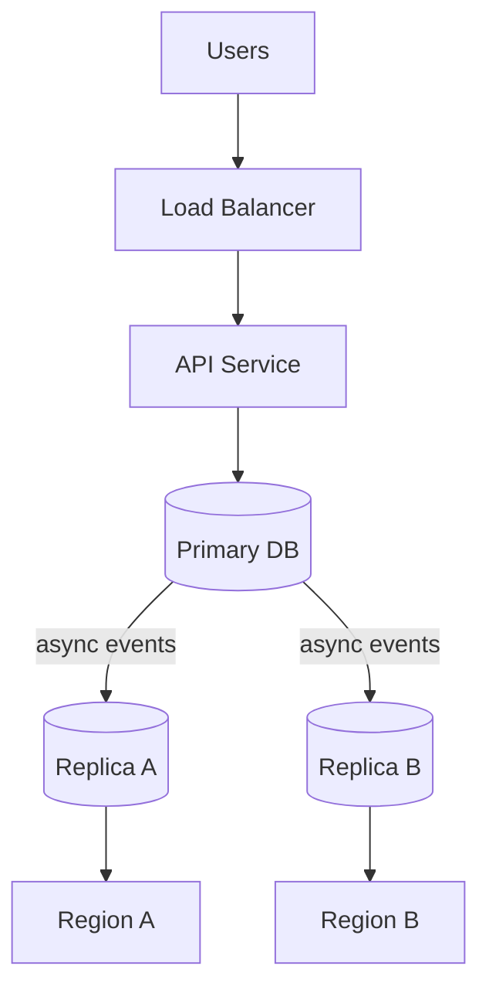
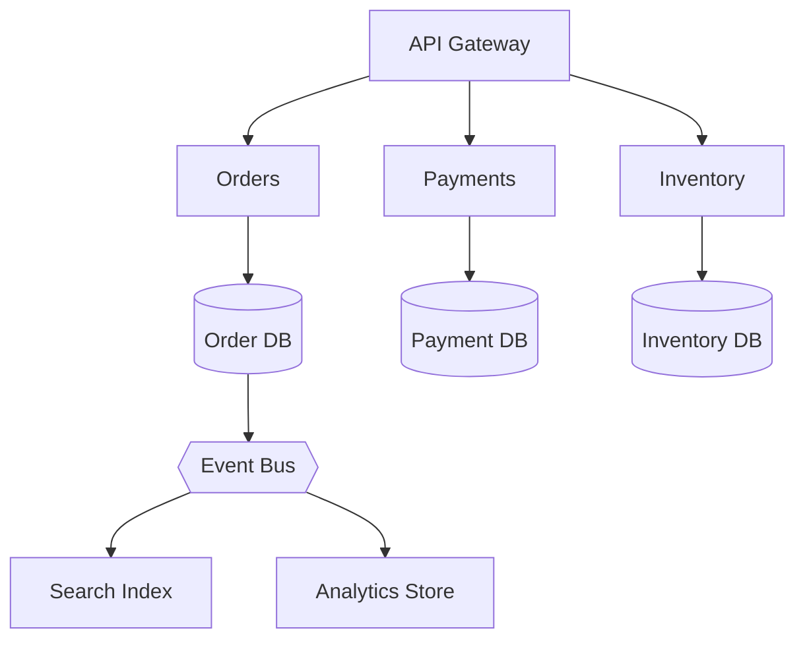
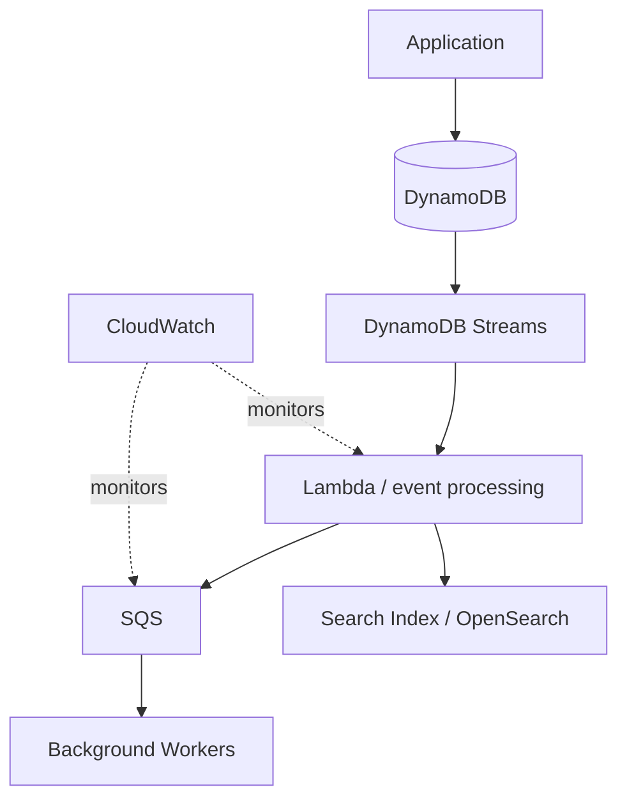

# BASE Properties in System Design

> **TL;DR:** BASE (Basically Available, Soft state, Eventual consistency) is a design philosophy for distributed systems that trades immediate consistency for availability, latency, and scale. It is a conceptual model, not a database standard, and it is not the opposite of ACID. Most real systems use both: ACID inside a service boundary, eventual consistency between services.

## Contents

1. [Overview](#1-overview)
2. [B: Basically Available](#2-b--basically-available)
3. [A: Soft State](#3-a--soft-state)
4. [S: Eventual Consistency](#4-s--eventual-consistency)
5. [BASE vs ACID vs CAP](#5-base-vs-acid-vs-cap)
6. [BASE in Microservices](#6-base-in-microservices)
7. [Choosing Strong vs Eventual Consistency](#7-choosing-strong-vs-eventual-consistency)
8. [Trade-offs](#8-trade-offs)
9. [Operating BASE Systems (SRE View)](#9-operating-base-systems-sre-view)
10. [BASE on AWS](#10-base-on-aws)
11. [Interview Q&A](#11-interview-qa)
12. [Key Takeaways](#12-key-takeaways)

---

## 1. Overview

| Letter | Property | One-line meaning |
|---|---|---|
| **B** | Basically Available | Keep serving useful responses during partial failure |
| **A** | Soft State | Observed state may change over time as updates propagate, expire, or reconcile |
| **S** | Eventual Consistency | Replicas converge if updates stop and propagation succeeds |

BASE is relevant to distributed databases, microservices, e-commerce catalogs, social feeds, CDNs, distributed caches, event-driven systems, and globally distributed apps.

> **Caveat:** BASE does not mean every operation is eventually consistent, and a BASE-oriented system can still use transactions.

### Why it matters

A merchant updates a product description in one region. Requiring every region to synchronously confirm before responding hurts latency and availability during network problems. A BASE design accepts the write locally and propagates it asynchronously.

During propagation, some users see the old value and others the new one. If updates stop and propagation completes, replicas converge. You gain responsiveness and resilience, and you pay in consistency.



*Simplified. Real systems may use multi-primary replication, partitioning, message brokers, or managed distributed databases.*

---

## 2. B: Basically Available

**Definition:** The system is designed to keep providing useful responses under failure or degraded conditions. It does **not** guarantee that every request succeeds or that every response is fresh.

**Social feed example.** If the latest-posts service is down, the platform can serve a cached feed, show previously loaded content, return partial results, disable nonessential features, or retry failed requests asynchronously.

**Product catalog example.** If the catalog DB is unreachable, show cached descriptions and images. Checkout must still verify price and inventory against authoritative data. Different operations have different requirements.

**Techniques** (general availability engineering, not BASE-exclusive): replication, load balancing, caching, failover, graceful degradation, timeouts with bounded retries, circuit breakers, bulkheads, redundant infrastructure.

| Benefits | Limitations |
|---|---|
| Better UX during partial failure | Users may see stale data |
| Less dependence on a single component | Some operations must fail safely |
| Resilience under certain network failures | Fallback behavior needs careful design |
| Can serve cached or partial results | More operational complexity |

**Takeaway:** Preserve useful functionality during failures, but separate operations that tolerate stale data from operations that need authoritative data.

---

## 3. A: Soft State

**Definition:** Observed state can change over time without a new user action, because of asynchronous updates, replication, expiration, or background processing. It does **not** mean data is temporary or that durable storage is unnecessary.

**Cache example.** A price changes from ₹1,000 to ₹900. The DB has ₹900 while some cache nodes still hold ₹1,000.

1. Invalidation event is published
2. Cache nodes receive it
3. Entries are invalidated or refreshed
4. Subsequent reads return ₹900

**Profile picture example.** The profile service stores the new image reference, then a background event updates downstream services, search indexes, and caches. Until it finishes, different parts of the app show different versions.

**Techniques:** async replication, TTL expiry, event-driven updates, background reconciliation, eventual cache invalidation, periodic refresh jobs, materialized-view updates.

| Benefits | Risks |
|---|---|
| Less synchronous coordination | Temporary disagreement between components |
| Better horizontal scaling | Stale reads, delayed visibility |
| Lower latency for some operations | Hard-to-debug distributed state |
| Tolerates temporary communication delays | Prolonged inconsistency if events are lost or processing fails |

**Takeaway:** Soft state works when temporary differences are tolerable. It needs reliable propagation, retries, monitoring, and reconciliation behind it.

---

## 4. S: Eventual Consistency

**Definition:** Replicas are expected to converge when updates stop and the system has enough time and successful communication to propagate them.

It does **not** guarantee that a read returns the latest write, and it does **not** define how concurrent conflicting writes are resolved. That depends on the database and its conflict-resolution strategy (last-write-wins, vector clocks, CRDTs, application-level merge).

**Example: catalog across regions**

```text
Before:                              After propagation:
Region A: "Wireless Headphones"      Region A: "Wireless Headphones"
Region B: "Bluetooth Headphones"     Region B: "Wireless Headphones"
Region C: "Bluetooth Headphones"     Region C: "Wireless Headphones"
```

**Simplified flow:**

1. A node accepts the write
2. Change is recorded durably per the DB's guarantees
3. Change is propagated to other replicas
4. Replicas apply it
5. Reads eventually observe the converged state

The exact sequence differs by database.

**Good fits:** social feeds, product catalogs, search indexes, recommendations, analytics dashboards, distributed caches, activity counters, multi-region replicated data.

**Poor fits** (correctness required at decision time):

- Enforcing a strict spending limit
- Claiming a unique username exactly once
- Selling the last ticket to only one customer
- Preserving a financial invariant across concurrent updates

These need conditional writes, transactions, serializable isolation, or consensus-backed coordination.

**Takeaway:** Eventual consistency is a trade-off, not a free performance boost. Use it when stale reads are acceptable and you have a sound convergence strategy.

---

## 5. BASE vs ACID vs CAP

These describe different things and are not mutually exclusive categories.

| Concept | Question it answers |
|---|---|
| **ACID** | What guarantees does a database transaction provide? |
| **BASE** | Can the system stay useful while distributed state temporarily differs? |
| **CAP** | How do consistency and availability trade off during a network partition? |
| **Eventual consistency** | Under what conditions do replicas converge? |

### ACID vs BASE

| Dimension | ACID | BASE |
|---|---|---|
| Focus | Reliable transactions, integrity | Availability-oriented behavior, flexible consistency |
| Atomicity | All-or-nothing within the transaction boundary | No equivalent global transaction guarantee |
| Consistency | Preserves defined invariants on commit | Temporary replica disagreement allowed |
| Availability | Depends on architecture and failure mode | Emphasizes useful responses during failure |
| State | Transactions update durable state | Observed state shifts as async updates land |
| Typical use | Ledgers, inventory, relational workflows | Catalogs, feeds, caches, async projections |

**Combined in practice:** an order service writes the order and an outbox event in one ACID transaction, while search indexes and analytics projections update asynchronously.

### BASE vs CAP

Suppose two regions lose connectivity.

- A system accepting writes in both regions keeps serving, but needs a conflict-resolution strategy.
- A system requiring linearizable writes rejects or delays some operations until coordination returns.

The right choice depends on the business requirement. BASE is **not** a synonym for the "A" in CAP, and CAP does not say every system must permanently sacrifice one property.

---

## 6. BASE in Microservices



The Order Service commits to its own DB and publishes an event. Search and analytics update later. This is eventual consistency between services.

### Robust implementation

1. Local ACID transaction stores the order **and** an outbox event
2. Background publisher sends the event
3. Consumers process events idempotently
4. Retries and dead-letter queues handle failures
5. Reconciliation detects and repairs missing or inconsistent projections

The **transactional outbox** keeps the DB update and the intent to publish from being lost independently. It does not turn downstream services into one global atomic transaction.

### Failure handling

If a consumer processes a message but fails before acking, the message is redelivered, so consumers must tolerate duplicates.

| Technique | Purpose |
|---|---|
| Idempotency keys | Safe retries |
| Deduplication records | Reject repeated deliveries |
| Retry policies | Recover from transient failures |
| Dead-letter queues | Isolate poison messages |
| Event versioning | Safe schema evolution |
| Consumer lag monitoring | Detect propagation delay |
| Reconciliation jobs | Repair drift |

**Takeaway:** BASE architectures depend on explicit failure handling and convergence mechanisms. Asynchrony alone does not guarantee eventual consistency.

---

## 7. Choosing Strong vs Eventual Consistency

Let business invariants decide, not performance expectations.

| Use case | Typical approach | Reason |
|---|---|---|
| Bank ledger transfer | Strong transactional | Incorrect balances must be prevented |
| Inventory reservation | Conditional writes or suitable transactions | Avoid overselling |
| Product descriptions | Eventual is usually fine | Small delays tolerable |
| Social feed | Eventual often works | Global sync not required |
| Search index | Async updates | Index can lag the source |
| Analytics dashboard | Eventual | Recent data may arrive late |
| Session or cart | Depends per field | Some fields tolerate staleness, others do not |

**Ask before choosing:**

1. Can the user tolerate stale data?
2. What happens on concurrent updates to the same record?
3. Can conflicting writes be merged or resolved?
4. Must the operation preserve a financial or inventory invariant?
5. How fast must updates become visible?
6. What if a message is lost, delayed, or delivered twice?
7. How will inconsistent state be detected and repaired?

---

## 8. Trade-offs

| Advantages | Challenges |
|---|---|
| **Availability** during partial failures (serve cached, partial, or local data) | **Stale reads** |
| **Horizontal scalability** (less synchronous coordination) | **Conflict resolution** needs explicit rules |
| **Lower latency** (no waiting on every replica) | **Operational complexity** (retries, queues, lag, duplicates, reconciliation) |
| **Geographic distribution** (regional replicas, background sync) | **Business invariants** can't tolerate inconsistent decisions |
| **Flexible architecture** (services own models, derive data async) | **Debugging difficulty** (one service succeeded, downstream hasn't caught up) |
| | **No automatic convergence**: lost updates or unresolved conflicts can block it |

---

## 9. Operating BASE Systems (SRE View)

Eventual consistency without observability is just undetected data drift. Treat convergence as an SLO.

| Signal | What to measure | Failure it catches |
|---|---|---|
| Replication lag | Time/offset behind primary per replica | Slow or stalled replication |
| Consumer lag | Kafka consumer group lag, queue age (e.g. SQS `ApproximateAgeOfOldestMessage`) | Backed-up processing |
| Propagation latency | Write timestamp to visibility in downstream store (p50/p99) | Slow convergence |
| DLQ depth and age | Messages stuck in dead-letter queues | Poison messages, bad consumers |
| Duplicate/redelivery rate | Repeated deliveries per consumer | Idempotency gaps, ack failures |
| Reconciliation drift | Count of mismatches found per run | Silent divergence |
| Stale-read rate | Reads served older than a freshness budget | Cache/replica staleness |

**Practices:**

- Define a **convergence SLO** per data class (e.g. "99% of catalog updates visible in all regions within 30s").
- Alert on **lag growth rate**, not just absolute lag.
- Run reconciliation on a schedule and alert on non-zero drift.
- Make DLQs actionable with ownership, redrive tooling, and age alerts.
- Use correlation IDs to trace a write through every async hop.
- Load-test the failure path: duplicate delivery, reordering, partition, consumer restart.

---

## 10. BASE on AWS



Components: DynamoDB (data), Streams (item changes), Lambda (processing), SQS (buffering), OpenSearch (search), CloudWatch (failures and delays).

Guarantees depend on each service's delivery, retry, ordering, and consistency behavior. DynamoDB offers both eventually consistent and strongly consistent reads in applicable configurations, and global tables' multi-region behavior depends on the selected mode and configuration. Using a distributed cloud service does **not** automatically make every operation eventually consistent.

---

## 11. Interview Q&A

**Q1. What does BASE stand for?**
Basically Available, Soft state, Eventual consistency.

**Q2. Why is BASE useful?**
It keeps services responsive and lets distributed state converge asynchronously when temporary inconsistency is acceptable.

**Q3. What is eventual consistency?**
Replicas are expected to converge if updates stop and propagation continues successfully.

**Q4. Does BASE mean a system never rejects requests?**
No. It can still reject on validation failure, resource exhaustion, authorization, or correctness requirements.

**Q5. Does eventual consistency guarantee the latest value on every read?**
No. Reads can be stale until replicas converge.

**Q6. Is BASE the opposite of ACID?**
Not strictly. ACID is transaction guarantees; BASE is a conceptual model for availability-oriented distributed behavior. A system can use both.

**Q7. How do microservices implement eventual consistency?**
Events, message brokers, async consumers, transactional outbox, retries, idempotent processing, reconciliation.

**Q8. Can eventual consistency be used in banking?**
For supporting functions like analytics and reporting, yes. Ledger operations and balance invariants need stronger guarantees.

**Q9. How does BASE relate to CAP?**
BASE is associated with designs that tolerate temporary inconsistency. CAP describes the consistency/availability trade-off during a partition.

**Q10. Biggest challenge with BASE?**
Keeping business behavior correct under stale reads, duplicate events, delayed propagation, conflicting updates, and failures.

**Q11. How do you know an eventually consistent system is actually converging?**
Measure it: replication and consumer lag, end-to-end propagation latency, DLQ age, and scheduled reconciliation drift, tied to a convergence SLO.

---

## 12. Key Takeaways

- **Basically Available:** preserve useful functionality under supported failures.
- **Soft State:** observed state changes as updates propagate.
- **Eventual Consistency:** replicas converge when updates stop and propagation succeeds.
- BASE does not remove the need for transactions, integrity constraints, or backups.
- Eventual consistency requires reliable propagation, conflict resolution, monitoring, and recovery.
- Choose consistency by business invariant, not expected performance.
- ACID locally plus eventual consistency between services is a normal combination.

> **Core principle:** Use strong transactional guarantees where correctness demands them, and asynchronous, eventually consistent propagation where the business can tolerate delayed visibility.
