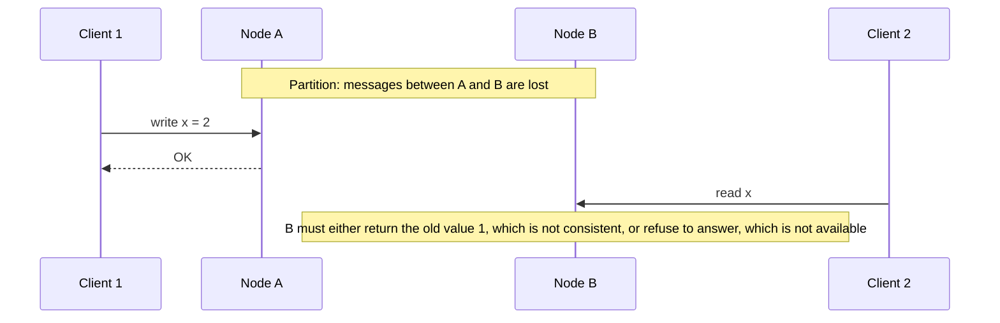
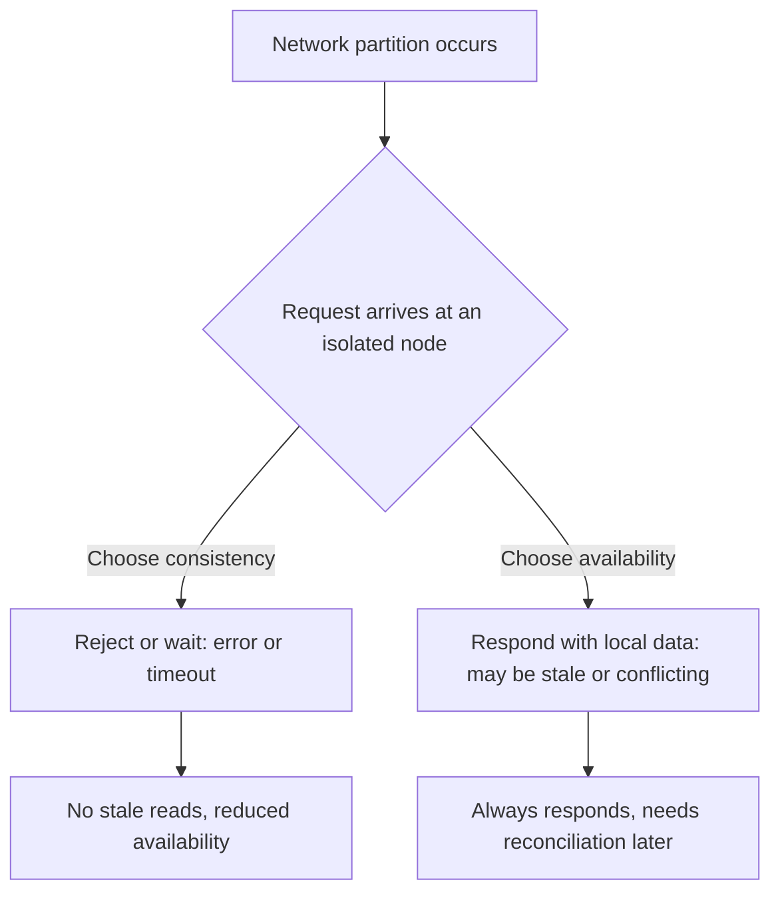

# CAP Theorem in System Design

> **Topic:** System Design Fundamentals (Distributed Data Systems)
> **Level:** Beginner to Intermediate
> **Focus:** Consistency, availability, network partitions, consistency models, PACELC, real databases, SRE implications
> **Companion guides:** [Scalability](scalability.md) · [Reliability](reliability.md) · [Latency](latency.md)
> **Last updated:** 20 October 2026

## Table of Contents

1. [What Is the CAP Theorem?](#1-what-is-the-cap-theorem)
2. [The Three Properties of CAP](#2-the-three-properties-of-cap)
3. [Why You Cannot Have All Three](#3-why-you-cannot-have-all-three)
4. [The CAP Trade-Off](#4-the-cap-trade-off)
5. [CP vs AP Systems](#5-cp-vs-ap-systems)
6. [CP vs AP: Comparison Table](#6-cp-vs-ap-comparison-table)
7. [A Step-by-Step CAP Scenario](#7-a-step-by-step-cap-scenario)
8. [Where Does CA Fit In?](#8-where-does-ca-fit-in)
9. [The Consistency Spectrum](#9-the-consistency-spectrum)
10. [Handling Partitions: Detect, Degrade, Recover](#10-handling-partitions-detect-degrade-recover)
11. [CAP in Real Databases](#11-cap-in-real-databases)
12. [CAP in AWS and Kubernetes](#12-cap-in-aws-and-kubernetes)
13. [CAP vs PACELC](#13-cap-vs-pacelc)
14. [Common CAP Misconceptions](#14-common-cap-misconceptions)
15. [How to Choose a Strategy](#15-how-to-choose-a-strategy)
16. [CAP Theorem Interview Questions](#16-cap-theorem-interview-questions)
17. [Cheat Sheet](#17-cheat-sheet)
18. [Key Takeaways](#18-key-takeaways)
19. [References](#19-references)

---

## 1. What Is the CAP Theorem?

The CAP Theorem is a fundamental result in distributed systems describing a trade-off between **consistency** and **availability** when a network partition occurs.

It was introduced as a conjecture by computer scientist Eric Brewer (PODC keynote, 2000) and formally proved by Seth Gilbert and Nancy Lynch (2002).

CAP stands for:

- **C: Consistency**
- **A: Availability**
- **P: Partition tolerance**

The central idea:

> **When a network partition occurs, a distributed system cannot guarantee both strong consistency and availability for every request. It must make a trade-off.**

Let's define each property precisely before exploring the trade-offs, because much confusion about CAP comes from using these words loosely.

## 2. The Three Properties of CAP

### 2.1 Consistency (C)

In CAP, consistency means that every successful read behaves as if it accessed the **most recent successful write**, according to a single, globally consistent order of operations. This property is called **linearizability** (or atomic consistency).

In simple terms, users should never receive outdated data after a successful update.

**Example: Bank account balance**

Your account holds ₹10,000. You transfer ₹2,000 to another account, and the new balance is ₹8,000.

A strongly consistent system must not return the old ₹10,000 balance from any replica after the transfer has completed.

This matters for:

- Bank transfers.
- Inventory reservations.
- Account balance updates.
- Unique username allocation.
- Distributed locking and leader election.

Strong consistency can require a system to delay or reject some requests if it cannot safely establish the latest value.

> **Important:** CAP consistency is **not** the "C" in ACID. ACID consistency means a transaction moves the database from one valid state to another (preserving invariants such as constraints). CAP consistency is about the **recency and ordering of reads and writes across replicas**. They are different concepts that happen to share a name.

### 2.2 Availability (A)

In CAP, availability means that **every request received by a non-failing node must eventually receive a response** (a non-error response), even if that response does not reflect the latest write.

Two details trip people up:

- It applies to **every** non-failing node, not just to "most of the system." A node that is alive but cut off from the others must still answer.
- CAP's availability is a binary guarantee about responses under the model's conditions. It is **not** the same as an availability SLO such as 99.99% uptime. A system can have excellent uptime and still not be "available" in CAP's sense during a partition (because some nodes refuse to answer), and vice versa.

**Example: Social media likes**

An application has two servers, Server A in Chennai and Server B in London. A network problem prevents them from communicating.

A user likes a post on Server A. Another user requests the like count from Server B.

An availability-focused design lets Server B answer from its local data, even though the count has not yet been updated. The application stays responsive, but the data is temporarily stale.

### 2.3 Partition Tolerance (P)

A network partition occurs when nodes cannot communicate because of network failures, dropped messages, routing problems, or similar issues. The network is allowed to lose arbitrarily many messages between nodes.

Partition tolerance means the system continues to operate (according to its design) despite such communication failures.

**Example: Two data centers**

```text
   +-----------------+                      +-----------------+
   |   Chennai       |                      |    London       |
   |   Server A      |  ---- X X X ----     |    Server B     |
   +-----------------+   network partition  +-----------------+
                         (updates cannot
                          be exchanged)
```

While communication is unavailable, the system must decide:

- Reject or delay some operations to preserve consistency, **or**
- Keep responding locally, potentially returning stale data or accepting conflicting updates.

This is where the CAP trade-off becomes important.

### 2.4 A timeout is a partition decision

A node cannot distinguish between "the other node is down," "the network is cut," and "the other node is just very slow." Every system resolves this with a **timeout**. When the timeout fires, the node must act as if a partition has occurred and choose consistency or availability.

So in practice, CAP applies not only to clean network splits but to **any severe slowdown**. A congested link with 30-second latency forces the same decision as a cable cut.

## 3. Why You Cannot Have All Three

The proof is simple and worth knowing for interviews. Take two nodes, A and B, each holding a copy of a value `x` (initially `1`).



When the partition occurs:

1. Client 1 writes `x = 2` to node A, and A acknowledges.
2. Client 2 then reads `x` from node B.
3. B has no way to learn about the write, because the network between A and B is cut.
4. B has only two options:
   - **Return `1`:** B answered (availability), but returned stale data (violating linearizability).
   - **Refuse or wait:** B preserves consistency, but fails to respond (violating availability).

There is no third option. Because partitions are possible in any real network, a distributed system **cannot guarantee both** for every request.

## 4. The CAP Trade-Off



### Partition tolerance is not optional

A common misreading of CAP is "pick any two of three." That framing is misleading, because in a distributed system **you do not get to choose whether partitions happen**. Networks fail. The real choice is:

> **When a partition happens, do you sacrifice consistency or availability?**

Brewer himself later described the "two out of three" framing as misleading, and noted that the choice is not binary or global: it can vary by operation, by data item, and by the user.

### In normal operation, you can have both

When there is no partition, a system can provide both strong consistency and availability, since nodes communicate successfully. The trade-off applies **only during the partition** (plus a related latency cost in normal operation; see [PACELC in Section 13](#13-cap-vs-pacelc)).

## 5. CP vs AP Systems

The two commonly discussed choices during a partition are CP and AP.

### 5.1 CP: Consistency and Partition Tolerance

A CP-oriented design preserves consistency during a partition, even if that means refusing or delaying some requests.

**Example: Inventory reservation**

An online store has one item remaining. Two customers try to buy it at the same time, but the servers are separated by a partition.

If both servers independently confirm the purchase, the store sells an item it does not have.

A CP-oriented design refuses a reservation on the isolated side until it can safely determine whether the item is still available.

Advantages:

- Reduces conflicting writes.
- Helps prevent overselling and duplicate allocation.
- Suits operations that need a single authoritative result.

Disadvantages:

- Some requests fail or wait during a partition.
- Users may experience temporary unavailability.

**Typical use cases:** distributed coordination and locks, leader election, metadata and configuration stores, and operations that require strongly consistent decisions.

### 5.2 AP: Availability and Partition Tolerance

An AP-oriented design continues responding during a partition, accepting that some replicas may temporarily disagree.

**Example: Social media reactions**

A user likes a post on one server while another is unreachable. The available server accepts the like and updates its local count. The other server may temporarily show an older count. After communication is restored, the system reconciles the updates.

Advantages:

- More requests succeed during partitions.
- Local operations stay responsive.
- Useful for globally distributed applications.

Disadvantages:

- Users may temporarily see stale data.
- Concurrent updates require reconciliation.
- Some operations are harder to implement safely.

**Typical use cases:** certain distributed caches, activity feeds, shopping carts, counters, and systems that tolerate temporary inconsistency.

AP does not mean data can never become consistent. Many AP-oriented designs aim for **eventual consistency**: if no new updates occur, replicas converge to the same value after updates have propagated.

## 6. CP vs AP: Comparison Table

| Feature | CP-oriented design | AP-oriented design |
|---|---|---|
| Behavior during a partition | May reject or delay requests | Continues responding where possible |
| Consistency | Preserves strong consistency for supported operations | May temporarily expose stale or conflicting data |
| Availability during a partition | May be reduced (for example, the minority side) | Prioritized |
| Reconciliation | Usually not needed for conflicting writes | Often needed for conflicting updates |
| Example use case | Preventing duplicate resource allocation | Keeping an activity feed responsive |
| Main risk | Requests become unavailable | Users may see temporarily inconsistent data |
| Typical mechanisms | Consensus (Raft, Paxos), quorum writes, leader-based replication | Multi-writer replication, hinted handoff, conflict resolution, CRDTs |

These labels are simplifications. Actual behavior depends on the operation, configuration, replication protocol, failure mode, and consistency settings.

## 7. A Step-by-Step CAP Scenario

A distributed banking application has two replicas:

- **Replica A** in Chennai and **Replica B** in London.
- Initial balance: ₹10,000.
- A network partition prevents the replicas from communicating.

During the partition, two requests arrive at the same time: a withdrawal of ₹8,000 at Replica A and another withdrawal of ₹8,000 at Replica B (for example, the customer uses a card and an app).

| Step | CP strategy | AP strategy |
|---|---|---|
| Request at A (₹8,000) | A cannot confirm it has the latest shared balance with a quorum, so it rejects or delays the request | A processes it from local state: balance becomes ₹2,000 |
| Request at B (₹8,000) | Same: B rejects or delays | B also processes it from local state: balance becomes ₹2,000 |
| Outcome during partition | Strong consistency preserved, but both withdrawals are unavailable | Both withdrawals succeed, and both customers are happy |
| After the partition heals | Normal operation resumes | Balances are merged: `10,000 − 8,000 − 8,000 = −6,000`, so the account is overdrawn |

The AP result is a **double spend**. Naively accepting conflicting balance updates is unsafe for money.

<details>
<summary><strong>How do real banks cope? (click to expand)</strong></summary>

Real financial systems often combine both approaches rather than picking one extreme:

- **Core ledger writes:** CP-oriented, with strongly consistent, quorum-based or single-leader transactions.
- **Stand-in processing with limits:** when a card network or branch cannot reach the core system, it may approve small amounts under a per-transaction and per-day cap, accepting bounded risk.
- **Reconciliation and compensation:** conflicts discovered later are fixed with business processes: overdraft fees, holds, reversals, or refunds.

The general lesson is that availability can sometimes be preserved **safely** by bounding the damage a conflict can cause, and by having a business-level recovery mechanism.

</details>

The lesson is not that one strategy is always better. It is that designers must understand which guarantees each operation needs and what a violation costs.

## 8. Where Does CA Fit In?

"CA" means consistency and availability without tolerating network partitions.

A single-node database can provide consistent and available operations while healthy because there is no replication link between nodes to partition. But a single node is a single point of failure.

In a genuinely distributed system, partitions are possible, so a design cannot guarantee both consistency and availability through every partition. Therefore:

- "CA" is best understood as a design that **assumes partitions do not occur**, or as a description of behavior under normal conditions.
- It is not a realistic guarantee for a multi-node system under arbitrary network failures.

When someone says "this database is CA," ask: *what happens when two nodes cannot talk?* The answer will reveal whether it behaves as CP, AP, or simply stops working.

## 9. The Consistency Spectrum

CAP's "consistency" is the strongest end of a spectrum. Many practical systems offer **weaker but useful** guarantees that stay available during partitions.

| Model | Guarantee | Available during a partition? |
|---|---|---|
| **Linearizable** | Behaves like a single copy; every read sees the latest completed write | No (this is the C in CAP) |
| **Sequential** | All nodes see operations in the same order, but not necessarily in real time | Generally no |
| **Causal** | Causally related operations are seen in order everywhere (a reply never appears before the post it answers) | Generally yes; often cited as the strongest model that can remain available |
| **Read-your-writes** | A client sees its own previous writes | Yes, with session routing or tracking |
| **Monotonic reads** | A client never sees data go backward in time | Yes, with session routing or tracking |
| **Eventual** | Replicas converge if updates stop | Yes |

Two clarifications:

- **Linearizability is not serializability.** Linearizability is about the recency of reads and writes of a **single object**. Serializability is about **multi-object transactions** behaving as if run one at a time. A database can offer one without the other, and offering both is called strict serializability.
- Many user-visible problems are fixed by **session guarantees** (read-your-writes, monotonic reads), which are cheap compared with full linearizability. For example, after updating a profile, you should see your own change immediately, even if other users see it slightly later.

### Tunable consistency with quorums

Many replicated stores let you tune consistency per operation using quorum sizes. With `N` replicas, a write acknowledged by `W` replicas, and a read consulting `R` replicas, setting `W + R > N` makes read and write quorums overlap, so reads see the latest acknowledged write (subject to caveats). For example, with `N = 3`:

| Setting | Behavior |
|---|---|
| `W = 3, R = 1` | Strong reads, but writes need all replicas up (less write availability) |
| `W = 2, R = 2` | Overlapping quorums; tolerates one replica failure for reads and writes |
| `W = 1, R = 1` | Fast and highly available, but reads can be stale |

See [Reliability, Section 11](reliability.md#112-tunable-quorums-in-leaderless-systems) for quorum details. The point for CAP is that **the trade-off is a dial, not a switch**.

## 10. Handling Partitions: Detect, Degrade, Recover

Brewer's later guidance reframed CAP as an engineering process: detect the partition, enter a limited mode, then recover. Designing for partitions means planning all three stages.

### 10.1 Detect

Use timeouts, heartbeats, and quorum membership to determine that a node is isolated. Tune carefully: too sensitive causes false partitions and unnecessary degradation; too slow prolongs bad behavior (see [Reliability, Section 16](reliability.md#16-failure-detection-and-health-checks)).

### 10.2 Degrade deliberately

Decide in advance, **per operation**, what the system does during a partition:

- Reject writes that could cause unsafe conflicts, but allow reads (possibly flagged as potentially stale).
- Allow operations that are safe to merge (adding to a cart, incrementing a counter).
- Accept risky operations only within bounded limits (stand-in limits, reservation quotas).
- Tell users clearly when data may be stale or an action is pending.

### 10.3 Recover and reconcile

When the partition heals, replicas must converge. Strategies:

| Strategy | How it works | Trade-off |
|---|---|---|
| **Last-write-wins (LWW)** | Keep the update with the latest timestamp | Simple, but **silently discards** concurrent writes and depends on clock accuracy (clock skew can pick the wrong "latest") |
| **Version vectors / vector clocks** | Track causal history to detect truly concurrent writes, then keep both versions ("siblings") | Detects conflicts accurately; the application must resolve them |
| **CRDTs** | Data types designed so concurrent updates merge automatically and deterministically | No coordination needed; limited to data structures that can be expressed this way |
| **Application-level merge** | Domain-specific logic (for example, union of cart items) | Correct for the domain; requires custom code |
| **Compensation** | Fix conflicts afterward with business actions (refund, apology, reversal) | Works when conflicts are rare and reversible |

### 10.4 Example: a CRDT counter for likes

A **G-Counter** (grow-only counter) shows how convergence works without coordination. Each replica keeps its own count, keyed by replica ID. The value is the **sum** across replicas. To merge, take the **per-replica maximum**.

| Moment | Replica A state | Replica B state | Visible total |
|---|---|---|---|
| Start | `{A: 0, B: 0}` | `{A: 0, B: 0}` | 0 |
| Partition: 3 likes at A, 2 at B | `{A: 3, B: 0}` | `{A: 0, B: 2}` | A sees 3, B sees 2 |
| Partition heals, states merged (max per replica) | `{A: 3, B: 2}` | `{A: 3, B: 2}` | **5** on both |

No likes are lost, no matter the order or number of merges, and merging is safe to repeat. Supporting decrements requires a PN-Counter (two G-Counters). This is why counters and sets are standard CRDT examples, and why likes are a good AP use case while account balances are not.

## 11. CAP in Real Databases

CAP categories should not be treated as permanent labels. A database may offer different guarantees for different operations and configurations. Kleppmann's essay *Please stop calling databases CP or AP* makes this point forcefully.

| System | Important considerations |
|---|---|
| **Apache Cassandra** | Tunable per-query consistency levels (for example `ONE`, `QUORUM`, `LOCAL_QUORUM`, `ALL`). Quorum reads and writes (`W + R > N`) give stronger recency; lightweight transactions provide linearizable operations for specific cases. Behavior depends on configuration and failure conditions. |
| **Amazon DynamoDB** | Strongly consistent reads are available for supported operations (not on global secondary indexes, and not across regions in global tables); eventually consistent reads are the default. Global tables replicate across regions with their own conflict-resolution behavior. |
| **MongoDB** | Replica-set elections, write concern (for example `w: "majority"`), and read concern settings affect behavior during failures. During an election there is no primary, so writes are briefly unavailable. |
| **etcd** | Uses Raft consensus for strongly consistent replicated state; losing quorum prevents writes from committing. Linearizable reads are the default; serializable (possibly stale) reads can be requested for lower latency. |
| **Apache ZooKeeper** | Writes are linearizable through a quorum-based protocol; reads served by a follower can be stale unless a sync is issued. Loses write availability without a quorum. |
| **Google Spanner** | Provides external consistency (strong consistency across regions) using synchronized clocks. Technically consistency-prioritizing during partitions, with very high availability in practice due to engineering of the underlying network and replication. |

For interviews, explain the guarantees of the **specific operation and configuration** rather than memorizing a database as "CP" or "AP."

## 12. CAP in AWS and Kubernetes

### 12.1 AWS distributed architecture

Consider an application running across multiple Availability Zones. If the network between parts of the application becomes unreliable, the design must determine which operations can continue independently and which require a consistent shared decision.

Examples:

- A product catalog can often tolerate a short period of stale data.
- A payment authorization needs safeguards against conflicting decisions.
- A distributed lock must prevent multiple workers from owning the same exclusive resource.
- An asynchronous notification can be retried without requiring every consumer to see updates immediately.

AWS services have their own documented consistency and availability behavior. CAP is a framework for understanding design trade-offs, not a substitute for reading each service's documentation.

### 12.2 Kubernetes and etcd

Kubernetes stores cluster state in etcd, which uses Raft consensus to maintain a consistent view of that state. If the etcd cluster loses quorum, it cannot commit updates safely.

| etcd members | Majority required | Failures tolerated |
|---:|---:|---:|
| 1 | 1 | 0 |
| 3 | 2 | 1 |
| 5 | 3 | 2 |

For example, if a three-member etcd cluster loses communication with two members, the remaining member cannot form a majority, and writes become unavailable until quorum is restored.

This is an intentional CP trade-off: preserving a consistent cluster state is considered more important than accepting conflicting updates. In practice:

- Already-running Pods generally keep running, because the kubelet on each node continues operating with its last known state.
- Changes that require API writes (deployments, scaling, scheduling new Pods) cannot proceed.

**SRE takeaway:** monitor etcd quorum health, member latency, disk performance (etcd is sensitive to slow disks), and network connectivity, and rehearse recovery procedures. See [Reliability, Section 11](reliability.md#111-majority-quorums) for the quorum math.

## 13. CAP vs PACELC

CAP describes the consistency-availability trade-off **during network partitions**. PACELC (Daniel Abadi, 2010) extends the discussion to what happens when there is **no** partition.

- **P:** If there is a Partition,
- **A or C:** choose between Availability and Consistency;
- **E:** Else, when the system is running normally,
- **L or C:** choose between Latency and Consistency.

Even without failures, waiting for replication or coordination increases latency. For example, a strongly consistent write replicated synchronously across regions must wait for at least one cross-region round trip (tens to well over a hundred milliseconds depending on distance; see [Latency, Section 5](latency.md#5-latency-numbers-worth-knowing)).

Systems are often classified like this (as general tendencies, since configuration can change behavior):

| Classification | Meaning | Typical examples |
|---|---|---|
| **PA/EL** | Favors availability in a partition and low latency otherwise | Dynamo-style stores with default settings |
| **PC/EC** | Favors consistency in both situations | Consensus-backed stores, Spanner-like systems |
| **PA/EC** | Available in a partition, but consistent when healthy | Some leader-based replicated databases under default settings |
| **PC/EL** | Consistent in a partition, but low latency otherwise | Less common |

PACELC explains why database design involves more than a CAP label: **strong consistency costs latency every day, not just during failures.**

## 14. Common CAP Misconceptions

**Misconception 1: "Every system must pick two of three, permanently."**

Correction: Partitions are not a choice. The trade-off applies when a partition occurs, and normal-operation behavior can be different.

**Misconception 2: "Consistency means ACID consistency."**

Correction: CAP consistency is linearizability: a strong view of recency and ordering. ACID consistency concerns preserving database-defined invariants across transactions.

**Misconception 3: "AP systems never become consistent."**

Correction: Many AP-oriented systems converge through replication and reconciliation after communication is restored.

**Misconception 4: "CP systems reject every request during a partition."**

Correction: Availability depends on which nodes remain reachable, whether a quorum is available, and the operation. A majority partition in a consensus system continues serving requests, while the minority side cannot.

**Misconception 5: "Every database is completely CP or completely AP."**

Correction: Real systems have multiple consistency levels and operation-specific behavior. A single label rarely captures them.

**Misconception 6: "CAP tells us which database is best."**

Correction: CAP explains one fundamental trade-off. Choosing a database also involves workload, latency, durability, recovery, cost, and operational complexity.

**Misconception 7: "CAP availability is the same as high availability."**

Correction: CAP availability requires every non-failing node to answer. A system with 99.99% uptime may still refuse requests on a partitioned minority side, and a system that answers everywhere may return wrong data.

**Misconception 8: "Partitions are rare, so CAP does not matter."**

Correction: Partitions include long delays, overloaded links, misconfigured firewalls, and failed switches. Even if rare, the system's behavior during one must be defined in advance, and the latency-consistency trade-off (PACELC) applies all the time.

## 15. How to Choose a Strategy

Use these questions when designing a distributed system:

1. What happens if two replicas receive conflicting updates?
2. Can the application tolerate stale reads, and for how long?
3. Is it acceptable to reject requests temporarily?
4. Does the operation involve money, inventory, identity, or exclusive ownership?
5. Can conflicting changes be reconciled safely (or compensated later)?
6. What happens if the system loses quorum?
7. How much additional latency is acceptable for stronger guarantees?
8. What should users see during degradation?

A practical rule of thumb:

- **Favor strong consistency** when incorrect or conflicting decisions could violate important business rules.
- **Favor availability with eventual convergence** when responsiveness matters more and temporary inconsistency is acceptable.
- **Design per operation** rather than forcing the same requirement onto every feature.

### Per-operation examples

| Operation | Typical choice | Why | Degraded behavior |
|---|---|---|---|
| Account balance debit | Consistency | Double spend is costly | Reject or queue when quorum is unavailable |
| Inventory reservation (scarce item) | Consistency | Overselling is costly | Show "try again" on the isolated side |
| Inventory reservation (abundant item) | Availability with limits | Slight oversell is cheap to fix | Accept orders, reconcile and backorder |
| Unique username or ID | Consistency | Uniqueness needs a single authority | Reject sign-up temporarily |
| Product catalog read | Availability | Stale data is harmless | Serve cached or replica data |
| Shopping cart | Availability | Merge by union is safe | Accept edits, merge later |
| Like or view counters | Availability | Approximate is fine; CRDT merges safely | Accept increments locally |
| Leader election, locks | Consistency | Two leaders is dangerous | Minority side stops acting as leader |
| User profile edit | Read-your-writes | The user must see their own change | Route the session to a consistent replica |
| Feed or timeline | Availability, causal order | Fresh is nice; ordering matters | Serve slightly stale feed |

This ties back to scalability: relaxing consistency reduces coordination, which is what lets systems scale (see [Scalability, Section 27](scalability.md#27-the-cap-theorem-and-scalability) and [Reliability, Section 20.4](reliability.md#204-consistency-trade-offs)).

## 16. CAP Theorem Interview Questions

### Beginner

**Q1. Explain CAP in simple terms.**

When a network partition occurs in a distributed system, it cannot guarantee both strong consistency and availability for every request. The system must make a trade-off.

**Q2. What is the difference between CP and AP?**

A CP-oriented design may reject or delay requests to preserve consistency during a partition. An AP-oriented design prioritizes responding to requests, potentially returning stale data or accepting updates that require reconciliation.

**Q3. Why is partition tolerance important?**

Distributed systems communicate over networks, and networks can fail. If a system spans multiple nodes or data centers, it must define its behavior when they cannot communicate. You do not get to opt out of partitions.

**Q4. Is a single-node database CA?**

It can provide consistency and availability while healthy, since there is no distributed link to partition. But it can still fail, and it does not provide the fault tolerance of a replicated system.

### Intermediate

**Q5. Why can't a system have all three properties during a partition?**

Take two nodes with a copy of `x`. During a partition, a write to one node cannot reach the other. A read at the second node must either return the stale value (violating consistency) or refuse to answer (violating availability).

**Q6. Why might etcd reject writes when quorum is lost?**

etcd uses Raft consensus to maintain strongly consistent replicated state. Without a majority, it cannot safely commit new state changes, so it sacrifices write availability to avoid conflicting updates.

**Q7. How does CAP affect an e-commerce application?**

Inventory reservation of scarce items and payment authorization may need strong consistency to avoid overselling or conflicting transactions. Product descriptions, recommendations, carts, and counters can tolerate short-lived staleness and be merged later.

**Q8. What is the relationship between CAP and eventual consistency?**

AP-oriented designs allow replicas to diverge during a partition and reconcile later. Eventual consistency is a convergence property: replicas end up identical if updates stop. It does not by itself say how conflicts are resolved.

**Q9. What is the difference between CAP and PACELC?**

CAP covers the consistency-availability trade-off during a partition. PACELC adds the latency-consistency trade-off during normal operation.

**Q10. Is CAP "consistency" the same as ACID "consistency"?**

No. CAP consistency is linearizability: reads reflect the latest write across replicas. ACID consistency means a transaction preserves database invariants.

### Advanced

**Q11. How would you handle concurrent writes to the same key in an AP system?**

Detect concurrency with version vectors, then resolve with application-specific merge logic, a CRDT, or (with caution) last-write-wins, which can silently drop updates and depends on clock accuracy. For some domains, accept the conflict and compensate afterward.

**Q12. Is MongoDB CP or AP?**

It depends on configuration. With majority write concern and appropriate read concern, it favors consistency, and there is no writable primary during an election. With weaker settings it can acknowledge writes that may later be rolled back. The honest answer is to describe the behavior for a given configuration, not assign a label.

**Q13. What's the difference between linearizability and serializability?**

Linearizability concerns the recency of operations on a single object, as if there were one copy. Serializability concerns multi-object transactions behaving as if executed one at a time. Strict serializability provides both.

**Q14. How is CAP availability different from an availability SLO?**

CAP availability requires every non-failing node to return a response. An SLO measures the fraction of successful requests or uptime. A system can meet a high SLO while being "unavailable" in CAP's sense on a partitioned minority, and a system answering everywhere can still violate correctness.

**Q15. Design a likes counter that stays available during partitions.**

Use a CRDT counter: each replica increments its own slot, the total is the sum, and merging takes the per-replica maximum. Concurrent increments never conflict and no like is lost. Display may lag slightly, which is acceptable for this use case.

**Q16. How would you design an inventory system for a flash sale?**

For scarce stock, use a strongly consistent reservation (single authoritative counter or consensus-backed store, with atomic decrement) and accept reduced availability for that path during a partition. Queue purchase intents to smooth load. For non-scarce items, accept orders with limits and reconcile with backorders.

**Q17. What does a partition look like in practice?**

A cable cut or switch failure, but also a misconfigured firewall rule, an overloaded link with extreme latency, a long garbage-collection pause, or a crashed leader. Since nodes cannot distinguish a slow peer from a dead one, timeouts effectively define when the system treats a peer as partitioned.

**Q18. How does the etcd cluster size relate to partition behavior?**

A cluster of `n` members needs a majority (`⌊n/2⌋ + 1`) to commit writes. Three members tolerate one failure and five tolerate two. Even sizes add cost without extra tolerance, so odd sizes are used.

## 17. Cheat Sheet

| Concept | Remember |
|---|---|
| CAP | During a partition, choose consistency or availability |
| Consistency (C) | Linearizability: reads see the latest write |
| Availability (A) | Every non-failing node answers, not necessarily with fresh data |
| Partition tolerance (P) | Operate despite lost messages; not optional in distributed systems |
| CP | Reject or wait to stay consistent |
| AP | Answer from local data and reconcile later |
| CA | Only meaningful if no partitions (single node or assumption) |
| Proof in one line | Write on one side of a partition, read on the other: stale or silent |
| Timeout | A partition decision: nodes cannot tell slow from dead |
| PACELC | If partition: A or C; else: latency or consistency |
| Linearizable vs serializable | Single-object recency vs multi-object transaction isolation |
| Weaker useful models | Causal, read-your-writes, monotonic reads, eventual |
| Quorum rule | `W + R > N` gives overlapping read and write quorums |
| Majority quorum | `⌊n/2⌋ + 1`; 3 nodes tolerate 1, 5 tolerate 2 |
| Reconciliation | LWW, version vectors, CRDTs, app merge, compensation |
| CRDT G-Counter | Per-replica slot, sum to read, max to merge |
| ACID "C" vs CAP "C" | Invariants vs replica recency; different things |
| Design rule | Decide per operation, plan to detect, degrade, recover |

## 18. Key Takeaways

1. CAP stands for Consistency, Availability, and Partition tolerance, and the critical trade-off occurs **during a network partition**.
2. Partitions are not optional in distributed systems, so the real choice is consistency or availability when one happens.
3. CAP consistency is linearizability, not ACID consistency, and CAP availability is not the same as an uptime SLO.
4. CP-oriented designs sacrifice availability (for some requests) to preserve consistency; AP-oriented designs sacrifice immediate consistency to keep responding.
5. A timeout is effectively a partition decision, so CAP applies to severe slowdowns as well as clean network splits.
6. Consistency is a spectrum; session guarantees and causal consistency solve many practical problems while staying available.
7. Design partition handling explicitly: detect, degrade deliberately, then recover and reconcile (LWW, version vectors, CRDTs, merge logic, compensation).
8. Real databases offer tunable, operation-specific guarantees; describe the behavior, not a label.
9. PACELC adds that strong consistency also costs latency in normal operation.
10. Decide per operation, based on the business cost of stale or conflicting data versus unavailability.

**Remember:** CAP is not about choosing the two best letters. It is about deciding what your system must guarantee, operation by operation, when parts of the distributed system cannot communicate.

## 19. References

1. Eric A. Brewer, "Towards Robust Distributed Systems," PODC keynote, 2000.
2. Seth Gilbert and Nancy Lynch, "Brewer's Conjecture and the Feasibility of Consistent, Available, Partition-Tolerant Web Services," *SIGACT News*, 2002.
3. Eric Brewer, "CAP Twelve Years Later: How the 'Rules' Have Changed," *IEEE Computer*, 2012.
4. Daniel Abadi, "Consistency Tradeoffs in Modern Distributed Database System Design," *IEEE Computer*, 2012 (PACELC).
5. Martin Kleppmann, [Please stop calling databases CP or AP](https://martin.kleppmann.com/2015/05/11/please-stop-calling-databases-cp-or-ap.html), 2015.
6. Martin Kleppmann, *Designing Data-Intensive Applications*, O'Reilly Media (chapters on replication, consistency, and consensus).
7. Marc Shapiro et al., "Conflict-free Replicated Data Types," 2011.
8. Diego Ongaro and John Ousterhout, "In Search of an Understandable Consensus Algorithm" (Raft), 2014.
9. [Amazon DynamoDB read consistency](https://docs.aws.amazon.com/amazondynamodb/latest/developerguide/HowItWorks.ReadConsistency.html).
10. [etcd documentation](https://etcd.io/docs/).
11. [MongoDB write concern](https://www.mongodb.com/docs/manual/reference/write-concern/).

---

*Last updated: 20 October 2026*

*Suggested repository path: `01-fundamentals/cap-theorem.md`*
