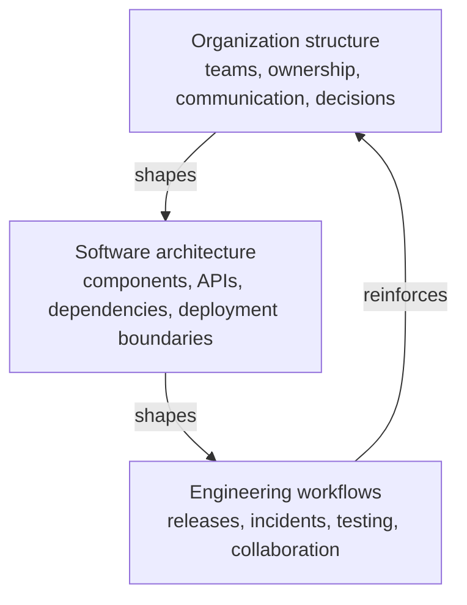
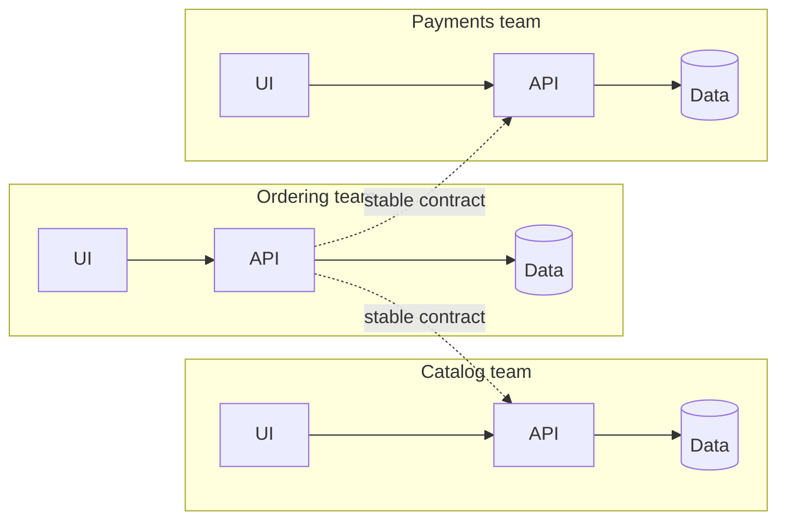
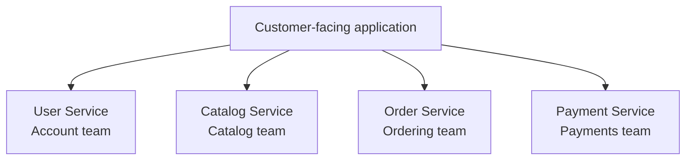

# Conway's Law in System Design

> **Topic:** System Design Fundamentals (Team and Organizational Design)
> **Level:** Beginner to Intermediate
> **Focus:** Team boundaries, service boundaries, ownership, the Inverse Conway Maneuver, platform engineering, SRE
> **Companion guides:** [Brooks's Law](brooks-law.md) · [Scalability](scalability.md) · [Reliability](reliability.md)
> **Last updated:** 20 October 2026

## Table of Contents

1. [What Is Conway's Law?](#1-what-is-conways-law)
2. [Origin and the Original Idea](#2-origin-and-the-original-idea)
3. [Why Does Conway's Law Matter?](#3-why-does-conways-law-matter)
4. [How Organizational Structure Influences Architecture](#4-how-organizational-structure-influences-architecture)
5. [Communication Structure Is Not the Org Chart](#5-communication-structure-is-not-the-org-chart)
6. [Evidence for the Mirroring Hypothesis](#6-evidence-for-the-mirroring-hypothesis)
7. [Example: E-Commerce System](#7-example-e-commerce-system)
8. [Finding Boundaries: Bounded Contexts and Data Ownership](#8-finding-boundaries-bounded-contexts-and-data-ownership)
9. [Conway's Law and Microservices](#9-conways-law-and-microservices)
10. [The Inverse Conway Maneuver](#10-the-inverse-conway-maneuver)
11. [Team Topologies and Cognitive Load](#11-team-topologies-and-cognitive-load)
12. [Common Organizational Anti-Patterns](#12-common-organizational-anti-patterns)
13. [Detecting Conway Problems in Your Codebase](#13-detecting-conway-problems-in-your-codebase)
14. [Conway's Law in SRE and Platform Engineering](#14-conways-law-in-sre-and-platform-engineering)
15. [Conway's Law and Kubernetes](#15-conways-law-and-kubernetes)
16. [Modernizing a Legacy System](#16-modernizing-a-legacy-system)
17. [Conway's Law and Brooks's Law](#17-conways-law-and-brookss-law)
18. [When Conway's Law Can Be Useful](#18-when-conways-law-can-be-useful)
19. [Practical Checklist for System Designers](#19-practical-checklist-for-system-designers)
20. [System Design Interview Questions](#20-system-design-interview-questions)
21. [Cheat Sheet](#21-cheat-sheet)
22. [Key Takeaways](#22-key-takeaways)
23. [References](#23-references)

---

## 1. What Is Conway's Law?

Conway's Law is an observation by computer programmer Melvin E. Conway about the relationship between organizations and the systems they build. In his words:

> Organizations which design systems (in the broad sense used here) are constrained to produce designs which are copies of the communication structures of these organizations.

In simple terms, **the architecture of a software system tends to mirror the communication structure of the organization that builds it.**

How teams communicate, share responsibilities, make decisions, and coordinate their work influences how software components are divided and how those components interact.

### A simple example

A company has three engineering teams:

- Team A manages user accounts.
- Team B manages payments.
- Team C manages notifications.

If each team has separate ownership, responsibilities, and deployment processes, the application tends to evolve into three distinct services:

- User Service
- Payment Service
- Notification Service

The boundaries between these services reflect the boundaries between the teams. This is Conway's Law in action.

A well-known joke from the *Jargon File* captures it: if four groups work on a compiler, you will get a four-pass compiler.

### What it is not

Conway's Law is an **observation about organizational influence**, not a rule that every team must have its own microservice, and not a law of physics. It describes a strong tendency and a constraint that you can recognize and work with, or ignore at your peril.

## 2. Origin and the Original Idea

Conway wrote the paper *How Do Committees Invent?* in 1967 and it was published in *Datamation* in April 1968. The name "Conway's Law" came later: Fred Brooks cited the idea in *The Mythical Man-Month* (1975) and gave it that name (see [Brooks's Law](brooks-law.md)).

Several points from the original paper are often overlooked:

- **The reasoning is about coordination.** To design interfaces between two parts of a system, the people designing them must communicate. Where communication is easy, interfaces can be rich and flexible; where it is hard, interfaces become narrow, rigid, or avoided.
- **The first design is rarely the best, but the team structure locks it in early.** The moment an organization splits into teams to design a system, certain design decisions have effectively been made. Reorganizing is costly, so the structure outlives the moment when it made sense.
- **Large organizations tend to fragment designs.** The more people involved, the more the design is divided along communication lines rather than along the most natural technical boundaries.
- **Flexibility matters.** Conway argued for organizations that can change their structure as understanding of the design improves.

## 3. Why Does Conway's Law Matter?

Software architecture is not determined by technology alone. Organizational structure influences it, often more than engineers expect.

Consider two companies building the same e-commerce application:

- **Company A:** one large team owns the entire application.
- **Company B:** separate teams own customer accounts, payments, inventory, and notifications.

Company A tends to develop a shared codebase with tightly coordinated changes. Company B tends to develop independently owned components with explicit interfaces between them.

Neither structure is automatically better. The right architecture depends on business requirements, team capabilities, dependencies, and operational constraints.

Conway's Law matters because a **mismatch** between team structure and software architecture creates unnecessary coordination, slow delivery, and unclear ownership. If the architecture wants to be three independent services but the teams are one large group (or vice versa), every change fights the structure.

## 4. How Organizational Structure Influences Architecture



The relationship works in both directions over time. Organizational structures influence architecture, while an existing architecture also influences how an organization assigns ownership and coordinates work (people who must change the same component end up needing to talk to each other). This feedback loop is why structures tend to persist.

### Common examples

| Organizational structure | Possible architectural outcome |
|---|---|
| One team owns the whole application | Shared codebase and coordinated releases |
| Separate teams own independent business capabilities | Services aligned to business capabilities |
| Database and application teams work in silos | Database changes become coordination bottlenecks |
| Every team builds its own infrastructure tools | Duplicated platforms and inconsistent operational practices |
| A centralized operations team controls every release | Deployment queues and release dependencies |
| Platform engineering provides self-service capabilities | More independent application-team delivery |
| Two companies merge | Two stacks joined by an integration layer at the seam |
| Teams in distant time zones with little overlap | Narrow, asynchronous, heavily documented interfaces |

These are common tendencies, not inevitable outcomes.

## 5. Communication Structure Is Not the Org Chart

Conway's Law is about **communication structure**, which is not the same as the formal reporting structure.

Communication structure includes:

- Who actually talks to whom (and how often).
- Informal networks, chat channels, and personal relationships.
- Physical and time-zone distance.
- Trust between teams.
- Decision rights and who must approve what.
- Shared tools, meetings, and rituals.

Consequences:

- Two teams in the same department who rarely talk will produce components with a narrow, awkward interface between them.
- Two teams in different departments who collaborate closely may produce tightly integrated components.
- Redrawing the org chart without changing how people actually communicate often changes nothing.

When diagnosing architecture problems, look at **real communication patterns** (who reviews whose pull requests, who gets paged together, who attends which meetings), not just the boxes on the chart.

## 6. Evidence for the Mirroring Hypothesis

The idea that product architecture mirrors organizational architecture is called the **mirroring hypothesis**, and it has been studied empirically:

- Research comparing loosely coupled, distributed open-source projects with tightly coordinated commercial teams found that the structure of the organization was reflected in the modularity of the product (MacCormack, Rusnak, and Baldwin).
- A Microsoft study of Windows Vista found that measures of organizational structure (such as how many people and teams touched a component and how distant they were from one another) were strong predictors of post-release failures, in some analyses better than conventional code metrics (Nagappan, Murphy, and Basili).

Treat these as supporting evidence for a strong tendency, not proof of an iron law. Results vary with context, and organizations can and do resist the pull.

## 7. Example: E-Commerce System

An e-commerce company is building a platform that supports millions of customers. The main capabilities are user accounts, product catalog, inventory, orders, payments, and notifications.

### Scenario A: Teams organized by technical layer

One team owns the user interface, another owns the database, and a third owns all backend APIs.

A simple business change, such as showing whether an item is available before checkout, needs all three teams.


The frontend team waits for an API change. The API team waits for a database change. The database team follows a separate release schedule. Each handoff adds waiting time and coordination.

The problem is not necessarily that there are too few services. The deeper issue is that ownership is organized around **technical layers** rather than the **business capabilities** that must evolve together.

### Scenario B: Teams aligned to business capabilities

Teams own clearly defined capabilities end to end.



Each team owns the code, interfaces, testing, and operational health of its capability. The Ordering team can evolve order-processing logic without needing the Payments team to approve every internal change, as long as their shared contract stays compatible.

Benefits may include:

- Clear ownership.
- Fewer cross-team dependencies.
- Faster independent delivery.
- Better accountability for production incidents.
- More predictable deployments.

The goal is not to eliminate collaboration. It is to make necessary collaboration **explicit** (through contracts) while reducing unnecessary coordination.

## 8. Finding Boundaries: Bounded Contexts and Data Ownership

Aligning teams with "business capabilities" is easy to say and hard to do. Domain-Driven Design (DDD) gives a practical tool: the **bounded context**, a part of the system within which a model and its vocabulary are consistent.

The same word often means different things in different parts of a business:

| Term | In Catalog | In Orders | In Shipping | In Billing |
|---|---|---|---|---|
| **Product** | Rich description, images, categories | A line item with a price at order time | A package with weight and dimensions | A taxable item with a tax code |
| **Customer** | Browsing preferences | Buyer with order history | Delivery address | Account holder with payment methods |

Trying to build one shared `Product` model for everyone forces teams to coordinate on every change. Giving each context its own model (and translating at the boundaries) reduces that coupling.

### Signals of a good boundary

- The vocabulary inside is consistent and different from neighboring contexts.
- Most changes touch one context, not several.
- One team can own it end to end, including its data.
- The interface to other contexts is small and stable.

### Data ownership matters most

The strongest coupling between teams is often a **shared database**. If two teams write to the same tables, they cannot change the schema independently, and their release schedules are linked no matter how the code is divided. A service boundary without a data boundary is mostly cosmetic.

Prefer: each component owns its data and exposes it through an API or events. See [Reliability, Section 22](reliability.md#22-reliability-in-microservices) for the distributed-monolith warning.

## 9. Conway's Law and Microservices

Conway's Law is especially relevant to microservices. A microservice architecture divides an application into independently deployable services with defined responsibilities and interfaces. A useful approach is to align services with stable business capabilities **and** the teams responsible for them.

### Example architecture



This is an illustrative architecture: each service has clear ownership and communicates through defined contracts.

### Benefits

1. Teams make many implementation decisions independently.
2. Changes are less likely to need coordinated releases across the whole system.
3. Production ownership is clearer.
4. Teams can optimize services for their workloads.
5. Service-level objectives can be assigned to responsible teams.

### Important warning

Do not create a microservice simply because a team exists.

If service boundaries are poorly chosen, the application becomes a **distributed monolith**: many separately deployed services that still require coordinated changes for nearly every feature. Microservices also add network failures, latency, distributed tracing needs, data consistency challenges, and operational cost (see [Scalability, Section 20](scalability.md#20-microservices-and-scalability)).

**A good service boundary reflects business responsibility, data ownership, and a reasonable level of independence, not merely an organizational chart.**

### Small teams: do not over-split

A five-person team usually does not need ten services. A well-structured **modular monolith** gives clear internal boundaries and simple operations, and it can be split later along the boundaries that prove their worth.

## 10. The Inverse Conway Maneuver

The Inverse Conway Maneuver is a deliberate strategy: **shape the team structure to encourage the architecture you want.**

Instead of letting the current organization determine the architecture by accident, design the organization to support the target architecture.

### Example

A company wants independently deployable services. It currently has teams organized by technical layer (frontend, backend, database, testing), and every feature passes through all four.

It reorganizes into cross-functional product teams that can build, test, deploy, and operate their services, plus a platform team that provides reusable infrastructure and self-service tooling.

This reduces handoffs and makes independent service ownership practical.

### Before and after

| Before | After |
|---|---|
| Teams organized by technical layer | Teams organized around product capabilities |
| Frequent cross-team handoffs | More work completed within a team |
| Centralized release bottleneck | Independent releases where appropriate |
| Unclear production responsibility | Explicit service ownership |
| Repeated infrastructure work | Shared platform capabilities |

### Making it work

Reorganization alone does not solve everything. Teams also need:

- The skills to own a capability end to end.
- Decision-making authority (including over their data and deployments).
- Tooling and automation (CI/CD, observability, a self-service platform).
- Well-designed, versioned interfaces.
- Time for new boundaries to settle; constant reshuffling resets shared context.

Change the architecture and the organization **together**, step by step. Reorganizing first and hoping the code follows, or refactoring first and keeping the old teams, usually produces friction.

## 11. Team Topologies and Cognitive Load

The *Team Topologies* framework (Skelton and Pais) turns Conway's Law into a design method. It defines four fundamental team types and three interaction modes.

| Team type | Purpose |
|---|---|
| **Stream-aligned** | Owns a flow of work aligned to a business domain or user journey |
| **Platform** | Provides internal services and tooling so stream-aligned teams stay independent |
| **Enabling** | Helps other teams adopt new capabilities and practices, then steps back |
| **Complicated-subsystem** | Owns a component that requires deep specialist knowledge |

| Interaction mode | Meaning |
|---|---|
| **Collaboration** | Two teams work closely together for a defined period (high bandwidth, high cost) |
| **X-as-a-Service** | One team consumes another's capability through a clear interface (low coordination) |
| **Facilitating** | One team helps another improve, without taking over ownership |

### Cognitive load as a design constraint

A team can only own as much as it can understand. Owning too many services, technologies, or domains slows a team even if it communicates perfectly. Team Topologies treats **cognitive load** as a primary limit and sizes team responsibilities accordingly.

Practical implications:

- Do not give one team more services than it can operate confidently.
- Make the platform a product that reduces the load on stream-aligned teams, instead of a pile of tools they must master.
- Prefer X-as-a-Service interaction (clear interfaces) as the steady state, and use collaboration temporarily.

For related guidance on scaling teams, see [Brooks's Law, Section 14](brooks-law.md#14-structuring-teams-to-scale).

## 12. Common Organizational Anti-Patterns

| Anti-pattern | Symptom | Conway effect | Direction of fix |
|---|---|---|---|
| **Layer teams** (UI, API, DB, QA) | Every feature crosses all teams | Architecture split by technical layer; many handoffs | Cross-functional teams aligned to capabilities |
| **Shared database** | Teams cannot change the schema independently | Data coupling ties release schedules together | One owner per data store; access via APIs or events |
| **Ownerless shared library** | Everyone depends on it; nobody maintains it | Fragile common code and slow updates | Assign an owning team; define a contribution model |
| **Ticket-driven handoffs** | Work waits in other teams' queues | Components designed around request queues | Self-service platform; embedded expertise |
| **Central approval board** | Every change needs sign-off | Release bottleneck; architecture frozen by process | Guardrails and automation instead of manual gates |
| **Matrix with unclear ownership** | Nobody is clearly accountable | Gaps and overlaps between components | Single accountable owner per component |
| **"Hero" team** | One team handles all hard problems | Single point of failure; bottleneck | Spread knowledge; enabling team |
| **Premature microservices** | Many services, few engineers | Distributed monolith with heavy overhead | Modular monolith first |
| **Constant reorganization** | Ownership changes every few months | Components with unclear or shifting owners | Stable ownership; evolve deliberately |

## 13. Detecting Conway Problems in Your Codebase

You can measure whether architecture and team structure are fighting each other.

### 13.1 Signals to watch

- **Change coupling:** components that always change together in the same commits, but are owned by different teams.
- **Lead time:** a feature spends most of its time waiting between teams, not being worked on.
- **Teams touched per feature:** features routinely need three or more teams.
- **Coordinated releases:** services that must deploy together or in a fixed order.
- **Pull requests across team boundaries:** frequent changes to code owned by others.
- **Incident routing:** pages bounce between teams before reaching an owner.
- **Waiting and handoff counts:** how many queues does a typical change cross?

The DORA metrics (deployment frequency, lead time for changes, change failure rate, time to restore service) are useful aggregate indicators. Poor numbers often reflect coordination cost, not engineering skill.

### 13.2 Change-coupling analysis from git history

Version history records which parts of the system change together. This script counts how often two top-level directories (as a proxy for components or services) change in the same commit:

```python
#!/usr/bin/env python3
"""Count how often two components change in the same commit."""
import collections
import itertools
import subprocess
import sys

DEPTH = 1  # path components that identify a "component" (1 = top-level directory)
SINCE = sys.argv[1] if len(sys.argv) > 1 else "6 months ago"

log = subprocess.run(
    ["git", "log", f"--since={SINCE}", "--name-only", "--pretty=format:@@%H"],
    capture_output=True, text=True, check=True,
).stdout

pairs, per_component = collections.Counter(), collections.Counter()
for commit in log.split("@@")[1:]:
    files = commit.strip().splitlines()[1:]  # first line is the commit hash
    comps = {"/".join(f.split("/")[:DEPTH]) for f in files if "/" in f}
    per_component.update(comps)
    pairs.update(itertools.combinations(sorted(comps), 2))

for (a, b), n in pairs.most_common(10):
    share = n / min(per_component[a], per_component[b])
    print(f"{a} <-> {b}: {n} shared commits ({share:.0%} of the smaller component's commits)")
```

Run it from the repository root (`python3 cochange.py "3 months ago"`).

How to read the result:

- A high share between two components **owned by the same team** is usually fine (they are cohesive).
- A high share between components **owned by different teams** is a Conway signal: the boundary on the org chart does not match the boundary in the code, so those teams must coordinate on most changes.
- Consider merging the components, moving the capability to one team, or redefining the interface between them.

This is a heuristic. Large "cleanup" commits (formatting, dependency bumps, renames) inflate co-change counts, so filter them out or use `--no-merges` and sensible exclusions.

### 13.3 Make ownership explicit with CODEOWNERS

On GitHub, a `CODEOWNERS` file documents (and enforces through review requests) who owns which paths:

```text
# .github/CODEOWNERS
/services/catalog/    @acme/catalog-team
/services/orders/     @acme/ordering-team
/services/payments/   @acme/payments-team
/platform/            @acme/platform-team
```

A path with no owner, or with several competing owners, points to an ownership gap worth resolving. Keeping this file aligned with your architecture is a lightweight way to apply Conway's Law deliberately.

## 14. Conway's Law in SRE and Platform Engineering

Conway's Law has practical implications for Site Reliability Engineering.

Consider an organization with 100 production services and a centralized operations team responsible for every deployment, alert, and infrastructure change. As services multiply, the operations team becomes a bottleneck. Developers wait for infrastructure changes. Operations engineers handle repetitive requests. Incident ownership is unclear, because the team that builds a service may not own its reliability.

### A better operating model

A balanced model combines product-team ownership with a shared platform.

**Application teams own:**

- Application code and deployment configuration.
- Service-level indicators and objectives.
- Application alerts and runbooks.
- Initial incident investigation and remediation.
- Capacity and performance improvements for their services.

**Platform and SRE teams provide:**

- Standardized infrastructure and deployment tooling.
- Reusable observability and alerting patterns.
- Reliability engineering guidance and reviews.
- Incident management practices.
- Automation and self-service capabilities.
- Support for complex, cross-service reliability issues.

The exact split depends on the organization's size, risk, and maturity. SRE should not become an isolated team that absorbs all production responsibility from developers. The widely quoted principle "you build it, you run it" captures the intent: **the team that builds a service is best placed to operate it**, supported by shared tooling and expertise.

### Platform as a product

A platform team succeeds when application teams **choose** to use its offerings because the "paved road" (the standard, supported path) is easier than building their own. Treat internal teams as customers: gather feedback, measure adoption and satisfaction, and keep the road smooth. A platform that must be used regardless of quality becomes a bottleneck and breeds workarounds.

### Ownership and incident response

Ownership shapes on-call and incident response. Clear service ownership means pages go to the right team the first time. For incident coordination across teams, see [Reliability, Section 28](reliability.md#28-incident-management-and-root-cause-analysis).

## 15. Conway's Law and Kubernetes

Imagine a company running hundreds of workloads on Kubernetes. If every application team must manually manage cluster provisioning, network policies, monitoring, secrets, and deployment pipelines, the company will develop inconsistent practices and high operational overhead.

A platform team can provide standardized capabilities:

- Approved deployment templates.
- Reusable Helm charts or Kustomize bases.
- Namespace and access-control patterns.
- Standard metrics, logs, and traces.
- Deployment pipelines.
- Resource requests, limits, and policy enforcement.

Application teams then focus on their services rather than rebuilding infrastructure repeatedly.

The Kubernetes structure itself reflects ownership boundaries: namespaces, RBAC roles, resource quotas, and per-team pipelines are how an organization encodes "who owns what" into the platform. A well-designed namespace and quota model gives each team autonomy while limiting the blast radius of mistakes (see [Reliability, Section 8](reliability.md#8-failure-domains-and-blast-radius)).

However, a centralized platform should not become a mandatory approval bottleneck for routine deployments. Good platform design makes the secure and reliable path the **easy** path.

**SRE takeaway:** platform boundaries and team boundaries should support independent application delivery without sacrificing security, reliability, or operational consistency.

## 16. Modernizing a Legacy System

Conway's Law is especially useful when breaking up a monolith.

1. **Map the current state:** which teams own which parts, and where do changes cross team boundaries? (Use [Section 13](#13-detecting-conway-problems-in-your-codebase).)
2. **Identify business capabilities and bounded contexts** ([Section 8](#8-finding-boundaries-bounded-contexts-and-data-ownership)).
3. **Choose a capability that can be extracted safely**, with relatively few dependencies and clear data ownership, rather than splitting into arbitrary technical layers.
4. **Align a team with it** (the Inverse Conway Maneuver), giving that team end-to-end ownership.
5. **Extract incrementally** using the strangler fig pattern: route a slice of traffic to the new component while the old one keeps working, and expand until the old code can be retired.
6. **Separate the data** as well as the code; a shared database leaves the coupling in place.
7. **Measure** lead time, deployment frequency, and change failure rate to confirm the change helped.

Avoid a "big bang" rewrite: it freezes the old structure's problems into a new system if the teams and communication patterns stay the same.

## 17. Conway's Law and Brooks's Law

Both laws explain how organizational structure affects software delivery, but they address different problems.

| Aspect | Conway's Law | Brooks's Law |
|---|---|---|
| Main idea | Architecture reflects organizational communication | Adding people to a late project can make it later |
| Focus | Team boundaries and system structure | Staffing, onboarding, and coordination overhead |
| Main risk | Architectural boundaries that mirror problematic team boundaries | Communication overhead that offsets additional capacity |
| Possible response | Align teams with desired architecture | Address bottlenecks and onboarding before adding staff |
| Example | Separate teams produce tightly coupled services | More developers slow a delayed release through extra coordination |

They share a root cause: **communication has a cost**. Brooks's Law counts the cost of adding communication paths; Conway's Law describes how the pattern of those paths shapes the system. Reducing the number of necessary conversations (through clear interfaces, ownership, and platforms) addresses both.

See [Brooks's Law, Section 8](brooks-law.md#8-related-laws) for how these ideas connect with Amdahl's Law and the Universal Scalability Law.

## 18. When Conway's Law Can Be Useful

Use Conway's Law when:

1. Designing service boundaries for a new application.
2. Breaking a monolith into independently owned components.
3. Investigating why simple changes require many teams.
4. Reducing deployment and release coordination.
5. Defining ownership for production services.
6. Designing a platform engineering operating model.
7. Planning an organizational restructure to support a target architecture.
8. Deciding whether teams should be organized by technical layer or business capability.
9. Integrating systems after a merger or acquisition.
10. Planning how a distributed or remote team should divide work.

Before changing the architecture or organization, map current dependencies and identify the actual bottlenecks.

Not every coordination problem needs microservices or a reorganization. Better documentation, clearer APIs, improved automation, and explicit decision rights may be enough.

## 19. Practical Checklist for System Designers

Before finalizing a system design, ask:

- [ ] Does every major component have a clear owner?
- [ ] Are service boundaries aligned with business responsibilities and bounded contexts?
- [ ] Does each component own its data (no shared writable databases across teams)?
- [ ] Can teams deploy independently when the business requires it?
- [ ] Are API contracts stable, versioned, and documented?
- [ ] Are release approvals or handoffs creating unnecessary queues?
- [ ] Is production ownership (and on-call) clear?
- [ ] Does the platform provide reusable infrastructure instead of duplicated tooling?
- [ ] Are teams equipped, and is their cognitive load reasonable, for operating what they own?
- [ ] Does the organizational structure support the target architecture?
- [ ] Does `CODEOWNERS` (or equivalent) reflect actual ownership?
- [ ] Do change-coupling patterns cross team boundaries?

These questions help identify organizational causes of architectural complexity.

## 20. System Design Interview Questions

### Q1. What is Conway's Law?

Systems designed by an organization tend to reflect the communication structure of that organization.

### Q2. Who named it, and where did it come from?

Melvin Conway described it in a 1967 paper published in *Datamation* in 1968. Fred Brooks named it "Conway's Law" in *The Mythical Man-Month*.

### Q3. How does Conway's Law influence microservices?

Team ownership and communication boundaries influence service boundaries. Teams aligned to distinct business capabilities find it easier to build and operate independently deployable services.

### Q4. What is the Inverse Conway Maneuver?

Deliberately structuring teams and communication patterns to encourage a desired architecture.

### Q5. Does Conway's Law mean every team should own one microservice?

No. Team-to-service mapping depends on complexity, business capabilities, and operational needs. One team may own several services, and a service may need contributions from several teams.

### Q6. Is the communication structure the same as the org chart?

No. It includes who actually communicates, informal networks, time zones, trust, and decision rights. Changing the org chart without changing real communication usually changes little.

### Q7. What is a distributed monolith, and how does Conway's Law contribute to it?

Separately deployed services that remain tightly coupled and need coordinated changes. Poor team boundaries, unclear ownership, shared databases, and excessive inter-service dependencies contribute to it.

### Q8. How would you decide service boundaries?

Start from business capabilities and bounded contexts, check that each boundary has consistent vocabulary and clear data ownership, and confirm one team can own it end to end. Validate with change-coupling data: components that always change together probably should not be separated across teams.

### Q9. How would you apply Conway's Law to a large SRE organization?

Define clear service ownership, align application teams with business capabilities, provide shared platform capabilities as a product, and reduce unnecessary handoffs. Measure with deployment frequency, lead time, reliability, incident response, and team cognitive load.

### Q10. How can Conway's Law help when modernizing a legacy monolith?

Map business capabilities and dependencies to current team responsibilities, choose boundaries that enable meaningful independence, align a team with each extracted capability, and migrate incrementally (strangler fig), separating data as well as code.

### Q11. How would you detect that team boundaries and architecture are mismatched?

Look at lead time and handoffs, how many teams each feature touches, coordinated releases, cross-team pull requests, incident routing confusion, and change coupling in version history between components owned by different teams.

### Q12. What happens to the architecture after a merger of two companies?

The two systems typically persist as separate stacks connected by an integration layer at the seam where the organizations meet. Unifying them usually requires aligning teams and ownership around the target architecture, not just replatforming.

### Q13. How do Conway's Law and Brooks's Law relate?

Both stem from the cost of communication. Brooks's Law says adding people adds communication paths and onboarding cost; Conway's Law says the pattern of communication paths shapes the system's structure. Reducing necessary communication through clear interfaces and ownership helps with both.

### Q14. Is Conway's Law good or bad?

Neither. It is a force. Ignored, it produces accidental architecture and friction. Used deliberately (the Inverse Conway Maneuver), it lets you shape teams to produce the architecture you want.

### Q15. A five-person startup asks whether to adopt microservices. What do you say?

Probably not yet. With one small team and high communication bandwidth, a modular monolith gives clear boundaries with far less operational overhead. Split along boundaries when the team grows and independent ownership or scaling actually becomes necessary.

## 21. Cheat Sheet

| Concept | Remember |
|---|---|
| Conway's Law | System design mirrors the organization's communication structure |
| Origin | Conway, 1967 paper, published in Datamation 1968; named by Brooks in 1975 |
| Communication vs org chart | Real communication patterns matter, not boxes on a chart |
| Mirroring hypothesis | Empirical idea that product and organization structures correspond |
| Inverse Conway Maneuver | Design teams to produce the architecture you want |
| Bounded context | A region where a model and vocabulary are consistent; a boundary candidate |
| Shared database | The strongest hidden coupling between teams |
| Distributed monolith | Many services, still changed and deployed together |
| Modular monolith | Clear internal boundaries without distributed-systems overhead |
| Stream-aligned team | Owns a flow of work for a business domain |
| Platform team | Provides self-service capabilities as a product |
| Cognitive load | A team can own only what it can understand and operate |
| X-as-a-Service | Steady-state interaction through a clear interface |
| Change coupling | Components that change together; a Conway signal if teams differ |
| CODEOWNERS | Makes path ownership explicit in the repo |
| "You build it, you run it" | The building team is best placed to operate the service |
| Strangler fig | Incrementally replace a legacy system behind a routing layer |
| Related | Brooks's Law (cost of communication paths) |

## 22. Key Takeaways

1. Conway's Law connects organizational communication with software architecture: systems tend to mirror the structure of the teams that build them.
2. What matters is **actual communication structure**, not just the org chart.
3. Team boundaries influence component boundaries and dependencies, and architecture feeds back into how teams organize.
4. Teams aligned to business capabilities (with their own data) tend to deliver more independently than teams aligned to technical layers.
5. The Inverse Conway Maneuver uses deliberate team design to support a target architecture; change the organization and the architecture together.
6. Bounded contexts and data ownership are practical tools for finding boundaries; a shared database undermines any service split.
7. Microservices are not automatically the answer; poor boundaries create distributed monoliths, and small teams are often better off with a modular monolith.
8. Platform engineering and SRE reduce duplicated work and clarify operational ownership when run as an internal product, not a gate.
9. Cognitive load limits what a team can own; size responsibilities accordingly.
10. You can measure mismatch: lead time, handoffs, coordinated releases, and change coupling across team boundaries.
11. Conway's Law and Brooks's Law share a root: communication has a cost, so design systems and organizations to minimize the communication they require.

**Remember:** If you want a different software architecture, examine not only the code and technology but also how the organization communicates, assigns ownership, and makes decisions.

## 23. References

1. Melvin E. Conway, "How Do Committees Invent?", *Datamation*, April 1968. See also the author's page: [melconway.com](http://www.melconway.com/Home/Conways_Law.html).
2. Frederick P. Brooks Jr., *The Mythical Man-Month*, 1975 (names and discusses the law).
3. Alan MacCormack, John Rusnak, and Carliss Baldwin, "Exploring the Duality between Product and Organizational Architectures: A Test of the 'Mirroring' Hypothesis," *Research Policy*, 2012.
4. Nachiappan Nagappan, Brendan Murphy, and Victor Basili, "The Influence of Organizational Structure on Software Quality: An Empirical Case Study," ICSE 2008.
5. Matthew Skelton and Manuel Pais, *Team Topologies*, IT Revolution Press, 2019. See also [teamtopologies.com](https://teamtopologies.com/).
6. Eric Evans, *Domain-Driven Design: Tackling Complexity in the Heart of Software*, Addison-Wesley, 2003.
7. Martin Fowler, [Conway's Law](https://martinfowler.com/bliki/ConwaysLaw.html).
8. Martin Fowler, [Microservices](https://martinfowler.com/articles/microservices.html).
9. Martin Fowler, [Strangler Fig Application](https://martinfowler.com/bliki/StranglerFigApplication.html).
10. [DORA research program](https://dora.dev/) (DevOps Research and Assessment).

---

*Last updated: 20 October 2026*

*Suggested repository path: `01-fundamentals/conways-law.md`*
