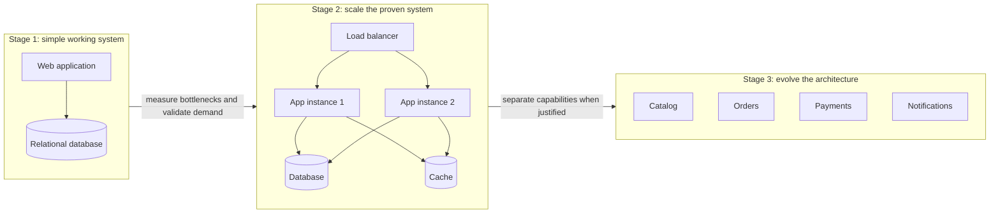
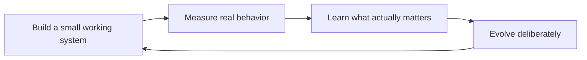

# Gall's Law in System Design

> **Topic:** System Design Fundamentals (Evolutionary Design)
> **Level:** Beginner to Intermediate
> **Focus:** Incremental design, complexity management, monolith-first, measured scaling, SRE maturity, when to break the rule
> **Companion guides:** [Scalability](scalability.md) · [Reliability](reliability.md) · [Brooks's Law](brooks-law.md) · [Conway's Law](conways-law.md)
> **Last updated:** 21 October 2026

## Table of Contents

1. [What Is Gall's Law?](#1-what-is-galls-law)
2. [Origin and Context](#2-origin-and-context)
3. [Why Does Gall's Law Matter in System Design?](#3-why-does-galls-law-matter-in-system-design)
4. [A Visual Example: Evolving an E-Commerce System](#4-a-visual-example-evolving-an-e-commerce-system)
5. [The Key Principles Behind Gall's Law](#5-the-key-principles-behind-galls-law)
6. [What Counts as "Simple"?](#6-what-counts-as-simple)
7. [Techniques for Evolving Safely](#7-techniques-for-evolving-safely)
8. [Decisions That Are Hard to Change Later](#8-decisions-that-are-hard-to-change-later)
9. [Gall's Law and Monolith vs Microservices](#9-galls-law-and-monolith-vs-microservices)
10. [Gall's Law and Scalability](#10-galls-law-and-scalability)
11. [Gall's Law and SRE](#11-galls-law-and-sre)
12. [Gall's Law and Kubernetes](#12-galls-law-and-kubernetes)
13. [Failure Patterns: The Second-System Effect and Big Rewrites](#13-failure-patterns-the-second-system-effect-and-big-rewrites)
14. [Limits and Counter-Arguments](#14-limits-and-counter-arguments)
15. [Gall's Law vs Brooks's Law vs Conway's Law](#15-galls-law-vs-brookss-law-vs-conways-law)
16. [A Practical Example: Building a URL Shortener](#16-a-practical-example-building-a-url-shortener)
17. [Common Mistakes](#17-common-mistakes)
18. [Interview Questions and Answers](#18-interview-questions-and-answers)
19. [Cheat Sheet](#19-cheat-sheet)
20. [Key Takeaways](#20-key-takeaways)
21. [References](#21-references)

---

## 1. What Is Gall's Law?

Gall's Law is a principle about designing complex systems, formulated by physician and systems theorist John Gall in his book *Systemantics* (first published in 1975).

The principle is usually quoted like this:

> A complex system that works is invariably found to have evolved from a simple system that worked.

Gall continued with a corollary: a complex system designed from scratch never works and cannot be patched up to make it work; you have to start over, beginning with a working simple system.

The central idea is that successful complex systems usually grow from simpler, functioning systems through incremental improvement. Trying to build a highly complex system from scratch, without a working foundation, tends to lead to failure or expensive redesign.

**In simple terms:** Start with something small that works, learn from it, and gradually build the more complex system you need.

In software engineering, this means delivering a small, working solution first and evolving it as requirements, traffic, and operational needs become clearer.

## 2. Origin and Context

*Systemantics* is a satirical but serious look at why systems fail, written by a pediatrician who observed organizations and institutions. It was reissued under several titles and editions (including *The Systems Bible*). The book collects many aphorisms; Gall's Law is the one that software engineers cite most.

Related ideas from software and engineering:

| Idea | Core point | Relationship to Gall's Law |
|---|---|---|
| **KISS** (Keep It Simple) | Prefer the simplest design that works | Same instinct, stated as a design rule |
| **YAGNI** (You Aren't Gonna Need It) | Do not build features until they are needed | Applies Gall's Law at the feature level |
| **Walking skeleton / tracer bullet** | Build a thin end-to-end slice first | A concrete technique for starting simple ([Section 7](#7-techniques-for-evolving-safely)) |
| **Evolutionary architecture** | Design so architecture can change safely over time | The enabling practice ([Section 7](#7-techniques-for-evolving-safely)) |
| **Second-system effect** (Brooks) | The follow-up system tends to be over-engineered | The classic failure mode ([Section 13](#13-failure-patterns-the-second-system-effect-and-big-rewrites)) |
| **Choose Boring Technology** | Spend a small budget of "innovation tokens" | A way to limit complexity ([Section 6](#6-what-counts-as-simple)) |

Gall's Law is an **empirical observation and heuristic**, not a mathematical theorem. It describes a strong pattern in how complex systems come to work, and it has important limits ([Section 14](#14-limits-and-counter-arguments)).

## 3. Why Does Gall's Law Matter in System Design?

Imagine building an e-commerce platform that must support millions of users.

From day one, you plan to implement:

- Twenty microservices.
- Multi-region active-active deployment.
- Distributed caching.
- Event-driven communication.
- Kubernetes orchestration.
- Complex database sharding.
- Multiple message brokers.
- Advanced machine-learning recommendations.

These technologies may eventually be appropriate. But implementing all of them before validating the basic business workflow introduces many moving parts and failure modes. When something goes wrong, you cannot tell which of the many untested interactions is responsible.

A simpler starting point might include:

- One web application.
- One relational database.
- Basic product and order management.
- Authentication.
- Automated tests.
- Basic monitoring and backups.

Once this works and real usage reveals its limits, you can introduce caching, queues, service separation, and horizontal scaling where justified.

The lesson is not to avoid sophisticated architecture. It is to **earn complexity through demonstrated requirements rather than introduce it prematurely**.

## 4. A Visual Example: Evolving an E-Commerce System



- **Stage 1:** deliver products, customers, orders, and basic checkout.
- **Stage 2:** add capacity, caching, reliability controls, and automation where measurements show a need.
- **Stage 3:** introduce independently deployable services when scale, ownership, or business needs justify them.

This is an illustrative progression, not a mandatory roadmap. Some systems need a distributed architecture from the beginning because of regulatory, availability, security, or workload requirements ([Section 14](#14-limits-and-counter-arguments)). For a more detailed staged journey with measurable triggers, see [Scalability, Section 8](scalability.md#8-a-typical-scaling-journey).

## 5. The Key Principles Behind Gall's Law



### 5.1 Start with a working foundation

The first version should solve a real problem, even if it supports only a few users or features.

For example, build a service that can accept an order, persist it reliably, and return its status before introducing a complex event-driven architecture. A small working system can be tested, operated, and improved.

### 5.2 Add complexity only when necessary

Every new component brings costs:

- Deployment and configuration.
- Network communication.
- Monitoring and alerting.
- Failure handling.
- Security and access control.
- Testing and maintenance.
- Infrastructure and operational cost.
- Cognitive load for the team.

Adding a message broker may decouple services, but it also introduces delivery semantics, retries, dead-letter handling, and consumer monitoring. The component should solve a real problem that justifies these costs.

### 5.3 Learn from real usage

Initial assumptions about traffic, user behavior, data volume, and latency may be wrong. Production measurements reveal which parts actually need improvement.

Useful measurements:

- Request rate.
- p95 and p99 latency.
- Error rate.
- CPU and memory utilization.
- Database query latency.
- Queue depth and processing delay.
- Cost per transaction.
- Availability and SLO performance.

Build from evidence instead of predicting every future requirement.

### 5.4 Preserve the ability to change

A simple starting system must not become an excuse for poor engineering. Use sensible modularity, automated tests, clear interfaces, and documented decisions so the system can evolve without a rewrite.

**Important distinction:** Gall's Law encourages evolutionary design, not careless shortcuts or accumulating technical debt without a plan.

## 6. What Counts as "Simple"?

"Simple" is easy to misread. A system that is quick to build is not necessarily simple, and a simple system is not necessarily easy.

### Simple vs easy

Rich Hickey's talk *Simple Made Easy* distinguishes the two:

- **Simple** means not intertwined: concerns are separated and can be understood independently.
- **Easy** means familiar or close at hand.

A tangled shortcut can be easy today and complex forever. A well-separated design may take more thought but stay simple. When Gall's Law says "start simple," it means start with a design whose parts are **understandable and independent**, not one that is merely quick.

### Essential vs accidental complexity

Fred Brooks (*No Silver Bullet*) separated:

- **Essential complexity:** inherent in the problem (tax rules, payment states, concurrency).
- **Accidental complexity:** introduced by our tools and choices (unneeded services, frameworks, abstractions, infrastructure).

You cannot remove essential complexity, only manage it. Gall's Law is largely about **not adding accidental complexity** before the essential complexity has been understood.

### A complexity budget

Dan McKinley's essay *Choose Boring Technology* proposes treating novelty as a scarce resource: a team has a small number of "innovation tokens" to spend. Using a new database, a new orchestration platform, and a new language in one project spends all of them on infrastructure rather than on the product.

Practical use: for each project, list the unfamiliar technologies you are adopting. If the list is long, ask which are essential and which are fashionable.

### A simple test

For any proposed component, ask:

1. What measured problem does it solve?
2. What is the simplest thing that could solve it?
3. What new failure modes and operational work does it add?
4. How will we know it worked, and how could we remove it if it did not?

## 7. Techniques for Evolving Safely

Evolution is not accidental drift. These techniques make incremental growth safe.

### 7.1 Walking skeleton (tracer bullet)

Build the thinnest possible **end-to-end** slice first: a request enters, passes through each major component (even trivially), is stored, and returns. It is deployed through the real pipeline with real monitoring.

It proves the architecture can connect and ship before any component is made sophisticated, and gives you something working to grow, which is exactly Gall's Law.

### 7.2 Vertical slices

Deliver features as **vertical slices** (a thin piece of UI, logic, and data for one user-visible capability) rather than building complete horizontal layers (all database, then all APIs, then all UI). Each slice works, so the system works at every step.

### 7.3 Modularity inside one deployable

Separate code into modules with explicit interfaces and clear data ownership, even inside a single application. This is the main enabler of later extraction ([Section 9](#9-galls-law-and-monolith-vs-microservices)).

### 7.4 Strangler fig migration

When part of the system must be replaced, route a slice of traffic to the new implementation while the old one keeps working, and expand until the old code can be retired. The system works throughout, which respects Gall's Law, unlike a big-bang cutover.

### 7.5 Feature flags and gradual rollout

Ship changes dark, enable them for a small share of traffic, and expand as measurements confirm they work. A failed experiment can be switched off without a redeploy. See [Reliability, Section 25](reliability.md#25-safe-change-management-and-deployments).

### 7.6 Expand and contract for data changes

Change schemas in compatible steps (add, dual-write, backfill, switch reads, remove old), so the system works at each step.

### 7.7 Architecture Decision Records with revisit triggers

Document why you chose the simple option and **what evidence would change your mind**. This turns "we will scale later" from a hope into a plan.

```markdown
# ADR-012: Keep orders as a module inside the monolith

- Status: Accepted (2026-10-21)
- Context: About 40 orders per second at peak, one owning team, no independent
  scaling need, shared transactional data with checkout.
- Decision: Orders stays a module with an internal interface and its own
  tables. No network boundary yet.
- Consequences: Simple deploys and local transactions. The module must not read
  other modules' tables directly.
- Revisit when:
  (a) orders releases are blocked by other teams' releases more than twice a month,
  (b) orders needs a scaling profile that differs from the rest by roughly 5x or more,
  or (c) a second team takes ownership.
```

The numbers are illustrative; the habit is writing down measurable triggers in advance.

## 8. Decisions That Are Hard to Change Later

Gall's Law says start simple. It does not say every decision is equally reversible. Some choices are cheap to change later; others are expensive to retrofit. Spend design effort in proportion to **how hard a decision is to undo**.

| Usually cheap to change later | Costly to retrofit |
|---|---|
| Number of application instances | Core data model and identifier strategy (for example, primary-key and ID choices) |
| Adding a cache in front of a read path | Multi-tenancy and tenant-isolation model |
| Internal module structure (if modular) | Authentication and authorization model |
| Choice of a library behind an interface | Public API contracts that clients depend on |
| UI and presentation | Event and message contracts consumed by many systems |
| Instance sizes and scaling policies | Privacy, compliance, and data-residency handling (PII placement, deletion) |
| Adding read replicas | Time handling (store UTC, avoid ambiguous local times) |
| Switching an internal queue implementation | Backup and restore design, and the ability to actually restore |
| Splitting out a well-bounded module | Observability conventions (trace IDs, structured logs) once spread across many services |

Practical rule: **start simple on infrastructure, but get the one-way doors right early**: data model, identity and access, contracts, security, privacy, and recoverability. Amazon's decision-making framing of "one-way door" and "two-way door" decisions captures this: move fast through two-way doors, deliberate more at one-way doors.

## 9. Gall's Law and Monolith vs Microservices

A common application of Gall's Law is deciding how to start an architecture.

### A modular monolith

A modular monolith deploys as one application but separates its internal code into well-defined modules. For an e-commerce system, modules might be customer management, catalog, orders, payments, and notifications.

This provides clear boundaries without network communication between every module.

Benefits:

- Simpler deployment.
- Easier local testing.
- Fewer distributed failure modes (see [Fallacies of Distributed Computing](fallacies-of-distributed-computing.md)).
- Lower initial infrastructure overhead.
- Local transactions instead of distributed ones.
- A practical path to later service extraction.

### When microservices become appropriate

Consider extracting a module into a separate service when there is a demonstrated need:

- Independent scaling requirements.
- Independent release schedules.
- Clear ownership by separate teams ([Conway's Law](conways-law.md)).
- Different security or availability requirements.
- A need to isolate failures or workloads.

Martin Fowler's *MonolithFirst* argues that almost all successful microservice systems started as monoliths that were later broken up, while systems built as microservices from scratch often ran into trouble, partly because boundaries are hard to draw before you understand the domain.

### Evidence runs both ways

Many well-known companies are commonly cited as having begun as monoliths and evolved toward services as scale and organization grew. Conversely, several teams have publicly described **consolidating** services back into larger deployables when the distributed design's overhead outweighed its benefits (for example, Segment in 2018 and an Amazon Prime Video monitoring team in 2023). The lesson is not "monoliths good" or "microservices bad." It is that **architecture should track measured needs**, in both directions.

### Not always the right starting point

A modular monolith is not always right. Organizations with existing platforms, strong service boundaries, or strict isolation requirements may reasonably start with distributed services ([Section 14](#14-limits-and-counter-arguments)).

The principle is to choose the simplest architecture that satisfies the actual requirements and can evolve safely.

## 10. Gall's Law and Scalability

A system should not be made unnecessarily complex merely because it might someday serve millions of users. Establish a working baseline and measure its limits.

| Growth stage | Possible approach | Why |
|---|---|---|
| Early prototype | Simple application and database | Validate the core workflow |
| Initial production | Monitoring, backups, error handling | Establish operational reliability |
| Growing traffic | Query optimization, caching, connection pooling | Address measured bottlenecks |
| Higher traffic | Load balancing and horizontal scaling | Add capacity |
| High asynchronous workload | Queues and background workers | Decouple work and absorb bursts |
| Independent team or workload needs | Selected service extraction | Enable independent ownership or scaling |
| Multi-region requirements | Regional deployment and replication | Meet geographic, resilience, or latency needs |

These stages are illustrative, not thresholds based on user counts. The workload's actual requirements determine when a change is necessary.

### Measured triggers for added complexity

Tie each step to **evidence**. Thresholds are examples; use your own SLOs.

| Measured symptom | Candidate response | Probably premature |
|---|---|---|
| Database CPU high from repeated identical reads, after query and index tuning | Cache, read replica | Sharding |
| High p99 caused by work done in the request path (email, analytics) | Queue and worker | A new microservice |
| App tier saturating CPU while the database is healthy | Scale out stateless instances | Re-architecting the data layer |
| Teams blocked by each other's releases | Clear module ownership, then extraction | Hiring more engineers ([Brooks's Law](brooks-law.md)) |
| One component needs far more capacity than the rest | Extract and scale it independently | Scaling everything |
| Writes saturate a tuned, vertically scaled primary | Partition or shard | A new database "just in case" |
| Users in distant regions see unacceptable latency | CDN, regional reads, then multi-region | Active-active everywhere on day one |

The pattern: first **measure**, then **tune what exists**, then **add the least complex thing that addresses the measured bottleneck**.

## 11. Gall's Law and SRE

For SRE, Gall's Law means evolving operational maturity in manageable, measurable steps.

A small application with no monitoring, no automated deployment, and no tested recovery process does not need a sophisticated multi-cluster platform first. It needs its most urgent risks addressed.

A useful progression:

1. **Establish basic visibility:** collect logs, metrics, and errors.
2. **Automate deployments:** make releases repeatable and reversible.
3. **Define service-level objectives:** measure reliability from the user's perspective.
4. **Automate recovery:** health checks, safe restarts, and suitable remediation.
5. **Test backups and disaster recovery:** validate that recovery actually works.
6. **Improve capacity management:** monitor saturation and forecast resource needs.
7. **Introduce advanced resilience:** multi-region recovery or sophisticated traffic management when justified.

Each step builds on a working operational foundation.

### The non-negotiable floor

Evolving does not mean postponing basics. Some things belong in the **first** production release:

- Backups, with a **tested restore**.
- TLS and sensible authentication and authorization.
- Structured logs and a few meaningful alerts on user-visible symptoms.
- A repeatable deploy and a way to roll back.
- Secrets kept out of source control.
- Defined ownership and on-call for the service.

See the [Production Readiness Checklist](reliability.md#33-production-readiness-checklist) and [Reliability, Section 32](reliability.md#32-practical-sre-reliability-workflow) for the fuller progression.

### Reliability matches the stage

An early product does not need four nines. Use error budgets to choose a target that matches user needs, and raise it as the business depends on the service more. Over-investing in reliability too early is itself premature complexity.

## 12. Gall's Law and Kubernetes

Kubernetes is powerful, but it brings significant operational complexity.

A sensible adoption path for a small application:

1. Run the application locally.
2. Package it in a container.
3. Add health checks and resource requests.
4. Deploy to a small Kubernetes environment.
5. Configure Services, Deployments, and ConfigMaps.
6. Add secrets management, network policies, and observability.
7. Introduce autoscaling and deployment strategies.
8. Add advanced resilience and multi-cluster patterns when needed.

The same ladder works well for **learning** Kubernetes: understand each layer before adding the next, instead of starting with a service mesh, GitOps, and multi-cluster federation all at once.

Kubernetes is not a universal requirement. For a small workload, a managed application platform, a container service, or even a single well-run VM may be more appropriate. Adopt Kubernetes when you need what it provides (many workloads, standardized deployment, autoscaling, a platform for many teams), not because it is fashionable. See [Scalability, Section 23](scalability.md#23-scalability-in-kubernetes) and [Reliability, Section 23](reliability.md#23-reliability-in-kubernetes).

## 13. Failure Patterns: The Second-System Effect and Big Rewrites

Gall's Law explains two classic project disasters.

### The second-system effect

Fred Brooks observed in *The Mythical Man-Month* that the **second** system an engineer or team designs is the most dangerous. Having succeeded with a modest first system, they pour in every feature and idea that was previously held back, producing something over-engineered, late, and fragile.

The remedy is discipline: be explicit about what is **not** being built, keep the scope to demonstrated needs, and resist adding "all the things we could not do last time."

### The big rewrite

The tempting fix for a messy system is to rewrite it from scratch with a clean, modern architecture. By Gall's Law, a complex system designed from scratch is unlikely to work, and the rewrite must **recreate years of accumulated behavior and edge cases** the old system quietly handles. Joel Spolsky's essay *Things You Should Never Do, Part I* argues this forcefully.

Safer alternatives:

- **Strangler fig:** replace the system piece by piece, with the old and new running side by side.
- **Refactor in place** behind tests, improving structure while the system keeps working.
- **Extract one well-bounded capability at a time**, validating each before the next.

A system that works at every step can be evolved indefinitely; a rewrite offers no working system until the end.

## 14. Limits and Counter-Arguments

A good engineer knows when a heuristic does not apply.

### 14.1 Safety-critical and regulated systems

Aircraft flight control, medical devices, and nuclear control systems cannot be "tried in production and iterated." These are designed with extensive upfront analysis, modeling, and staged verification. Even so, they typically build on **earlier working generations and proven components**, which is Gall's Law at the level of an engineering lineage.

### 14.2 Well-understood problems with proven patterns

If the problem and its solution are well understood (a team that has built the same kind of system several times), more upfront design is reasonable, because the unknowns Gall's Law warns about are largely known.

### 14.3 Hard requirements known from day one

Genuine regulatory, availability, residency, or isolation requirements (for example, a payment system that must be multi-zone from launch, or data that must stay in a region) are not "premature complexity." They are requirements. Distinguish **real constraints** from **hypothetical scale**.

### 14.4 Long lead times and expensive retrofits

Hardware, physical infrastructure, contracts, and data models have long lead times or high change costs ([Section 8](#8-decisions-that-are-hard-to-change-later)). Decide those carefully, even if the software on top starts small.

### 14.5 "Simple" can be misused

Gall's Law can be abused to justify shortcuts: no tests, no security, no monitoring, one giant function. That is not a simple working system; it is a fragile one. The law favors a **simple, working, well-separated** start, not a sloppy one.

### 14.6 Evolution requires a capacity to evolve

Incremental growth only works if the team can change the system safely: tests, deployment automation, modular boundaries, and feedback from production. Without these, the "simple system" calcifies into a hard-to-change one.

### Putting it together

| Situation | Gall's Law guidance |
|---|---|
| New product, unknown demand | Start simple; measure |
| New system in a domain you know well | Reuse proven patterns; moderate upfront design |
| Hard regulatory or availability requirement | Include it from the start; it is a requirement |
| Safety-critical system | Staged verification; build on proven components |
| Legacy system needing replacement | Strangler fig, not big rewrite |
| One-way-door decisions | Think carefully up front |

## 15. Gall's Law vs Brooks's Law vs Conway's Law

These three principles address different aspects of system development.

| Principle | Main idea | System design implication |
|---|---|---|
| Gall's Law | Complex systems evolve from simple, working systems | Build incrementally and learn from real behavior |
| Brooks's Law | Adding people to a late project can make it later | Account for onboarding and coordination overhead |
| Conway's Law | Architecture tends to reflect organizational communication | Align team ownership and communication with the desired architecture |

Together they highlight three design dimensions:

- How the **system** evolves.
- How the **engineering team** delivers it.
- How the **organization** shapes its architecture.

They interact: a big up-front design tends to need a big team (Brooks), whose communication structure then shapes the system (Conway), making it harder to evolve from a simple working core (Gall). Starting small keeps all three manageable. See [Brooks's Law, Section 8](brooks-law.md#8-related-laws) and [Conway's Law](conways-law.md).

## 16. A Practical Example: Building a URL Shortener

Imagine building a URL-shortening service like Bitly. (For capacity numbers and the full design, see [Scalability, Section 30](scalability.md#30-designing-a-scalable-url-shortener).)

### Version 1: Simple working system

- An API to create a short URL.
- A database to store the original URL.
- A redirect endpoint.
- Basic validation and error handling.

Verify that the core functionality works. For perspective, the scalability guide's estimate of about 39 writes per second and about 3,900 average reads per second is in a range that a single well-tuned database with a cache can often serve; confirm with a load test before assuming you need more.

### Version 2: Production readiness

- Authentication where required.
- Input validation and abuse protection.
- Monitoring and structured logging.
- Automated tests.
- Backups and tested recovery.
- Rate limiting.

Now the system is safer and easier to operate.

### Version 3: Performance improvements

Measure the workload and introduce appropriate improvements:

- Database indexes.
- Caching for frequently accessed mappings.
- Horizontal application scaling.
- Connection pooling.
- Load balancing.

### Version 4: Advanced scale

If actual requirements justify it:

- Database partitioning or sharding.
- Multi-region serving.
- Asynchronous analytics processing.
- Separate services for independent capabilities.
- More advanced traffic management.

Each stage responds to a measured need, rather than assuming the final architecture must exist on day one. The one-way doors (ID scheme, API contract, data model) get attention at Version 1; the infrastructure waits.

## 17. Common Mistakes

**Mistake 1: Designing for millions of users before validating the product.**
Start with the real requirements and a credible growth path.

**Mistake 2: Treating Gall's Law as an argument against good architecture.**
A simple system still needs modularity, security, data integrity, tests, and operational safeguards.

**Mistake 3: Delaying essential reliability work.**
Monitoring, backups, access control, and recovery planning belong in the first production release, not after the first outage.

**Mistake 4: Scaling infrastructure without measuring bottlenecks.**
More servers do not fix a slow query, a serial dependency chain, or an inefficient algorithm.

**Mistake 5: Assuming a monolith must eventually become microservices.**
Many systems stay modular monoliths for life. Distributed architecture has costs and should serve a purpose.

**Mistake 6: Confusing incremental evolution with uncontrolled patching.**
Each change should improve the system's ability to meet requirements. Refactor regularly and review architecture.

**Mistake 7: Spending all your "innovation tokens" on infrastructure.**
Adopting many new technologies at once multiplies unknowns.

**Mistake 8: Falling into the second-system effect.**
Resist pouring every deferred idea into the follow-up system.

**Mistake 9: Attempting a big-bang rewrite.**
Replace incrementally and keep a working system at every step.

**Mistake 10: Ignoring one-way-door decisions.**
Start simple on infrastructure but deliberate on data model, identity, contracts, and recoverability.

**Mistake 11: Starting simple with no way to evolve.**
Without tests, deployment automation, and module boundaries, the simple system hardens instead of growing.

**Mistake 12: Never removing complexity.**
Evolution includes simplification: delete unused services, flags, and abstractions that did not earn their keep.

## 18. Interview Questions and Answers

### Q1. What is Gall's Law?

A complex system that works is invariably found to have evolved from a simple system that worked, and a complex system designed from scratch never works and cannot be patched into working. It encourages incremental, evolutionary design.

### Q2. How does Gall's Law influence system architecture?

Begin with a simple architecture that meets current requirements, measure real bottlenecks, and add components only when they provide a justified benefit.

### Q3. Does Gall's Law mean you should never design for scale?

No. Understand expected load, security needs, availability targets, and constraints. The principle discourages **unnecessary** complexity, not capacity planning. Distinguish real requirements from hypothetical scale.

### Q4. How does Gall's Law apply to microservices?

Avoid introducing a large network of services without a clear need. A modular monolith is a useful starting point, with extraction when independent scaling, release cadence, ownership, or isolation needs are demonstrated.

### Q5. How does Gall's Law apply to SRE?

Develop operational maturity incrementally: monitoring and repeatable deployments, then reliability targets, automated recovery, and advanced resilience, while including a non-negotiable floor (backups, security, observability) from the start.

### Q6. What is the difference between Gall's Law and MVP?

An MVP is a product strategy for validating value with a minimal offering. Gall's Law is a broader principle about how complex systems come to work. They are related but not identical.

### Q7. Can a system start with a distributed architecture?

Yes, if requirements demand independent scaling, strict isolation, geographic distribution, or similar capabilities. Gall's Law favors a justified, working design over unnecessary complexity.

### Q8. When would you not follow Gall's Law?

When requirements are known and demanding from day one (regulatory, availability, residency, isolation), when building a well-understood kind of system with proven patterns, in safety-critical domains requiring staged upfront verification, or for one-way-door decisions where retrofitting is very costly.

### Q9. What is a walking skeleton?

A thin, end-to-end implementation of the main components, deployed through the real pipeline, that proves the architecture connects and gives a working base to grow.

### Q10. How is Gall's Law related to the second-system effect?

The second-system effect is the failure mode Gall's Law warns about: after a modest success, a team over-designs the follow-up by including every deferred idea, producing a complex system that does not work. Evolving the working first system avoids it.

### Q11. Why are big rewrites risky?

A rewrite is a complex system designed from scratch, with no working version until the end, and it must reproduce all the accumulated behavior and edge cases of the old system. Prefer the strangler fig pattern or in-place refactoring.

### Q12. How do you decide when to split a monolith?

Use measured triggers: teams blocked by each other's releases, a component with a very different scaling profile, differing security or availability needs, or separate ownership. Write these as revisit triggers in an ADR rather than splitting preemptively.

### Q13. What decisions should you not defer in a "start simple" design?

One-way doors: the data model and identifier strategy, the authentication and authorization model, public API and event contracts, privacy and compliance handling, time handling, and the ability to back up and restore.

### Q14. Is "simple" the same as "easy"?

No. Simple means not intertwined, with concerns separated. A quick, tangled shortcut is easy but not simple, and it will resist evolution.

### Q15. How would you apply Gall's Law to adopting Kubernetes?

Containerize and run locally, add health checks and resource requests, deploy to a small environment, then add Services, secrets, observability, autoscaling, and advanced patterns step by step, and ask first whether a simpler platform would meet the need.

## 19. Cheat Sheet

| Concept | Remember |
|---|---|
| Gall's Law | A working complex system evolved from a working simple one |
| Corollary | A complex system designed from scratch never works; start over from a simple working one |
| Origin | John Gall, *Systemantics*, 1975 |
| Earn complexity | Add components for measured needs, not hypothetical ones |
| Walking skeleton | Thin end-to-end slice, deployed for real, then grown |
| Vertical slices | Deliver user-visible capabilities, not complete layers |
| Modular monolith | Clear internal boundaries, one deployable |
| Strangler fig | Replace incrementally; the system works throughout |
| Second-system effect | Over-engineering the follow-up system |
| Big rewrite | Rarely works; no working system until the end |
| Simple vs easy | Simple = not intertwined; easy = familiar |
| Essential vs accidental | Manage the first; avoid adding the second |
| Innovation tokens | Limited budget for novel technology |
| One-way doors | Data model, identity, contracts, privacy, recoverability: decide carefully |
| Revisit triggers | Write measurable conditions in ADRs for when to evolve |
| Non-negotiable floor | Backups (tested restore), TLS and auth, logs and alerts, rollback |
| When to break the rule | Hard requirements, proven patterns, safety-critical, costly retrofits |
| Related | Brooks's Law (people), Conway's Law (organization) |

## 20. Key Takeaways

1. Complex systems that work evolve from simple systems that worked; a complex design from scratch tends not to work.
2. Start with the smallest architecture that satisfies the real requirements, and make it **simple in the sense of well-separated**, not merely quick.
3. Measure behavior before adding complexity, and tie each addition to evidence and a stated revisit trigger.
4. Use techniques that keep the system working throughout: walking skeleton, vertical slices, strangler fig, feature flags, expand and contract.
5. Start simple on infrastructure but get one-way-door decisions (data model, identity, contracts, privacy, recoverability) right early.
6. Include a non-negotiable floor of security, observability, backups, and rollback in the first production release.
7. Beware the second-system effect and the big rewrite, the two classic ways to ignore Gall's Law.
8. Know the limits: real requirements, proven patterns, and safety-critical domains justify more upfront design.
9. Architecture should track measured needs in both directions, including removing complexity that did not pay off.
10. Gall's Law, Brooks's Law, and Conway's Law together describe how the system, the team, and the organization shape each other.

**Remember:** Start simple, make it work, measure it, and evolve it deliberately.

## 21. References

1. John Gall, *Systemantics: How Systems Really Work and How They Fail*, 1975 (later editions under various titles, including *The Systems Bible*).
2. Frederick P. Brooks Jr., *The Mythical Man-Month*, 1975 (the second-system effect), and "No Silver Bullet: Essence and Accidents of Software Engineering," 1986.
3. Martin Fowler, [MonolithFirst](https://martinfowler.com/bliki/MonolithFirst.html).
4. Martin Fowler, [Strangler Fig Application](https://martinfowler.com/bliki/StranglerFigApplication.html).
5. Neal Ford, Rebecca Parsons, and Patrick Kua, *Building Evolutionary Architectures*, O'Reilly Media.
6. Rich Hickey, *Simple Made Easy* (conference talk, 2011).
7. Dan McKinley, *Choose Boring Technology* (essay, 2015).
8. Joel Spolsky, *Things You Should Never Do, Part I* (essay, 2000).
9. Andrew Hunt and David Thomas, *The Pragmatic Programmer* (tracer bullets), and Alistair Cockburn on the walking skeleton.
10. [The Twelve-Factor App](https://12factor.net/).
11. [Google SRE Book](https://sre.google/sre-book/table-of-contents/).
12. [AWS Well-Architected Framework](https://docs.aws.amazon.com/wellarchitected/latest/framework/welcome.html).

---

*Last updated: 21 October 2026*

*Suggested repository path: `01-fundamentals/galls-law.md`*
